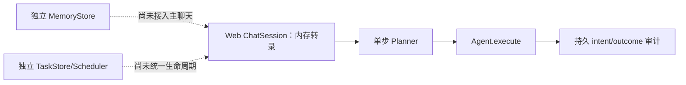
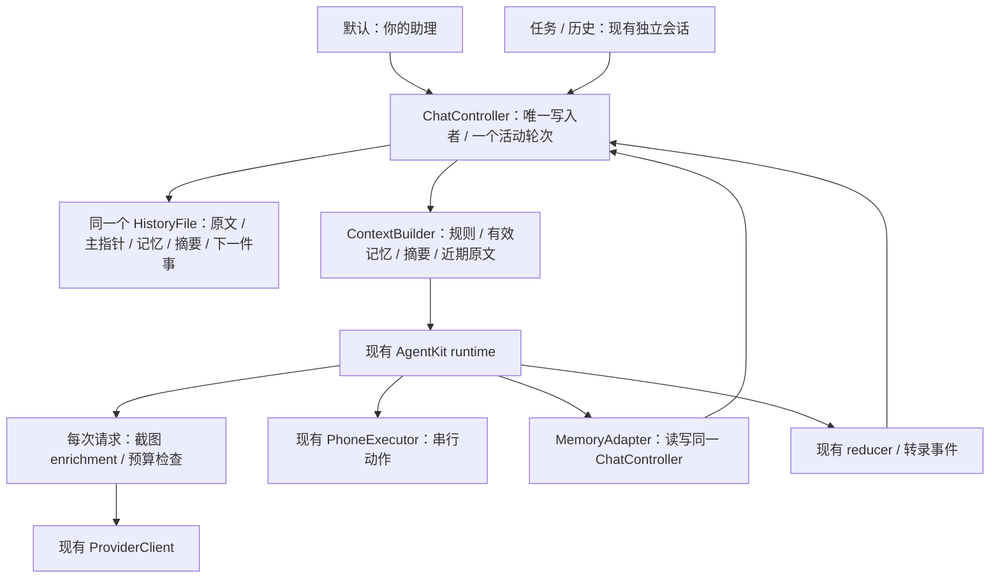

# 单入口与长期记忆技术方案

> 状态：公开资料及固定版本关键架构路径已静态核对；具体改造方案 v1 设计中；未修改应用代码
>
> 最后核对：2026-10-14
>
> 面向读者：PocketAgent iOS、AgentKit 集成与测试开发者
>
> 范围：同一个助理入口，跨天延续对话与记忆；复用现有手机执行链路
>
> 源码基线：`devicehub-control`，`abae3f67bd66f2434662a24251058fdaddee1227`

## 1. 需求与关联资料

用户确认目标为“单入口＋长期记忆”：再次打开 App 时直接回到同一个助理，换话题、换模型和跨天使用时仍能找回相关偏好与之前的决定。现有 PocketAgent 的主组织单位是独立会话，每条会话分别保存历史、模型和项目。推荐新增默认“你的助理”独立入口，保留旧任务会话与历史；继续用 AgentKit，补齐宿主的主线、记忆、上下文与输入队列。长期连续性来自数据与上下文管理，每轮仍是有起止的执行。首版沿用本机运行方式，不依赖常驻服务器。

| 类型 | 链接 | 说明 |
|---|---|---|
| 需求真源 | 用户于 2026-10-14 在本次探索中确认“单入口＋长期记忆” | 尚无独立需求文档 |
| Figma | 不涉及 | 先定义信息架构；实现阶段补界面稿 |
| 当前工程设计 | [engineering.md](engineering.md) | 历史完整性、配置冻结、动作队列、同步边界 |
| 手机后端设计 | [devicehub-control.md](devicehub-control.md) | DDI 默认与 WDA 可选的现有能力 |
| Muse | [Meta 官方介绍](https://about.fb.com/news/2026/09/introducing-muse-personal-ai-agent/) | 记住偏好与目标、长期协助的产品方向 |
| Grok Bot | [Grok Bot 101](https://x.ai/bot/guides/grok-bot-101) | 持续使用的助理、持久执行环境与 routines |
| OpenAI dot | [OpenAI Docs：Tasks and memory](https://learn.chatgpt.com/docs/dots/tasks-and-memory) | 一个助理协调多项责任；对话上下文与持久笔记分开 |
| OpenClaw | [Home 主会话](https://github.com/openclaw/openclaw/blob/ddaa0bd2b0dd077c946ace62a4b87383f032e26e/docs/concepts/main-session.md) | 固定版本文档与 TypeScript 源码核验 |
| Hermes Agent | [Persistent Memory](https://github.com/NousResearch/hermes-agent/blob/d97007c32d6340f7ba79ac1dfb5773cc00846448/website/docs/user-guide/features/memory.md) | 固定版本文档与 Python 源码核验 |
| OpenMuse 同名项目 | [CopilotKit](https://github.com/CopilotKit/openmuse)、[tuxevil](https://github.com/tuxevil/openmuse)、[tahodev](https://github.com/tahodev/openmuse) | 同名项目逐一核对，保留 jerelvelarde 历史版本对照 |
| OpenMuseAgent 后继 | [nanoMuse](https://github.com/nano-muse/nanoMuse) | Python、OpenMinis iOS 与桌面 Harness 分别核验 |
| iOS 生命周期 | [Apple：BGContinuedProcessingTaskRequest](https://developer.apple.com/documentation/backgroundtasks/bgcontinuedprocessingtaskrequest) | 用户在前台发起、可继续到后台的工作 |

用户最新要求是基于调研与现有代码收敛具体改造方案，“先不改代码”，并交给 Opus 5.5 独立评估。本次交付为源码依据与具体方案，不修改 App 行为。主动提醒、定时监控、持续语音和离开 App 后全天候工作属于后续扩展，没有被本次需求确认。

## 2. 公开项目调研与结论

本轮已沿入口、会话 admission、模型/工具循环、历史与记忆、取消和重启路径深化源码分析，并纳入四条主要 OpenMuse 路线及其不同版本。项目提出的分层思路相近，实际接线与完成度不同：有的已把记忆接入聊天，有的仍是独立模块或设计文档。OpenClaw 提供 Home 主会话；Hermes 提供策展记忆与历史检索；nanoMuse/OpenMinis 的 iOS 主线与摘要投影是直接相关的手机端参考。Muse、Grok Bot、OpenAI dot 的公开信息能支持产品与部分运行架构判断，本次未取得三者完整的会话/记忆 harness 源码，不能据此声称复刻其内部算法。

1. 产品上的连续性可以由稳定助理身份和一个聊天入口承接。工作上下文可以原位压缩或在明确边界重建；后台 session ID 的生命周期不是产品入口的定义。
2. 重点借鉴 nanoMuse/OpenMinis iOS 的主会话指针与非破坏摘要投影、Hermes 的小型偏好记忆与历史检索、OpenClaw 的 Home/工作 thread 分层。CopilotKit OpenMuse 的 rich chat/worker 适合作为应用分层参考，但当前依赖外部 Intelligence。
3. 当前两个固定版本都支持原位压缩；Hermes 当前默认 `in_place=true`。没有依据要求 PocketAgent 在每次压缩时建立新 session，也不应按旧教程默认每日清空。
4. 记忆学习、历史检索和压缩分别有触发与预算。保存事实由实际工具写入完成；记忆文件、摘要或模型声称“已记住”不能互相替代。
5. PocketAgent 已有固定 AgentKit 的记忆/压缩原语。下文保留适配建议供后续讨论；按用户“先做好调研”的要求，当前不开始实现，不引入新的后台服务。

### 本轮收敛：入口、记忆与执行引擎分别选型

建议采用“独立助理入口＋现有 AgentKit＋宿主补齐长期记忆”。用户本轮要求先形成具体改造方案，尚未授权代码实现或最终选定替换框架。

| 路线 | 改动与收益 | 主要代价 | 本轮建议 |
|---|---|---|---|
| 固定当前某条会话，隐藏其他会话 | 导航改动小 | 易继承旧项目/一次性任务；仍需记忆、预算和队列改造 | 不作为主方案 |
| 新增默认“你的助理”，旧任务/历史共存，继续 AgentKit | 默认入口稳定；保留原执行与旧数据；宿主分别管理记忆和上下文 | 新增主指针、数据扩展、请求投影与运行宿主 | 推荐 |
| 替换成 OpenMinis 类自有 loop | 可控制整个循环，与上游机制一致 | 替换模型适配、事件、工具调度、取消、生命周期；仍须接入 DDI/WDA | 当前收益不足，后置评估 |

独立入口与保留 AgentKit 可以同时成立。固定版本 AgentKit 已有非破坏请求 pipeline、记忆协议/工具和无工具摘要服务；PocketAgent 尚未把这些接成长期助理。新增入口给用户一个稳定落点，宿主改造让这个落点真正有长期记忆。

[OpenAI Docs](https://learn.chatgpt.com/docs/dots/tasks-and-memory)明确区分助理笔记与工作任务自己的上下文，也支持从同一助理进入可见任务。本方案借鉴这一信息架构；普通聊天与手机轮次如何运行，仍由 PocketAgent 的本机生命周期决定。OpenMinis 的摘要投影机制适合借鉴，但它的 Swift loop、SQLite、同步及工具能力是一个整套宿主实现，不构成必须替换 AgentKit 的依据。

公开资料、固定版本源码与差异核验

### 核验方法与证据范围

- 商业产品只采用官方产品文档、研究文章与官方仓库；不把泄露提示词、同名社区项目或模型的自述当作内部实现证据。
- OpenClaw 核验固定提交 [`ddaa0bd2b0dd077c946ace62a4b87383f032e26e`](https://github.com/openclaw/openclaw/commit/ddaa0bd2b0dd077c946ace62a4b87383f032e26e)，提交日期 2026-10-13。
- Hermes Agent 指 [NousResearch/hermes-agent](https://github.com/NousResearch/hermes-agent)，核验固定提交 [`d97007c32d6340f7ba79ac1dfb5773cc00846448`](https://github.com/NousResearch/hermes-agent/commit/d97007c32d6340f7ba79ac1dfb5773cc00846448)，提交日期 2026-10-13；与同名模型、其他 Hermes 项目区分。
- 两个开源清单初稿来源：peer；主会话复核路由/reset、默认压缩、记忆快照刷新和搜索等决定性源码。未安装、执行或连接用户部署，结论属于静态实现核验；下方继续给出关键架构调用链与同名项目分析。

### 公开程度与共同思路

| 项目 | 本次获得的公开信息 | 连续性来自什么 | 尚未核实的边界 |
|---|---|---|---|
| Muse | 官方产品说明、安全运行架构、模型与硬件 SDK 公开资料 | 同一用户的 VM、文件/记忆、持久应用状态、子任务 | 具体记忆提炼、检索与压缩算法；完整个人助理 harness |
| Grok Bot | 官方 Bot 管理、聊天、电脑/任务文档 | 命名 Bot 的角色、偏好和工作摘要；持久云端电脑 | 记忆 schema、压缩触发、历史合并源码 |
| OpenAI dot | OpenAI Docs 的任务、记忆和跨渠道行为说明 | 同一 dot 的持久笔记；工作任务各自有上下文 | 笔记生成/召回和内部 session 生命周期源码 |
| OpenClaw | 官方文档与本次固定版本 TypeScript 源码 | Home 主会话、SQLite transcript、Markdown 记忆、检索和压缩 | 实际部署参数、长期召回质量与运行可靠性 |
| Hermes Agent | 官方文档与本次固定版本 Python 源码 | 稳定聊天路由、SQLite 历史、小容量个人记忆、原位压缩 | 用户部署行为、记忆学习及中文检索实际质量 |

### Muse：公开了真实运行架构，记忆算法披露仍有限

[Meta 的安全架构文章](https://research.meta.ai/blog/security-and-safety-for-ai-agents-our-approach-with-muse)说明客户端连接用户专属 VM；Hatch harness 与用户工作区位于 runtime container，持久应用状态位于独立 Postgres，凭证与外部动作控制在另外的服务中。文章也说明用户可查看、编辑、下载自己的文件与记忆，VM 可承载并发子 agent 和 cron。这里“机器内存/RAM”与“助理记忆”需要分别理解。

[Muse Wonder 官方介绍](https://about.fb.com/news/2026/10/introducing-muse-wonder-models/)于 2026-10-12 将 Active Memory 描述为跨对话保留重要信息并取回相关细节。这是公开能力描述，未说明记忆库 schema、召回索引、摘要边界或写入策略；不能据此认定记忆通过模型权重在线学习。

存在可核实的官方开放材料：[Muse Glimmer 开放模型权重](https://research.meta.ai/blog/introducing-muse-glimmer-open-agentic-model)与 [Muse Gadget SDK](https://github.com/facebookincubator/muse-gadget-sdk)。后者是 ESP32/Linux 硬件接入 SDK 和固件。它们分别提供模型或设备接入能力；本次没有在这些资料中拿到 Muse 个人助理完整的会话/长期记忆实现。

### Grok Bot：长期身份以 Bot 为单位，可有多个角色

[官方 overview](https://docs.x.ai/grok-bot/overview)说明同一账户的 Bots 共享云端电脑与文件/浏览器登录状态，但每个 Bot 的会话和学习上下文独立，记忆内容包括稳定偏好、角色信息和过往工作摘要。[Bot 管理文档](https://docs.x.ai/grok-bot/bots)把持久描述和任务消息区分，也明确复制 Bot 配置不复制其聊天历史与学习记忆。

因此可借鉴的是“固定助理身份拥有记忆，具体任务有范围”；该产品本身允许多个 Bot 和群聊，公开资料并没有要求一个账户只能有一条永久对话。[聊天文档](https://docs.x.ai/grok-bot/chat-and-collaboration)支持执行中继续发送指令、按消息回应和调整优先级。公开文档未给出其内部记忆更新和压缩实现。

### OpenAI dot：持久笔记与工作上下文明确分开

[OpenAI Docs：Tasks and memory](https://learn.chatgpt.com/docs/dots/tasks-and-memory)说明 dot 使用当前对话、相关 ChatGPT memory 和自己的持久笔记；笔记包含偏好、决定与进行中的工作，属于选取的信息，不是完整转录。它可以在同一对话中协调多项工作，任务有自己的上下文，不自动接收用户全部历史。跨渠道访问同一个 dot 会延续笔记，但不同渠道的可见消息仍分别保留。

这直接支持“一个助理入口＋按需上下文”的产品方向。公开说明不足以确认其内部如何做 token 预算、记忆写入、摘要持久化和冲突处理。

### OpenClaw：Home 长期主会话是当前直接参考

1. **稳定入口。** [main-session 文档](https://github.com/openclaw/openclaw/blob/ddaa0bd2b0dd077c946ace62a4b87383f032e26e/docs/concepts/main-session.md#L10-L28)把 Home 定义为个人助理默认入口，默认 DMs 汇入 `agent:<agentId>:main`，其他任务可在独立 threads 中工作并返回结果。源码 [DM routing](https://github.com/openclaw/openclaw/blob/ddaa0bd2b0dd077c946ace62a4b87383f032e26e/src/routing/session-key.ts#L215-L252)的默认 scope 是 main；[reset-policy.ts](https://github.com/openclaw/openclaw/blob/ddaa0bd2b0dd077c946ace62a4b87383f032e26e/src/config/sessions/reset-policy.ts#L26-L28)的默认 reset mode 为 none，daily/idle 是配置选择。
2. **当前存储。** [官方 store 文档](https://github.com/openclaw/openclaw/blob/ddaa0bd2b0dd077c946ace62a4b87383f032e26e/docs/reference/session-management-compaction/store.md#L9-L12)说明 session rows 与 transcript events 均位于每 agent 的 SQLite；历史有边界/树结构，包含原消息、工具结果和摘要。[SQLite 路径解析](https://github.com/openclaw/openclaw/blob/ddaa0bd2b0dd077c946ace62a4b87383f032e26e/src/config/sessions/session-sqlite-target-paths.ts#L17-L46)与此一致。旧 JSONL/`sessions.json` 是迁移或归档材料，不能用旧教程代替当前运行时说明。
3. **分层记忆。** [memory 文档](https://github.com/openclaw/openclaw/blob/ddaa0bd2b0dd077c946ace62a4b87383f032e26e/docs/concepts/memory.md#L20-L58)区分小型 USER.md、策展后的 MEMORY.md 和详细 daily notes。日记用于按需检索，近期日记可在 reset 后重新加载；完整日记不在每轮全量注入。
4. **检索能力。** 默认 plugin slot 是 [memory-core](https://github.com/openclaw/openclaw/blob/ddaa0bd2b0dd077c946ace62a4b87383f032e26e/src/plugins/slots.ts#L17-L20)。[搜索实现](https://github.com/openclaw/openclaw/blob/ddaa0bd2b0dd077c946ace62a4b87383f032e26e/extensions/memory-core/src/memory/manager-search-orchestration.ts#L398-L430)具备 keyword-only 分支；后续 [vector 与 hybrid 排序](https://github.com/openclaw/openclaw/blob/ddaa0bd2b0dd077c946ace62a4b87383f032e26e/extensions/memory-core/src/memory/manager-search-orchestration.ts#L512-L568)按配置与实际 provider 可用性工作。可选 LanceDB plugin 是另一种 memory provider，不能据此称默认实现必须依赖 LanceDB。
5. **学习与压缩。** [flush-plan 源码](https://github.com/openclaw/openclaw/blob/ddaa0bd2b0dd077c946ace62a4b87383f032e26e/extensions/memory-core/src/flush-plan.ts#L12-L28)给 pre-compaction flush 设定当天 daily note 的追加目标，并将 bootstrap 文件设为只读。Flush 是阈值维护；[dreaming consolidation](https://github.com/openclaw/openclaw/blob/ddaa0bd2b0dd077c946ace62a4b87383f032e26e/docs/concepts/memory.md#L51-L58)另行整理有用信息。写日记、整理长期记忆和摘要当前上下文是不同流程。

**本版文档差异：** main-session 文档称 reset 分配新的 live session ID；但 [session 初始化源码](https://github.com/openclaw/openclaw/blob/ddaa0bd2b0dd077c946ace62a4b87383f032e26e/src/auto-reply/reply/session.ts#L570-L583)对普通 durable session 沿用 transcript identity，并 [建立 reset boundary](https://github.com/openclaw/openclaw/blob/ddaa0bd2b0dd077c946ace62a4b87383f032e26e/src/auto-reply/reply/session.ts#L746-L753)。ACP 等路径可轮转。因此此研究采用“工作上下文重置、历史保留”的语义，不声称每次 reset 必换物理 ID。未运行重置复现，这属于源码与文档的范围差异核验。

### Hermes Agent：小型个人记忆与真实历史检索

1. **连续入口。** [gateway session key](https://github.com/NousResearch/hermes-agent/blob/d97007c32d6340f7ba79ac1dfb5773cc00846448/gateway/session.py#L685-L720)包含 profile、平台和聊天/thread 维度，每个稳定路由指向活跃工作 session。[显式 reset](https://github.com/NousResearch/hermes-agent/blob/d97007c32d6340f7ba79ac1dfb5773cc00846448/gateway/session.py#L1134-L1155)产生新 ID，并保留旧 parent。[用户文档](https://github.com/NousResearch/hermes-agent/blob/d97007c32d6340f7ba79ac1dfb5773cc00846448/website/docs/user-guide/features/memory.md#L59-L65)说明消息平台会话可跨重启持续，建议在自然任务边界 `/new`。
2. **小容量策展记忆。** [初始化代码](https://github.com/NousResearch/hermes-agent/blob/d97007c32d6340f7ba79ac1dfb5773cc00846448/agent/agent_init.py#L1297-L1334)的内置默认预算为 MEMORY.md 2,200 字符、USER.md 1,375 字符，可配置。超预算更新会拒绝，由模型整理条目。[memory tool](https://github.com/NousResearch/hermes-agent/blob/d97007c32d6340f7ba79ac1dfb5773cc00846448/tools/memory_tool.py#L374-L397)当前提供 add/patch/remove，而不是无边界堆积全部历史。
3. **更新触发。** 默认 nudge interval 为 10 个用户 turn；[turn 计数](https://github.com/NousResearch/hermes-agent/blob/d97007c32d6340f7ba79ac1dfb5773cc00846448/agent/turn_context.py#L753-L762)达到间隔后可启动后台 review，由模型决定是否实际调用 memory tool。公开的“学习”在这些已核验路径里体现为数据/工具操作，不代表每条消息都保存或模型权重持续训练。
4. **历史检索。** [`session_search` schema](https://github.com/NousResearch/hermes-agent/blob/d97007c32d6340f7ba79ac1dfb5773cc00846448/tools/session_search_tool.py#L651-L666)明确返回实际 SQLite 消息，无额外 LLM 摘要；[FTS5 结果处理](https://github.com/NousResearch/hermes-agent/blob/d97007c32d6340f7ba79ac1dfb5773cc00846448/tools/session_search_tool.py#L389-L431)允许按消息锚点继续读取。自动学习、历史搜索和上下文摘要不应合并为一个组件。
5. **当前默认原位压缩。** [`compression.in_place` 默认 true](https://github.com/NousResearch/hermes-agent/blob/d97007c32d6340f7ba79ac1dfb5773cc00846448/agent/agent_init.py#L1575-L1577)；[提交实现](https://github.com/NousResearch/hermes-agent/blob/d97007c32d6340f7ba79ac1dfb5773cc00846448/agent/conversation_compression.py#L3736-L3743)将旧消息 soft-archive，仍可检索，同时保存缩减后的活跃上下文。显式关闭 in_place 才使用可选的 parent→child 轮转路径；不能将旧版轮转描述为当前默认。

**本版记忆刷新边界：** [MemoryStore](https://github.com/NousResearch/hermes-agent/blob/d97007c32d6340f7ba79ac1dfb5773cc00846448/tools/memory_tool_store.py#L618-L621)在普通 turn 中使用冻结的 prompt snapshot，以保持缓存前缀。memory 文档说新写入在新 session 才注入；[prompt invalidation 源码](https://github.com/NousResearch/hermes-agent/blob/d97007c32d6340f7ba79ac1dfb5773cc00846448/agent/system_prompt.py#L808-L826)还在压缩边界重新加载记忆。因此“只能新 session 生效”范围不完整，普通 turn、成功压缩重建和新 session 应分别描述。PocketAgent 每轮创建 runtime，适合冻结当前轮并在下一轮重新取有效记忆。

### 架构深化：入口、运行 owner 与持久化边界

本轮范围扩展到消息入口→会话 admission/队列→模型循环→工具执行→结果持久化→记忆召回→后续轮次，并补查取消与重启路径。它是围绕单入口/长期记忆的架构静态核验，不是所有 connector、所有模型 provider 或所有平台的完整审计。未运行外部项目；“存在恢复代码”不等于外部副作用已经证明恰好执行一次。

**OpenClaw 的主线控制路径：** `runPreparedReply → prepareReplyRunContext/admission → executePreparedReplyRun → runReplyAgent → embedded candidate → runEmbeddedAgentEntry/runEmbeddedAgent → session lane + global admission → harness attempt → transcript/terminal settlement`。入口在 [get-reply-run.ts](https://github.com/openclaw/openclaw/blob/ddaa0bd2b0dd077c946ace62a4b87383f032e26e/src/auto-reply/reply/get-reply-run.ts#L10-L28)，执行层可处理 steer/follow-up，[run-entry](https://github.com/openclaw/openclaw/blob/ddaa0bd2b0dd077c946ace62a4b87383f032e26e/src/agents/embedded-agent-runner/run-entry.ts#L73-L114)保留同一逻辑轮次的 admission 与 lifecycle generation，[lane controller](https://github.com/openclaw/openclaw/blob/ddaa0bd2b0dd077c946ace62a4b87383f032e26e/src/agents/embedded-agent-runner/run/lane-controller.ts#L282-L313)把等待/超时取消纳入队列控制。Gateway 持有会话事实，模型运行时通过 harness/plugin 接口接入；Home、工作 threads 与工具资源不必共用一个永久进程对象。

**Hermes 的主线控制路径：** `Gateway inbound → routing key/active-turn claim → session transcript load → cached AIAgent → per-turn runner → run_conversation → tool round → canonical DB append → tool execution → finalizer/persist`。源码的 [inbound admission](https://github.com/NousResearch/hermes-agent/blob/d97007c32d6340f7ba79ac1dfb5773cc00846448/gateway/run_inbound.py#L1285-L1359)在第一次 await 前占用会话；[agent resolution](https://github.com/NousResearch/hermes-agent/blob/d97007c32d6340f7ba79ac1dfb5773cc00846448/gateway/run_turn_runner.py#L1139-L1176)可复用 agent cache，但每条消息创建独立 turn。`state.db` 是 [可重放 transcript 的 canonical 来源](https://github.com/NousResearch/hermes-agent/blob/d97007c32d6340f7ba79ac1dfb5773cc00846448/gateway/session_transcript.py#L631-L652)；[tool round](https://github.com/NousResearch/hermes-agent/blob/d97007c32d6340f7ba79ac1dfb5773cc00846448/agent/turn_tool_round.py#L145-L174)要求先成功持久化 assistant/tool-call 行再执行工具。Cron 另起 task session，不能据此要求主聊天 agent 承载全部后台工作。

对 PocketAgent 的含义：应把 UI 主线、运行 admission、历史 owner、记忆接口和手机资源 owner 分开。长期聊天可以复用 agent 或每轮新建 runtime；现有 PocketAgent 每轮新建 AgentRuntime 的方式本身不阻止长期连续性。

### 同名 OpenMuse：关系、固定版本与实现状态

用户确认“同名项目都比较”。本轮逐一读取下列源码；GitHub fork 标志不能替代提交历史或代码归属核验。提交 compare 确认 CopilotKit 当前版本包含 jerelvelarde 所查提交，二者是同一历史的不同阶段；其余候选不能按同名归为一个项目。旧 OpenMuseAgent 项目的 [README](https://github.com/OpenMuseAgent/OpenMuse)明确指向 nanoMuse，并称旧仓库是 0.1.0–0.6.0 历史存档；没有把它与其他同名项目视作同一实现。

| 项目 | 固定提交 | 当前许可文件/声明 | 已核实主要边界 |
|---|---|---|---|
| [tuxevil/openmuse](https://github.com/tuxevil/openmuse) | `0dd00b46920407276ce0ca7c69e9dfc0b9ef7767` | 尚未选择许可；README 明示 | Phase 1/2 持久控制面与模型 adapter，后续 memory/Sentinel/runtime 多为设计 |
| [tahodev/openmuse](https://github.com/tahodev/openmuse) | `e96d76aafcc538706b61b56f48649df128fca983` | MIT | host policy/audit/approval 有接线；memory/task 模块尚未接入正式 Web chat |
| [jerelvelarde/openmuse](https://github.com/jerelvelarde/openmuse) | `61796eb2f1dee6bb5479a9023caa94f9daa89355` | MIT | React Native/CopilotKit 主聊天与 SQL lease worker 分离；后台注入记忆；主聊天可经状态工具读取 |
| [CopilotKit/openmuse](https://github.com/CopilotKit/openmuse) | `1ac68f3909f2478ab6280883f1ab5ea65eb5719d` | MIT；Intelligence 是外部服务 | 同一历史的后续版本；Intelligence 必需，模型循环改用 TanStack adapter |
| [nano-muse/nanoMuse](https://github.com/nano-muse/nanoMuse) | `58b9346f3d8a130c226beef5f906277af350dcb5` | 当前 GPL-3.0-or-later；README/notice | Python agent、OpenMinis 手机宿主、DeepSeek Harness 桌面插件分别实现 |

OpenMuse/nanoMuse 三份 reader 清单来源：peer；以下决定性 composition、上下文和持久化路径由主会话复核。许可在此仅记录仓库声明，本次没有复制实现代码。

### tuxevil/openmuse：持久任务骨架，长期记忆还在设计层

实际链路为 `API/CLI → ControlPlaneRepository → goal/task/schedule/execution → AgentHarness.run → ContextBuilder → ModelAdapter.complete → ToolRegistry → checkpoint/finish_execution`。

- [ContextBuilder](https://github.com/tuxevil/openmuse/blob/0dd00b46920407276ce0ca7c69e9dfc0b9ef7767/src/openmuse/context.py#L16-L35)重建的是 goal、task、prior executions 元数据。没有读取 conversation messages 或持久个人记忆；名为 bounded 的上下文只明确输出/时限字段，没有在这里做输入 token 裁切或摘要。
- [Harness](https://github.com/tuxevil/openmuse/blob/0dd00b46920407276ce0ca7c69e9dfc0b9ef7767/src/openmuse/harness.py#L81-L122)默认最多 8 个模型步，执行中的局部 transcript 在内存；checkpoint 保存近期状态。控制面 [事务性 schedule delivery](https://github.com/tuxevil/openmuse/blob/0dd00b46920407276ce0ca7c69e9dfc0b9ef7767/src/openmuse/repository.py#L127-L165)有 dedupe/claim，不能由此推导出完整 crash 后工具结果 reconciliation。
- [实际 CLI demo](https://github.com/tuxevil/openmuse/blob/0dd00b46920407276ce0ca7c69e9dfc0b9ef7767/src/openmuse/cli.py#L51-L58)使用 FakeModelAdapter；HTTP API 主要创建控制面实体。`MEMORY.md`、`SENTINEL.md` 是设计文档，不是已接入的记忆库/宿主权限服务。
- [README 许可段](https://github.com/tuxevil/openmuse/blob/0dd00b46920407276ce0ca7c69e9dfc0b9ef7767/README.md#L147-L149)明示尚未选择许可。本次按“公开代码研究对象”处理。

可参考：goal/task/execution 的分层与事务性 delivery key。不能据此选为已经具备单长期会话和个人记忆的现成底座。

### tahodev/openmuse：精确动作边界较具体，聊天连续性未贯通

实际链路为 `HTTP /api/chat → ChatSession.handle → OpenAICompatiblePlanner.plan → Agent.execute → result event → assistant text`。Web 的 conversation transcript 是 [进程内 dict](https://github.com/tahodev/openmuse/blob/e96d76aafcc538706b61b56f48649df128fca983/src/openmuse/web_chat.py#L91-L133)，每轮只读最近 12 条 user/assistant entry；当前消息的工具结果另存局部列表。这里限制历史长度的方式是窗口截取，源码未见摘要压缩。

- [Planner](https://github.com/tahodev/openmuse/blob/e96d76aafcc538706b61b56f48649df128fca983/src/openmuse/providers/openai_compatible.py#L14-L31)通过标准库 HTTP 获取单步 JSON action；[Agent.execute](https://github.com/tahodev/openmuse/blob/e96d76aafcc538706b61b56f48649df128fca983/src/openmuse/core.py#L24-L53)执行前写 intent，结果审计写入失败会返回 unknown 且不可重试。这个动作边界适合参考。
- MemoryStore 的 remember/search/forget 有独立实现，但在所查 Web composition 和 Agent/planner 入口中无调用；同样 TaskStore 与 Scheduler 尚未成为 ChatSession 的生命周期 owner。[架构文档](https://github.com/tahodev/openmuse/blob/e96d76aafcc538706b61b56f48649df128fca983/docs/architecture.md#L74-L84)也承认这些层未统一。
- 审批记录持久化，等待 map 与 token authority 属于进程内；重启后遗留 pending 被标为 interrupted。TaskStore 的 cancel 是状态写入，未接入 Web 运行中取消信号；模块存在不等于聊天执行会遵从它。

可参考：明确 Action/Result、unknown effect 与审批记录；当前聊天历史与记忆接线不足以直接承接 PocketAgent 的目标。

### jerelvelarde/openmuse 历史版本：聊天协调器与持久 worker 两条链

实际聊天链路为 `Expo ChatScreen → ConversationQueue → CopilotKit runAgent → Hono/CopilotRuntime → ConversationAgent/BuiltInAgent`；任务链路为 `delegate_task → SQL records → lease worker → task-specific BuiltInAgent → tools → state/checkpoint/events`。模型 loop/AG-UI 来自 CopilotKit，自有部分包括任务、worker、记录存储、审批和 Docker Computer。

- [聊天 agent](https://github.com/jerelvelarde/openmuse/blob/61796eb2f1dee6bb5479a9023caa94f9daa89355/apps/server/src/engine/conversation.ts#L89-L150)提供 remember_fact，却未把 memories 读入 prompt；[后台任务 agent](https://github.com/jerelvelarde/openmuse/blob/61796eb2f1dee6bb5479a9023caa94f9daa89355/apps/server/src/engine/model.ts#L275-L304)每次读取 owner 全部记忆，连同 task state/evidence/artifacts 一起注入。主聊天的 agent_status 会经 [service.snapshot](https://github.com/jerelvelarde/openmuse/blob/61796eb2f1dee6bb5479a9023caa94f9daa89355/apps/server/src/engine/service.ts#L124-L146) 返回 memories，因此已有工具式读取路径；这里的缺口是自动相关性召回和 token 预算，不应误称主聊天完全无法使用记忆。
- 未启用 Rich Threads 时是 owner 下的单条 conversation 记录；客户端在轮次退出后尝试保存。Rich Threads/额外重放依赖 CopilotKit Intelligence 的外部服务，不能把它视作此仓库独立自托管实现。
- [worker](https://github.com/jerelvelarde/openmuse/blob/61796eb2f1dee6bb5479a9023caa94f9daa89355/apps/server/src/engine/worker.ts#L64-L115)会重领 lease 过期的 running 任务；部分工具收据或 operations checkpoint 能去重，但并非所有外部效果都被同一原子提交覆盖。因此这种恢复策略不能整体迁入 PocketAgent 的“中断手机动作不重放”契约。
- [默认配置](https://github.com/jerelvelarde/openmuse/blob/61796eb2f1dee6bb5479a9023caa94f9daa89355/apps/server/src/config.ts#L35-L41)为 sample；live/model 模式才走真实模型。OpenBot 是可选 adapter seam，不能把 README 的 future backend 当作已经连接的能力。

可参考：主聊天协调工作、任务有独立持久状态与 UI 活动记录。Node worker、Docker Computer 与 React Native/CopilotKit 状态不适合直接取代 iPhone 本机执行链。

### CopilotKit 官方 OpenMuse：必须按后续版本重新评价

[提交比较](https://github.com/CopilotKit/openmuse/compare/61796eb2f1dee6bb5479a9023caa94f9daa89355...1ac68f3909f2478ab6280883f1ab5ea65eb5719d)确认旧 jerelvelarde 提交是当前固定版本的祖先。当前代码路径仍为主聊天协调器与 SQL worker 分层，但 [配置](https://github.com/CopilotKit/openmuse/blob/1ac68f3909f2478ab6280883f1ab5ea65eb5719d/apps/server/src/config.ts#L69-L86)以及 readConfig 要求 `CPK_INTELLIGENCE_API_KEY`，不再采用旧版本的可选 Rich Threads 自托管回退。

[ConversationAgent](https://github.com/CopilotKit/openmuse/blob/1ac68f3909f2478ab6280883f1ab5ea65eb5719d/apps/server/src/engine/conversation.ts#L366-L393)仍提供 remember_fact；主 prompt 没有预先注入个人事实，agent_status 可读取 [包含 memories 的完整状态](https://github.com/CopilotKit/openmuse/blob/1ac68f3909f2478ab6280883f1ab5ea65eb5719d/apps/server/src/engine/service.ts#L136-L158)；[任务 agent](https://github.com/CopilotKit/openmuse/blob/1ac68f3909f2478ab6280883f1ab5ea65eb5719d/apps/server/src/engine/model.ts#L316-L340)读取 owner 全部记忆和 task state 后运行。模型轮次改经 `tanstackAgent`，它用 CopilotKit BuiltInAgent factory 接入 TanStack AI 与 provider adapters，再提供 AG-UI 事件。旧版直接构造 BuiltInAgent 的调用方式不能当作当前完整循环。

还需分别看主聊天与任务运行：停止主聊天不等于取消已委派任务；worker 对过期 lease 可重领运行，外部 action 则有 outcome_unknown 的独立恢复保护。新版本可选 E2B desktop provider 有真实接线，默认 Docker；不要沿用旧版本“E2B 不存在”的判断。

此官方版本必须纳入应用信息架构比较，尤其是持久主 thread、后台 task 和界面结果卡片；它包含外部 Intelligence 持久化依赖，和 PocketAgent 本机目标的运行方式不同。下方对 nanoMuse 的评价仍按其独立实现，而非依赖此服务。

### nanoMuse：最相关的手机端参考，需要分别理解三套实现

| 端 | 实际 runtime/owner | 历史与工作上下文 | 长期记忆 |
|---|---|---|---|
| Python server | NanoMuseApp 共享 stores；MuseService 每 thread 创建 MuseAgent/worker | 独立 session JSON 与 timeline；默认近期 80 条请求窗口 | SQLite；按请求关键词＋可用 embeddings 召回，记忆工具写入；后台 tidy 是另一流程 |
| iOS | OpenMinis Swift AIChatViewModel 自有 loop，nanoMuse hooks 扩展 | ChatStore SQLite 全历史；compact marker 投影到模型请求 | GLOBAL.md、近期日记、nanoMuse USER.md；两套同步分别处理记忆和主/旁聊 |
| Desktop | DeepSeek Harness sessionController＋nanoMuse Rooms plugin | Harness 管理的主/旁 session | rooms.json 文本条目，最多最近 60 条注入；不同于 Python SQLite recall |

Python [composition root](https://github.com/nano-muse/nanoMuse/blob/58b9346f3d8a130c226beef5f906277af350dcb5/nanomuse/app.py#L82-L100)创建共享记忆/工具；[per-thread factory](https://github.com/nano-muse/nanoMuse/blob/58b9346f3d8a130c226beef5f906277af350dcb5/nanomuse/server/service.py#L825-L885)创建独立 agent 和文件。[recall_for](https://github.com/nano-muse/nanoMuse/blob/58b9346f3d8a130c226beef5f906277af350dcb5/nanomuse/agent/core.py#L255-L266)逐轮召回；[context_messages](https://github.com/nano-muse/nanoMuse/blob/58b9346f3d8a130c226beef5f906277af350dcb5/nanomuse/agent/core.py#L362-L378)主要裁切近期窗口，不能将 iOS 的摘要 marker 算法归到这个 Python 路径上。

iOS 的实际链路为 `NanoMuseMainChat → ChatStore/AIChatViewModel load → send/queue → OpenMinis runAgentLoop → provider stream/tools → persist → nmAfterTurn`：

- [主会话指针](https://github.com/nano-muse/nanoMuse/blob/58b9346f3d8a130c226beef5f906277af350dcb5/android/src/ios/NanoMuse/NanoMuseShell.swift#L227-L271)跨启动恢复，账号切换另有 owner 对应指针；稳定的是聊天落点，VM/Task 可以重建。
- [完整 agent history 保留](https://github.com/nano-muse/nanoMuse/blob/58b9346f3d8a130c226beef5f906277af350dcb5/android/src/ios/Agent/Chat/AIChatViewModel+Persistence.swift#L415-L425)；[请求投影](https://github.com/nano-muse/nanoMuse/blob/58b9346f3d8a130c226beef5f906277af350dcb5/android/src/ios/Agent/Chat/AIChatViewModel+Persistence.swift#L1625-L1685)用摘要 marker 的消息锚点、近期原文与后续消息组成上下文，不删除旧聊天。这里对 PocketAgent 最有参考价值。
- [Swift loop](https://github.com/nano-muse/nanoMuse/blob/58b9346f3d8a130c226beef5f906277af350dcb5/android/src/ios/Agent/Chat/AIChatViewModel.swift#L4729-L4759)属于 OpenMinis 复用的宿主；nanoMuse 通过 hooks 加主入口、个人资料、goal/feed 与同步，不能将整套执行引擎归为 nanoMuse 从零自研。
- [记忆注入](https://github.com/nano-muse/nanoMuse/blob/58b9346f3d8a130c226beef5f906277af350dcb5/android/src/ios/Agent/Chat/AIChatViewModel+MemoryTools.swift#L9-L60)读取完整 GLOBAL.md 和近 30 天中最近 3 个有内容日期的日记，各日最多 200 行；USER.md addendum 有 4000 字符限制。这些预算与 Python/desktop 不同。
- OpenMinis [iCloud V2](https://github.com/nano-muse/nanoMuse/blob/58b9346f3d8a130c226beef5f906277af350dcb5/android/src/ios/Agent/Sync/V2/ChatStoreSyncHydrators.swift#L143-L157)注册 GLOBAL/daily memory 数据类型；nanoMuse Cloud 另同步 ChatStore 主/旁聊。不能根据 NanoMuseSync 没有 memory 字段就断言 iOS 没有记忆同步，也不能把两路同步混成一个状态 owner。
- [iOS 屏幕操作 slot](https://github.com/nano-muse/nanoMuse/blob/58b9346f3d8a130c226beef5f906277af350dcb5/android/src/ios/NanoMuse/NanoMuseModelsView.swift#L80-L90)指向电脑能力，手机端入口禁用；shell 工具运行在 iSH sandbox。它没有在本次核验中提供与 PocketAgent DDI/WDA 本机跨 App 操作等价的替换链路。iPhone routine 也受 App 打开与系统后台时间限制，不能泛化桌面/Python 的常在线能力。

当前源码 [第三方致谢](https://github.com/nano-muse/nanoMuse/blob/58b9346f3d8a130c226beef5f906277af350dcb5/README.md#L167-L174)明确 OpenMinis、DeepSeek Harness 和 UI-TARS 的复用关系。当前 GPL 许可与早期 OpenMuse MIT 版本需分别看；本次只借鉴架构，不复制相关实现。

### 深化后的选型结论

在当前“单入口＋长期记忆”范围，优先学习 nanoMuse/OpenMinis iOS 的主会话指针与非破坏摘要投影、Hermes 的小型个人记忆与可追溯历史检索、OpenClaw 的 Home/工作 thread 分层。继续保留 PocketAgent 的 AgentKit、原子历史存储和手机资源 owner。

其他 OpenMuse 候选提供具体的控制面、审批或后台 worker 参考，但本次发现的主聊天记忆接线缺口、云端运行假设和未完成层级，使它们不宜直接作为已满足目标的现成架构。功能模块、正式 composition 和交付验证需要分别评价；实现阶段仍需针对目标 iPhone 的长期对话、记忆更新/删除、摘要失效和手机操作不重放完成验收。

### 相似性、差异与 PocketAgent 的取舍

共同模式可以归纳为四层：长期助理身份、有限工作上下文、持久事实/偏好、可追溯历史。原位压缩和切换工作段都是可能实现，连续 UI 不要求固定采用其中一个。主动调度依赖运行生命周期，应与记忆管理分开设计。

推荐借鉴 OpenClaw 的 Home 入口与历史窗口语义，借鉴 Hermes 的小型策展记忆＋按需取回原文，继续用现有 AgentKit 实现模型侧接口。先不复制 daily notes、dreaming、外部 memory provider 和多渠道 gateway 的全部复杂度，也不因为 OpenClaw 使用向量检索就把 embeddings 设为首版依赖。中文 FTS/文本与语义检索的实际召回需在实现阶段对照评估。

根许可证方面，本次固定版本的 [OpenClaw](https://github.com/openclaw/openclaw/blob/ddaa0bd2b0dd077c946ace62a4b87383f032e26e/LICENSE)与 [Hermes](https://github.com/NousResearch/hermes-agent/blob/d97007c32d6340f7ba79ac1dfb5773cc00846448/LICENSE)均为 MIT。此处只确认仓库文件；本次不复制代码，若后续直接复用需核对具体文件、第三方依赖与 notice。

### Opus 5.5 独立评估与主审取舍

用户明确要求将参考项目和本地项目交给 Opus 5.5 评估。主评模型为 `claude-opus-5-5`，CLI 内置 advisor 同时使用 `claude-fable-5-1`，评审只开放 Read/Glob/Grep。来源：peer；主会话复核以下决定性接口与持久化路径。Opus 深入读取 PocketAgent、AgentKit 和 nanoMuse iOS，其他参考项目使用前文调研索引，没有声称第二次独立审计了所有仓库。

| 评审意见 | 主审处理 |
|---|---|
| 保留 AgentKit，增加独立助理入口 | 采纳；入口、上下文和 loop 分层选型 |
| 不急于新增 HistoryStore/TurnCoordinator/TurnRecord；先一个 pendingNext | 采纳；原 ChatController 保持唯一 writer，新增必要字段与适配 |
| 原生 AgentCompactionRecord/Projection 可以复用 | 已复核接口并采纳；额外指纹/失效元数据由宿主补齐 |
| 记忆不要放 sessionContext，摘要应有真实流式进度 | 已复核 contextSnapshot 捕获/重放与 buffered completion 路径，采纳 |
| 默认继续升级前选中会话 | 不作为默认；推荐新独立主线，旧项目/任务通过明确引用使用 |
| 普通聊天前台宿主拆分可以后置 | 采纳；一期保留系统任务与有限后台边界 |
| 删除记忆不等于删除原文；摘要失效本身不足以遗忘 | 采纳；定义停用/来源屏蔽/重学抑制，历史删除为独立操作 |

许可证组合、特定后台到期时间和所有运行保证均未据 peer 意见直接升级为确定结论；本次未复制外部实现、未重新运行设备验收。方案依据是已复核的宿主缺口与现有原语。

### 当前能力与具体缺口

会话/同步清单来源：peer；下列决定性落点已由主会话复核源码。

| 当前事实 | 源码位置（基线行号） | 对目标的影响 |
|---|---|---|
| 侧栏列出会话，右上角创建会话，模型/项目按会话选择 | `App/ChatRootView.swift:107-144` | 导航可以局部改造；模型切换无需创建新主线 |
| 启动恢复选中会话，本地历史为单个原子 JSON 文件 | `App/ChatSessions.swift:96-119,182-186` | 已有持久历史，需新增稳定主线身份与派生状态 |
| ChatJob 冻结历史、附件、模型配置、手机后端和项目 | `App/ChatSessions.swift:23-50` | 压缩、检索与模型选择必须遵守同样的入队边界 |
| 正在执行时 send 直接调用 steer | `App/ChatSessions.swift:366-372,411-442` | 单入口中应明确输入目标，避免独立请求串入当前任务 |
| 所有发送进入 queuedPhone，并受 foreground、engine.busy 控制 | `App/ChatSessions.swift:408,459-486` | 当前串行的是整个执行轮次；纯聊天/网络也不会天然并行 |
| 历史附件 hydration 限制图片数量，但文字从全部 prior 传入 | `App/Core/Attachments.swift:159-184` | 已有图片预算，缺少长期文字上下文预算 |
| 每轮新建 AgentRuntime，未接记忆工具/仓库适配，未配置持久 repository 或自定义 context pipeline | `App/PhoneAgent.swift:71-92` | AgentKit 的可用能力不等于宿主已有长期记忆 |
| 后端在 PhoneExecutor.ready 才连接，但 beginAgent 对每次发送提交系统后台任务 | `App/PhoneAgent.swift:328-334`、`App/AgentRunner.swift:28-56` | 现有按需连接复用；前台聊天宿主可后置，不能把入口独立等同于后台能力改变 |
| 未知工具被 reducer 默认计入手机动作 | `App/Core/ExecutionStatus.swift:110-115` | 注册 memory 工具还要补工具类型与状态展示 |
| 模型构造只指定输入能力与 4096 输出 token，未传上下文窗口 | `App/Core/ProviderConfig.swift:144-165` | 自动压缩不能假定所有自定义模型的窗口大小 |
| 迁移保留真实 ID；进行中的状态变 interrupted；按调用修复结果邻接 | `App/Core/ChatHistory.swift:123-180` | 主线迁移不能排序重写消息或恢复执行旧动作 |
| 同 ID 历史是前缀时选较长，否则保存冲突副本 | `App/Core/PortableSync.swift:286-307` | 两设备并发追加同一主线会产生分支，现有算法没有统一时间线语义 |
| SwiftUI 懒加载行，但先为完整消息构造渲染项与进度 | `App/ChatTranscriptView.swift:17-52` | 长历史仍需窗口化；LazyVStack 不会消除全量预处理成本 |

### 可直接复用的 AgentKit 原语

已核实项目锁定的 `8108c9bb87c546860cfc1769571e115af919fe8a` 源码，依赖 checkout 无本地改动；没有依赖最新版本的未核实 API。

- [AgentCompaction / AgentCompactionService](https://github.com/AkinoKaede/AgentKit/blob/8108c9bb87c546860cfc1769571e115af919fe8a/Sources/AgentKit/Runtime/AgentCompactionService.swift)：安全切分历史、保留近期预算、限制摘要输入中的工具输出，并用无工具模型调用生成摘要。`shouldCompact` 在未知窗口时返回 false，宿主需要明确预算来源。
- [AgentContextPipeline](https://github.com/AkinoKaede/AgentKit/blob/8108c9bb87c546860cfc1769571e115af919fe8a/Sources/AgentKit/Runtime/AgentContextPipeline.swift)：只变换发送给模型的上下文，不改写保留的历史。默认 chat pipeline 修复工具语法并重放上下文快照，没有自动长期摘要。
- [AgentMemoryAccessing / AgentMemoryState](https://github.com/AkinoKaede/AgentKit/blob/8108c9bb87c546860cfc1769571e115af919fe8a/Sources/AgentKit/Core/AgentMemory.swift)：宿主提供读写与会话搜索；内置文本检索可作为首版起点。
- [MemoryTool / MemorySearchTool / SessionSearchTool](https://github.com/AkinoKaede/AgentKit/blob/8108c9bb87c546860cfc1769571e115af919fe8a/Sources/AgentKit/Tools/BuiltIn/Skills/AgentMemoryTools.swift)：持久事实更新、按需取回相关事实和历史窗口。需要在 PocketAgent 的工具注册与策略中显式接入。
- [AgentMemoryLearningService](https://github.com/AkinoKaede/AgentKit/blob/8108c9bb87c546860cfc1769571e115af919fe8a/Sources/AgentKit/Services/AgentMemoryLearningService.swift)：从有预算的对话窗口提取记忆操作；仍需宿主决定何时调用、如何审核与持久化。

### Rejected alternatives

- 只删除“新会话”按钮并永远重发历史：缺少文字预算、记忆检索和长期性能控制，无法完成目标。
- 把旧会话按时间拼成一条，或用摘要替换原文：破坏任务上下文、工具邻接或可回溯性；旧会话通过检索访问。
- 首版引入云端常驻 agent、向量数据库或新的执行框架：当前目标不依赖这些能力，增加运维、同步与迁移范围。

## 3. 技术方案总括

**建议保留固定版本 AgentKit，新增默认“你的助理”入口。** 入口拥有一条固定主会话；现有独立会话保留在“任务 / 历史”区。两者共用当前 AgentKit、工具策略与手机执行链。OpenMinis 的主指针与摘要锚点机制可以借鉴，但无需引入它的自有 loop、数据库和同步实现。

第一版仍由 ChatController 持有唯一原子历史文件，并沿用一个活动运行槽。新增主指针、本地记忆、摘要记录和一个待处理请求；不新增持久 TaskStore、TurnRecord 或第二个协调 agent。记忆属于本地助理，不绑定某个模型或主会话 ID；重建主会话不会清空记忆。runtime 每轮创建和销毁，长期连续性由数据和请求投影承接。

| 层 | 直接复用 | 必须新增 / 轻量改造 |
|---|---|---|
| 入口与展示 | ChatRootView、ChatTranscriptView、Markdown、图片附件、模型选择 | 默认主入口、旧任务/历史分组、记忆面板、当前任务/下一件事输入目标 |
| 模型与执行 | AgentRuntime、provider streaming、steer/cancel、模型重试、工具调度、语法修复 | 宿主请求预算 wrapper、无工具摘要进度适配 |
| 手机能力 | PhoneExecutor FIFO、DDI/WDA、snapshot/前台复核、脚本 lease、终态清理 | 核心执行契约保持；记忆工具纳入现有 registry/reducer |
| 数据 | HistoryFile、原子写入、迁移、真实 ID、附件、attribution、同步冲突副本 | primarySessionID、MemoryLedger、StoredCompaction、pendingNext、必要 scope 元数据 |
| 记忆与摘要 | AgentMemoryAccessing、内置三工具、操作/内容校验、中文词法搜索、CompactionRecord/Projection/Service | 同仓库适配、scope/source、删除屏蔽、预算与失效策略 |

具体改造、状态流程与分阶段落地

### 入口与一次升级

1. 抽屉顶部固定“你的助理”，下方为“任务 / 历史”“记忆”“设置”。启动回主线；浏览旧任务只改变 selectedID。主入口去掉新会话按钮，任务区保留显式新建独立会话。
2. 推荐首次升级新建一个独立主 ChatSession，保存 primarySessionID；不默认把一次性旧任务提升为长期关系。旧会话/消息/草稿/模型/附件/项目和原选中记录均保留，不拼接或改写。无历史时也只创建一次主线。
3. 主线标题使用固定助理名称，默认模型取已有 defaultSelection，项目默认空。主指针是落点，selectedID 是浏览状态；换模型和换话题不建新主线。旧会话内容通过明确引用和历史搜索使用。
4. 主线清空和删除普通任务分开；活动运行/待处理请求继续受保护。用户以后可显式设定旧会话为主线，选择时说明会继续其原有上下文；不作为首版必需功能。

Opus 建议默认使用升级前选中的非空非冲突会话，以保留即时连续性。本方案采用新主线作为默认，原因是旧 ChatSession 绑定项目，历史还可带 contextSnapshot；一次性工作上下文不宜隐式成为助理起始规则。这是设计取舍，不是框架能力差异。

### 最小数据与唯一 owner

下列均为建议，当前尚未实现。HistoryFile 从 v3 做一次明确升级，保留现有未知版本拒绝覆盖规则，不扩大一般多版本兼容工程。

| 数据 | 内容 | 保存边界 |
|---|---|---|
| primarySessionID | 默认助理聊天落点；名称/模型继续用 ChatSession 字段 | 本地 HistoryFile |
| MemoryLedger | 原生 AgentMemoryEntry 内容/ID，加 scope、source session/message IDs、origin、revision、deletedAt/屏蔽 | 同一 HistoryFile；记忆不随换模型/换主线丢失 |
| StoredCompaction | 原生 AgentCompactionRecord 加 sessionID、来源前缀指纹、scope/遗忘版本 | 派生上下文；原文永远保留 |
| pendingNext | 一条真实用户 message、附件引用、目标和 pending/needsResume 状态 | 与草稿同级；配置/secret 仅在内存 pending ChatJob |
| 工作 scope 元数据 | 主线 prompt/message IDs 对应的项目范围 | 只用于历史投影归属，不另存运行状态机 |

继续让 ChatController（MainActor）成为唯一历史写入者。新增 memory/summarize/sync 的事务方法，不急于抽 HistoryStore actor。MemoryAdapter 以异步接口把操作交回该 owner：用最新状态校验 operations、scope 和屏蔽，再一次原子提交；成功后工具才返回已保存。摘要异步生成，提交前核验来源。读取/写入失败保持原文件和可恢复草稿，不能让模型声称保存成功。

完整消息、附件和 attributions 继续由当前事件 handler 落盘。AgentRuntime 的默认 InMemoryAgentRunRepository 用于活跃轮次，不成为第二套事实源，不用它恢复中断手机执行。运行状态继续用 ChatJob、ChatState 和 ExecutionStatus；已有 promptID/runID 与工具结果 ID 足够关联首版轮次。

### 记忆协议和工具接线

- 新增 `PocketMemoryAdapter: AgentMemoryAccessing`，实现 memoryState、applyMemory、searchMemories、searchSessions。原生协议支持 operations 原子应用，searchSessions 没有默认实现。复用 AgentMemoryState 校验、AgentSearchQuery/NLTokenizer 与词法排序，宿主补 scope/source、预算、tombstone。
- 按允许 scope 投影原生 AgentMemoryState，应用 operations 后按条目 ID 将差异写回 ledger；不同 scope 同文保留不同身份，不能被原生去重合并。user 表示全局偏好，memory 默认当前项目（无项目则全局），UI 可明确选择 scope。
- ToolCatalog 登记 memory、memory_search、session_search 与 `.memory` 类型，绑定现有内置工具的 schema/executor，统一能力提示和 RegistryApproval。不要启用整套 built-in catalog 改变原有授权。
- ExecutionStatus 对未知工具会默认计入 phoneAction；增加记忆阶段/presentation，使真实记忆活动不显示成操作手机，转录行与系统进度同源。
- **记忆只注入每轮重新组装的 systemPrompt，不放 sessionContext/contextSnapshot。** 后者会捕获到真实 prompt/steering 消息并持久化、重放；遗忘后旧副本可再次回来。同步 context pipeline 只接准备好的投影，不直接 await 记忆或摘要。

### 写入、召回与遗忘

首版完成显式“记住 / 修改 / 忘记”和记忆面板。写入绑定真实用户记忆请求或用户编辑；普通问题只开放读取，网页/工具输出不能自行授权写入。模型声称完成不成为完成事实，snapshot_id、坐标和临时手机状态不成为长期动作依据。

- 核心个人偏好小预算注入，再按当前请求与 scope 取相关决定。首版工程初值为核心偏好 ≤2,000 Unicode scalar，相关条目 ≤6,000 scalar/8 条，完整条目取入；这不是 token 计数，需中文样例校准。存储/单条预算也由宿主校验，超限明确要求整理，不截断事实。
- 自动召回零命中不补满无关条目。AgentMemoryState.referenceEntries 会按更新时间纳入零命中内容，不直接作为严格相关检索。memory_search 可按需读更多；session_search 返回原文窗口及 session/message/分页锚点，支持同语言关键词、短词和中文分词。
- 主线可切换项目时记录每轮工作 scope；近期原文和摘要也过滤 scope，不能只过滤 memory。旧记录归属未知时不猜测，通过明确引用读取。
- “忘记记忆”定义为停用条目、屏蔽已知来源、使相关摘要/索引失效并禁止自动学习复活；原文仍可供用户手动查看。若用户要求原始内容也消失，应使用删除历史。不能宣称清除一条 memory 等于语义上的完全遗忘。
- 每请求检查 forget revision，重新过滤旧注入/摘要，并从近期上下文或自动历史检索中屏蔽已知来源片段/完整安全组。只做摘要失效不足以遗忘：不带屏蔽重新摘要原文会再次写入同一事实。
- 显式搜索读取最新有效 ledger，正常 prompt 使用当前轮冻结的有效记忆快照；遗忘优先于旧快照。用户后来明确再次记住可创建新 revision；后台候选不能自行解除屏蔽。

自动学习后置：运行结束、前台且空闲时，用 AgentMemoryLearningService review/correction 生成有限候选，先展示候选再应用。记录 reviewed-through 与 revision，避免重复新增；不持有第二个常驻 agent。不影响显式记忆 MVP 的完成。

### 请求预算、摘要与真实进度

1. 在现有 ProviderFile 增加仅本机的 ContextBudgetOverrides，按 providerID/modelID 索引；ProviderStore 保存，接受请求时并入 RunConfiguration。不要把它直接加进可 portable 的 ProviderModelEntry。已有 4096 输出设置继续保留，已核实窗口可映射 AIModel.contextLength。
2. 窗口未知时要求明确输入预算或手动压缩，不把推测窗口当 provider 能力。估算包括规则、tools schema、记忆、摘要、消息、当前工具输出和图片；预留输出与估算误差。可用实际 `.usageUpdated.inputTokens` 校准对应模型的估算，不能据此反推固定窗口。
3. 先验证锚点、来源指纹、scope 和遗忘版本，再复用 [AgentCompactionRecord](https://github.com/AkinoKaede/AgentKit/blob/8108c9bb87c546860cfc1769571e115af919fe8a/Sources/AgentKit/Core/AgentTypes.swift#L1006-L1045)和 [AgentCompactionProjection](https://github.com/AkinoKaede/AgentKit/blob/8108c9bb87c546860cfc1769571e115af919fe8a/Sources/AgentKit/Runtime/AgentRunPersisting.swift#L164-L177)组装摘要＋近期原文。synthetic summary 只进入请求投影，不追加为真实用户消息。原 API 找不到有效锚点会返回原文；宿主仍须重新检查预算，不能把它当安全降级。
4. 跨轮复用 cutIndex/summarize；固定版本 [末尾是 tool 时返回 nil](https://github.com/AkinoKaede/AgentKit/blob/8108c9bb87c546860cfc1769571e115af919fe8a/Sources/AgentKit/Runtime/AgentCompactionService.swift#L64-L72)。首版摘要只覆盖当前 prompt 前的已持久完整前缀，补安全边界选择和指纹验证，不宣称自动任意轮内压缩。
5. 在 PhoneObservingModel.stream 的异步请求边界包装预算，并在 phone.prepare 加最新截图之后最终检查。当前轮增长先采用请求侧旧屏幕观察投影：保留真实动作 outcome/unknown/不重放标记和调用结果结构，失效的旧节点/屏幕细节不全量重复发送；不按年龄裁掉任意文件/网络结果。仍超预算且没有安全切点则明确停止，保存已完成结果，等待用户新轮继续。
6. contextPipeline 继续保留原 chat repairs/snapshot 语义；新投影只变发送内容，不改 messages/modelText。摘要和原文均是参考数据，不是新的执行授权。
7. **摘要用无工具、流式但有界的 AgentModelCompleting 适配器。** 默认 summarize→collectText→ProviderClient.complete 是收集完再返回，期间不通过宿主上报 chunk。适配器内部用原 client.stream，真实文字/推理到达时更新“整理上下文”和现有 workObserved/progress，不产生聊天消息、手机动作计数或假心跳；保留取消、输出上限和终态校验。系统仍可到期，不能保证流式输出就保活成功。
8. 提交摘要前再核验 canonical message IDs/source digest。摘要失败/取消不覆盖原文，不重跑工具；同一来源失败结果缓存，避免普通模型重试重复触发摘要付费。将上下文准备错误与 provider 主请求重试区分，保留明确失败原因。

### 当前任务与一个“下一件事”槽位

保留 `jobs[sessionID]` 表示当前已接受任务，并为主入口增加一个 pendingNext。canSend 按输入目标判断：下一件事不依赖当前 job.ready，steer 仍按原 readiness/取消规则拒绝。已有全局 engine.busy/queuedPhone/phoneSessionID 保持一运行槽，不新增 TurnCoordinator。活动状态时输入目标可选“补充当前任务 / 下一件事”；普通发送默认下一件事，第二项待处理请求先留在草稿，不能覆盖已排队那项。

| 情况 | 行为 | 数据边界 |
|---|---|---|
| 空闲发送 | 冻结配置、接受新的 ChatJob | 开跑前取历史/记忆，追加真实 prompt |
| 补充当前任务 | runtime.steer | 保持当前配置与 steeringDelivered 顺序 |
| 下一件事 | 存 pendingNext，冻结内存配置 | 显示待处理卡片，不把未执行 prompt 插入工具组 |
| 前件正常结束 | 完整清理后、前台时开下一件 | 取前件实际完成历史；模型仍用入队冻结配置 |
| 前件失败/取消 | pending 保留，等待用户继续 | 不因“取消当前”自动开始新动作 |
| App 重启 | active/queued interrupted，pending needsResume | 不还原 secret/运行队列，不重放 |

接受时冻结 provider/model/credential、项目、后端、剪贴板和附件；开跑时冻结有效历史与记忆。当前历史也在 ChatJob 构造时冻结，需要有意调整主入口队列：下一件事才能看到前一件真实结果。后续输入不提前进入该请求的 prior；prompt 激活时追加并保留原 ID，不能按 timestamp 排序。

恢复 pending 时保留原始内容和附件；只有当前草稿为空或仍符合 DraftRestore 的 revision 保护才回填，否则保留待处理卡片。缺失项目/附件或 BG 提交失败沿用未启动恢复规则；不悄悄替换模型、项目或清掉新草稿。

### 系统宿主、同步与长历史

首版保留现有 BGContinuedProcessingTask 路径，包括普通聊天。DDI/WDA 连接已是 lazy；普通聊天不用先完成手机 ready，仍会显示系统任务表面并受提交/expiration/600 秒限制。独立入口不会自动带来同时聊天与操作手机、或后台常驻能力。

后续若体验要求纯聊天没有系统任务表面，再抽共用 runtime factory 和前台聊天宿主，并新增接受时冻结的 phone capability。无手机能力不能注册手机工具，手机任务提交失败不能静默降级；这是可独立验证的后续改造，首版不需要。

primarySessionID、memory、summary、pendingNext 和 scope 元数据均本地保存；实际主线消息沿用现有 portable session，同步查看但不承诺两设备同一助理身份。Provider 的输入预算也本地，portable schema 首版保持。

applySync/delete 必须保留全部新本地字段；若现有 replaced 映射明确指向保留本地并发编辑的副本，可原子重映射主指针并提示。若主线已删除、分支归属不明或锚点不匹配，则摘要失效、显示恢复状态，由用户选主线后再执行；不任意挑 winner 或自动拼接时间线。多设备 memory tombstone/统一身份另行设计。

长历史显示目标为近期完整消息组与向上分页。先测量主线原子写盘和全量预处理；若达目标预算则保持现有单文件/渲染，若不达则补显示窗口与有界索引缓存。分页不改变原消息或 tool 邻接，索引可重建，不成为事实源。

| 端 / 共享层 | 影响 | 原因 |
|---|---|---|
| PocketAgent iOS | 受影响 | 主入口、本地数据、记忆/摘要和输入队列；本次仅文档 |
| AgentKit | 仅宿主适配受影响 | 固定 package 源码、循环和协议保持 |
| PortableSync / iCloud Drive | 本地回写路径需回归 | portable 算法与 schema 保持，保护新字段/主指针 |
| Looktech Android / iOS App | 不受影响 | 独立 PocketAgent 改造，不改眼镜业务 |
| 蓝牙 / ISP / Wi-Fi 固件 | 不受影响 | 无通信、媒体或电源契约变更 |
| schema / rpc / lt-vad | 不受影响 | 无共享消息、音频算法或 binding 改动 |

### 文件落点与验收

| 现有文件 / 建议新增 | 关系 | 具体内容 |
|---|---|---|
| ChatRootView.swift、ChatComposer.swift | 扩展 | 默认助理、旧任务区、记忆面板入口、输入目标 |
| ChatSessions.swift、Core/ChatHistory.swift | 扩展 | 唯一 writer 保持、一次迁移、主指针、ledger/摘要/pending、开跑快照 |
| 建议新增 Core/AssistantContext.swift | 新增 | 轻量 ledger/摘要元数据/pending 形状，不建 Task 状态机 |
| 建议新增 PocketMemoryAdapter.swift | 新增 | 内置记忆工具的 scope/source/事务适配、会话窗口检索 |
| 建议新增 AgentContextBuilder.swift、BudgetedAgentModel.swift | 新增 | 预算、原生摘要投影、流式摘要进度与每请求 guard |
| PhoneAgent.swift、Core/ToolCatalog.swift、ExecutionStatus.swift | 轻量扩展 | 记忆工具登记/显示、systemPrompt 注入、请求 wrapper/真实整理进度 |
| Core/ProviderConfig.swift、ProviderStore.swift、ProviderViews.swift | 扩展 | 仅本机预算 overrides 与冻结配置 |
| Core/PortableSync.swift、CloudSync.swift | 保持算法、补字段保护 | 指针映射/冲突恢复，不新增 portable memory |
| ChatTranscriptView.swift、Core/ChatPolicies.swift | 测量后必要扩展 | 近期窗口、分页和待处理卡片 |
| AgentRunner.swift、PhoneExecutor、PhoneControl / Native | 核心保持 | 现有后台生命周期、手机 owner、fresh snapshot、取消与不重放 |

本次仅做静态方案，没有实现、构建、安装或实机测试。实现验收覆盖：升级旧记录完整保留、重启主入口稳定；记忆跨天/换模型和项目 scope；已知遗忘来源不被旧摘要重新引入；排队模型冻结且可见前件结果；摘要含截图预算、失败不重放；pending 恢复不覆盖新草稿；取消/失败/后台到期清理；sync 不丢新本地字段、冲突可见；长历史写盘/滚动性能。交付沿用 core tests、iOS build、IPA inspection 与指定真实设备 exercise，不把静态推断当实机证明。

### 拒绝方案

- 替换 AgentKit 为 OpenMinis loop：关键缺口在宿主，新 loop 仍需接入原手机执行和数据契约，当前没有必须替换的能力依据。
- 只固定一个旧 session 或只加入口：有限上下文、记忆和输入分流仍需实现，导航变更不能单独满足目标。
- 首版新增协调 agent/持久 worker/第二套仓库：扩大恢复与资源 owner；现有单槽、三种记忆工具和原生摘要投影已足够构造 MVP。

## 4. 资源与交付计划

建议按“入口/数据 → 预算/摘要 → 显式记忆 → 输入分流与整体验证”落地。完成四项后交付单设备 MVP；普通聊天独立生命周期、自动学习、并行工作与多设备统一主线后置。各阶段只新增所需宿主接线，保持现有执行链。

| 阶段 / 需求模块 | 端/仓库 | 负责人 | 预计人日 | 开发分支 | 预期版本 | 提测时间 | 状态/最后核对 | 依赖 |
|---|---|---|---|---|---|---|---|---|
| P1 主入口、一次迁移、本地新字段 | PocketAgent iOS | 待确认 | 待估算 | 待确认 | 待确认 | 待确认 | 设计中；2026-10-14 | 主指针/ledger/摘要/pending 契约 |
| P2 预算、摘要投影、每请求 guard 与真实整理进度 | PocketAgent / AgentKit 适配 | 待确认 | 待估算 | 待确认 | 待确认 | 待确认 | 设计中；2026-10-14 | P1、仅本机模型预算、来源边界 |
| P3 显式记忆、历史检索、scope/来源/遗忘 | PocketAgent iOS | 待确认 | 待估算 | 待确认 | 待确认 | 待确认 | 设计中；2026-10-14 | P1/P2、registry/reducer、原子事务 |
| P4 一个下一件事槽位、sync 字段保护、长历史测量/必要分页、完整验收 | PocketAgent iOS | 待确认 | 待估算 | 待确认 | 待确认 | 待确认 | 设计中；2026-10-14 | P1–P3 与指定设备 |
| 自动学习候选 / 纠正 review | PocketAgent / AgentKit 适配 | 待确认 | 待估算 | 待确认 | 待确认 | 待确认 | MVP 后续 | 显式记忆/遗忘稳定 |
| 普通聊天前台宿主 | PocketAgent iOS | 待确认 | 待估算 | 待确认 | 待确认 | 待确认 | 后续体验优化 | 冻结 phone capability、系统生命周期验证 |
| 并行工作 / 自动委派 | PocketAgent 调度 | 待确认 | 待估算 | 待确认 | 待确认 | 待确认 | 后续扩展 | 新 task owner、资源和结果回流契约 |
| 多设备统一身份 / 记忆同步 | PocketAgent sync | 待确认 | 待估算 | 待确认 | 待确认 | 待确认 | 后续扩展 | portable 协议、并发协调、真实双设备验证 |
| 主动跟进 / 持续语音 | 待确认 | 待确认 | 待估算 | 待确认 | 待确认 | 待确认 | 未纳入本次需求 | 新运行与授权设计 |

已确认的用户选择是“单入口＋长期记忆”“先不改代码”，并要求 Opus 5.5 独立评估。保留 AgentKit、默认独立助理入口和本地单槽 MVP 是本轮推荐，状态仍为设计中，不把推荐写成用户已批准的实现决策。

实现者可自行解决宿主接线、原子写入、预算、检索与输入路由。仅用户决定的后续产品范围是自动学习默认写入、并行工作、主动跟进、持续语音与云端托管；这些选择不阻塞显式记忆 MVP。记忆质量、系统后台行为和长历史性能还须实现后验证。
