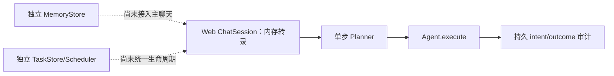
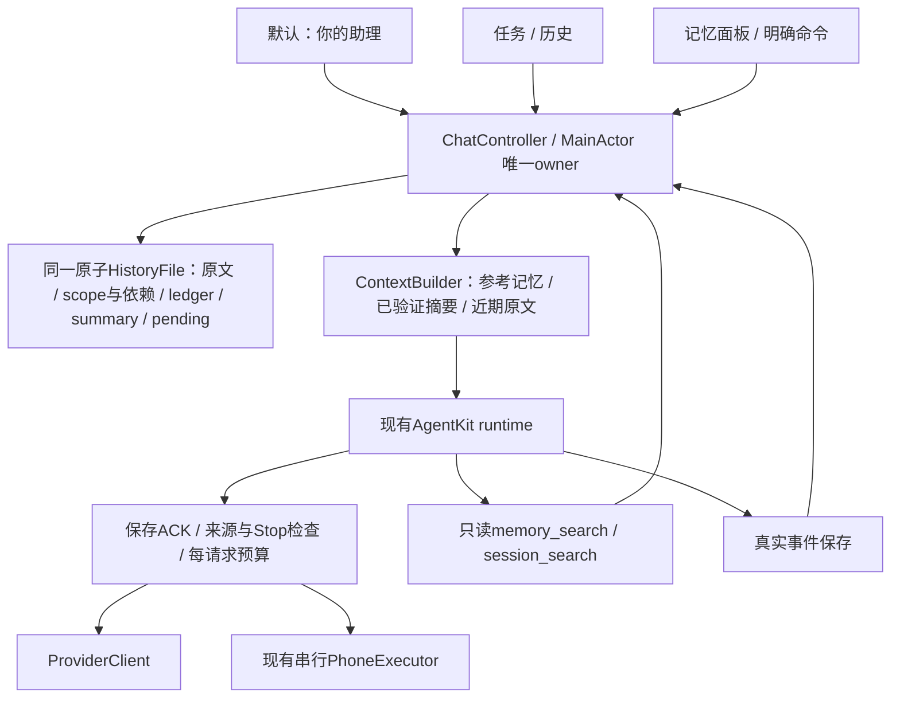

# 单入口与长期记忆技术方案

> 状态：公开资料及固定版本关键架构路径已静态核对；多模型讨论及双模型审查后的实现契约，已决定待开发；未修改应用代码
>
> 最后核对：2026-10-14
>
> 面向读者：PocketAgent iOS、AgentKit 集成与测试开发者
>
> 范围：同一个助理入口，跨天延续对话与记忆；复用现有手机执行链路
>
> 源码基线：`devicehub-control`，`abae3f67bd66f2434662a24251058fdaddee1227`

## 1. 需求与关联资料

用户确认目标为“单入口＋长期记忆”：再次打开 App 时直接回到同一个助理，换话题、换模型和跨天使用时仍能找回相关偏好与之前的决定。现有 PocketAgent 的主组织单位是独立会话，每条会话分别保存历史、模型和项目。推荐新增默认“你的助理”独立入口，保留旧任务会话与历史；继续用 AgentKit，补齐宿主的主线、记忆、上下文与输入队列。长期连续性来自数据与上下文管理，每轮仍是有起止的执行。首版沿用本机运行方式，不依赖常驻服务器。

| 类型 | 链接 | 说明 |
|---|---|---|
| 需求真源 | 用户于 2026-10-14 在本次探索中确认“单入口＋长期记忆” | 尚无独立需求文档 |
| Figma | 不涉及 | 先定义信息架构；实现阶段补界面稿 |
| 当前工程设计 | [engineering.md](engineering.md) | 历史完整性、配置冻结、动作队列、同步边界 |
| 手机后端设计 | [devicehub-control.md](devicehub-control.md) | DDI 默认与 WDA 可选的现有能力 |
| Muse | [Meta 官方介绍](https://about.fb.com/news/2026/09/introducing-muse-personal-ai-agent/) | 记住偏好与目标、长期协助的产品方向 |
| Grok Bot | [Grok Bot 101](https://x.ai/bot/guides/grok-bot-101) | 持续使用的助理、持久执行环境与 routines |
| OpenAI dot | [OpenAI Docs：Tasks and memory](https://learn.chatgpt.com/docs/dots/tasks-and-memory) | 一个助理协调多项责任；对话上下文与持久笔记分开 |
| OpenClaw | [Home 主会话](https://github.com/openclaw/openclaw/blob/ddaa0bd2b0dd077c946ace62a4b87383f032e26e/docs/concepts/main-session.md) | 固定版本文档与 TypeScript 源码核验 |
| Hermes Agent | [Persistent Memory](https://github.com/NousResearch/hermes-agent/blob/d97007c32d6340f7ba79ac1dfb5773cc00846448/website/docs/user-guide/features/memory.md) | 固定版本文档与 Python 源码核验 |
| OpenMuse 同名项目 | [CopilotKit](https://github.com/CopilotKit/openmuse)、[tuxevil](https://github.com/tuxevil/openmuse)、[tahodev](https://github.com/tahodev/openmuse) | 同名项目逐一核对，保留 jerelvelarde 历史版本对照 |
| OpenMuseAgent 后继 | [nanoMuse](https://github.com/nano-muse/nanoMuse) | Python、OpenMinis iOS 与桌面 Harness 分别核验 |
| iOS 生命周期 | [Apple：BGContinuedProcessingTaskRequest](https://developer.apple.com/documentation/backgroundtasks/bgcontinuedprocessingtaskrequest) | 用户在前台发起、可继续到后台的工作 |

用户最新要求是“先不改代码”，由主会话与 Opus 5.5 xhigh、DeepSeek Flash high、Grok 4.7 high 整体讨论，再由 GPT-6 Astra xhigh 与 Fable 5.1 xhigh 审查并确定技术细节及实施步骤。本次交付为源码依据与具体方案，不修改 App 行为。主动提醒、定时监控、持续语音和离开 App 后全天候工作属于后续扩展，没有被本次需求确认。

## 2. 公开项目调研与结论

本轮已沿入口、会话 admission、模型/工具循环、历史与记忆、取消和重启路径深化源码分析，并纳入四条主要 OpenMuse 路线及其不同版本。项目提出的分层思路相近，实际接线与完成度不同：有的已把记忆接入聊天，有的仍是独立模块或设计文档。OpenClaw 提供 Home 主会话；Hermes 提供策展记忆与历史检索；nanoMuse/OpenMinis 的 iOS 主线与摘要投影是直接相关的手机端参考。Muse、Grok Bot、OpenAI dot 的公开信息能支持产品与部分运行架构判断，本次未取得三者完整的会话/记忆 harness 源码，不能据此声称复刻其内部算法。

1. 产品上的连续性可以由稳定助理身份和一个聊天入口承接。工作上下文可以原位压缩或在明确边界重建；后台 session ID 的生命周期不是产品入口的定义。
2. 重点借鉴 nanoMuse/OpenMinis iOS 的主会话指针与非破坏摘要投影、Hermes 的小型偏好记忆与历史检索、OpenClaw 的 Home/工作 thread 分层。CopilotKit OpenMuse 的 rich chat/worker 适合作为应用分层参考，但当前依赖外部 Intelligence。
3. OpenClaw与Hermes的当前两个固定版本都支持原位压缩；Hermes 当前默认 `in_place=true`。没有依据要求 PocketAgent 在每次压缩时建立新 session，也不应按旧教程默认每日清空。
4. 记忆学习、历史检索和压缩分别有触发与预算。保存事实由实际工具写入完成；记忆文件、摘要或模型声称“已记住”不能互相替代。
5. PocketAgent 已有固定 AgentKit 的记忆/压缩原语。下文给出已收敛的宿主适配契约；按用户“先做好调研”的要求，当前不开始实现，不引入新的后台服务。

### 本轮收敛：入口、记忆与执行引擎分别选型

建议采用“独立助理入口＋现有 AgentKit＋宿主补齐长期记忆”。用户本轮要求先形成具体改造方案，已授权技术方案收敛，未授权代码实现。

| 路线 | 改动与收益 | 主要代价 | 本轮建议 |
|---|---|---|---|
| 固定当前某条会话，隐藏其他会话 | 导航改动小 | 易继承旧项目/一次性任务；仍需记忆、预算和队列改造 | 不作为主方案 |
| 新增默认“你的助理”，旧任务/历史共存，继续 AgentKit | 默认入口稳定；保留原执行与旧数据；宿主分别管理记忆和上下文 | 新增主指针、数据扩展、请求投影与运行宿主 | 推荐 |
| 替换成 OpenMinis 类自有 loop | 可控制整个循环，与上游机制一致 | 替换模型适配、事件、工具调度、取消、生命周期；仍须接入 DDI/WDA | 当前收益不足，后置评估 |

独立入口与保留 AgentKit 可以同时成立。固定版本 AgentKit 已有非破坏请求 pipeline、记忆协议/工具和无工具摘要服务；PocketAgent 尚未把这些接成长期助理。新增入口给用户一个稳定落点，宿主改造让这个落点真正有长期记忆。

[OpenAI Docs](https://learn.chatgpt.com/docs/dots/tasks-and-memory)明确区分助理笔记与工作任务自己的上下文，也支持从同一助理进入可见任务。本方案借鉴这一信息架构；普通聊天与手机轮次如何运行，仍由 PocketAgent 的本机生命周期决定。OpenMinis 的摘要投影机制适合借鉴，但它的 Swift loop、SQLite、同步及工具能力是一个整套宿主实现，不构成必须替换 AgentKit 的依据。


<details>
<summary>公开资料、固定版本源码与差异核验</summary>

### 核验方法与证据范围

- 商业产品只采用官方产品文档、研究文章与官方仓库；不把泄露提示词、同名社区项目或模型的自述当作内部实现证据。
- OpenClaw 核验固定提交 [`ddaa0bd2b0dd077c946ace62a4b87383f032e26e`](https://github.com/openclaw/openclaw/commit/ddaa0bd2b0dd077c946ace62a4b87383f032e26e)，提交日期 2026-10-13。
- Hermes Agent 指 [NousResearch/hermes-agent](https://github.com/NousResearch/hermes-agent)，核验固定提交 [`d97007c32d6340f7ba79ac1dfb5773cc00846448`](https://github.com/NousResearch/hermes-agent/commit/d97007c32d6340f7ba79ac1dfb5773cc00846448)，提交日期 2026-10-13；与同名模型、其他 Hermes 项目区分。
- 两个开源清单初稿来源：peer；主会话复核路由/reset、默认压缩、记忆快照刷新和搜索等决定性源码。未安装、执行或连接用户部署，结论属于静态实现核验；下方继续给出关键架构调用链与同名项目分析。

### 公开程度与共同思路

| 项目 | 本次获得的公开信息 | 连续性来自什么 | 尚未核实的边界 |
|---|---|---|---|
| Muse | 官方产品说明、安全运行架构、模型与硬件 SDK 公开资料 | 同一用户的 VM、文件/记忆、持久应用状态、子任务 | 具体记忆提炼、检索与压缩算法；完整个人助理 harness |
| Grok Bot | 官方 Bot 管理、聊天、电脑/任务文档 | 命名 Bot 的角色、偏好和工作摘要；持久云端电脑 | 记忆 schema、压缩触发、历史合并源码 |
| OpenAI dot | OpenAI Docs 的任务、记忆和跨渠道行为说明 | 同一 dot 的持久笔记；工作任务各自有上下文 | 笔记生成/召回和内部 session 生命周期源码 |
| OpenClaw | 官方文档与本次固定版本 TypeScript 源码 | Home 主会话、SQLite transcript、Markdown 记忆、检索和压缩 | 实际部署参数、长期召回质量与运行可靠性 |
| Hermes Agent | 官方文档与本次固定版本 Python 源码 | 稳定聊天路由、SQLite 历史、小容量个人记忆、原位压缩 | 用户部署行为、记忆学习及中文检索实际质量 |

### Muse：公开了真实运行架构，记忆算法披露仍有限

[Meta 的安全架构文章](https://research.meta.ai/blog/security-and-safety-for-ai-agents-our-approach-with-muse)说明客户端连接用户专属 VM；Hatch harness 与用户工作区位于 runtime container，持久应用状态位于独立 Postgres，凭证与外部动作控制在另外的服务中。文章也说明用户可查看、编辑、下载自己的文件与记忆，VM 可承载并发子 agent 和 cron。这里“机器内存/RAM”与“助理记忆”需要分别理解。

[Muse Wonder 官方介绍](https://about.fb.com/news/2026/10/introducing-muse-wonder-models/)于 2026-10-12 将 Active Memory 描述为跨对话保留重要信息并取回相关细节。这是公开能力描述，未说明记忆库 schema、召回索引、摘要边界或写入策略；不能据此认定记忆通过模型权重在线学习。

存在可核实的官方开放材料：[Muse Glimmer 开放模型权重](https://research.meta.ai/blog/introducing-muse-glimmer-open-agentic-model)与 [Muse Gadget SDK](https://github.com/facebookincubator/muse-gadget-sdk)。后者是 ESP32/Linux 硬件接入 SDK 和固件。它们分别提供模型或设备接入能力；本次没有在这些资料中拿到 Muse 个人助理完整的会话/长期记忆实现。

### Grok Bot：长期身份以 Bot 为单位，可有多个角色

[官方 overview](https://docs.x.ai/grok-bot/overview)说明同一账户的 Bots 共享云端电脑与文件/浏览器登录状态，但每个 Bot 的会话和学习上下文独立，记忆内容包括稳定偏好、角色信息和过往工作摘要。[Bot 管理文档](https://docs.x.ai/grok-bot/bots)把持久描述和任务消息区分，也明确复制 Bot 配置不复制其聊天历史与学习记忆。

因此可借鉴的是“固定助理身份拥有记忆，具体任务有范围”；该产品本身允许多个 Bot 和群聊，公开资料并没有要求一个账户只能有一条永久对话。[聊天文档](https://docs.x.ai/grok-bot/chat-and-collaboration)支持执行中继续发送指令、按消息回应和调整优先级。公开文档未给出其内部记忆更新和压缩实现。

### OpenAI dot：持久笔记与工作上下文明确分开

[OpenAI Docs：Tasks and memory](https://learn.chatgpt.com/docs/dots/tasks-and-memory)说明 dot 使用当前对话、相关 ChatGPT memory 和自己的持久笔记；笔记包含偏好、决定与进行中的工作，属于选取的信息，不是完整转录。它可以在同一对话中协调多项工作，任务有自己的上下文，不自动接收用户全部历史。跨渠道访问同一个 dot 会延续笔记，但不同渠道的可见消息仍分别保留。

这直接支持“一个助理入口＋按需上下文”的产品方向。公开说明不足以确认其内部如何做 token 预算、记忆写入、摘要持久化和冲突处理。

### OpenClaw：Home 长期主会话是当前直接参考

1. **稳定入口。** [main-session 文档](https://github.com/openclaw/openclaw/blob/ddaa0bd2b0dd077c946ace62a4b87383f032e26e/docs/concepts/main-session.md#L10-L28)把 Home 定义为个人助理默认入口，默认 DMs 汇入 `agent:<agentId>:main`，其他任务可在独立 threads 中工作并返回结果。源码 [DM routing](https://github.com/openclaw/openclaw/blob/ddaa0bd2b0dd077c946ace62a4b87383f032e26e/src/routing/session-key.ts#L215-L252)的默认 scope 是 main；[reset-policy.ts](https://github.com/openclaw/openclaw/blob/ddaa0bd2b0dd077c946ace62a4b87383f032e26e/src/config/sessions/reset-policy.ts#L26-L28)的默认 reset mode 为 none，daily/idle 是配置选择。
2. **当前存储。** [官方 store 文档](https://github.com/openclaw/openclaw/blob/ddaa0bd2b0dd077c946ace62a4b87383f032e26e/docs/reference/session-management-compaction/store.md#L9-L12)说明 session rows 与 transcript events 均位于每 agent 的 SQLite；历史有边界/树结构，包含原消息、工具结果和摘要。[SQLite 路径解析](https://github.com/openclaw/openclaw/blob/ddaa0bd2b0dd077c946ace62a4b87383f032e26e/src/config/sessions/session-sqlite-target-paths.ts#L17-L46)与此一致。旧 JSONL/`sessions.json` 是迁移或归档材料，不能用旧教程代替当前运行时说明。
3. **分层记忆。** [memory 文档](https://github.com/openclaw/openclaw/blob/ddaa0bd2b0dd077c946ace62a4b87383f032e26e/docs/concepts/memory.md#L20-L58)区分小型 USER.md、策展后的 MEMORY.md 和详细 daily notes。日记用于按需检索，近期日记可在 reset 后重新加载；完整日记不在每轮全量注入。
4. **检索能力。** 默认 plugin slot 是 [memory-core](https://github.com/openclaw/openclaw/blob/ddaa0bd2b0dd077c946ace62a4b87383f032e26e/src/plugins/slots.ts#L17-L20)。[搜索实现](https://github.com/openclaw/openclaw/blob/ddaa0bd2b0dd077c946ace62a4b87383f032e26e/extensions/memory-core/src/memory/manager-search-orchestration.ts#L398-L430)具备 keyword-only 分支；后续 [vector 与 hybrid 排序](https://github.com/openclaw/openclaw/blob/ddaa0bd2b0dd077c946ace62a4b87383f032e26e/extensions/memory-core/src/memory/manager-search-orchestration.ts#L512-L568)按配置与实际 provider 可用性工作。可选 LanceDB plugin 是另一种 memory provider，不能据此称默认实现必须依赖 LanceDB。
5. **学习与压缩。** [flush-plan 源码](https://github.com/openclaw/openclaw/blob/ddaa0bd2b0dd077c946ace62a4b87383f032e26e/extensions/memory-core/src/flush-plan.ts#L12-L28)给 pre-compaction flush 设定当天 daily note 的追加目标，并将 bootstrap 文件设为只读。Flush 是阈值维护；[dreaming consolidation](https://github.com/openclaw/openclaw/blob/ddaa0bd2b0dd077c946ace62a4b87383f032e26e/docs/concepts/memory.md#L51-L58)另行整理有用信息。写日记、整理长期记忆和摘要当前上下文是不同流程。

**本版文档差异：** main-session 文档称 reset 分配新的 live session ID；但 [session 初始化源码](https://github.com/openclaw/openclaw/blob/ddaa0bd2b0dd077c946ace62a4b87383f032e26e/src/auto-reply/reply/session.ts#L570-L583)对普通 durable session 沿用 transcript identity，并 [建立 reset boundary](https://github.com/openclaw/openclaw/blob/ddaa0bd2b0dd077c946ace62a4b87383f032e26e/src/auto-reply/reply/session.ts#L746-L753)。ACP 等路径可轮转。因此此研究采用“工作上下文重置、历史保留”的语义，不声称每次 reset 必换物理 ID。未运行重置复现，这属于源码与文档的范围差异核验。

### Hermes Agent：小型个人记忆与真实历史检索

1. **连续入口。** [gateway session key](https://github.com/NousResearch/hermes-agent/blob/d97007c32d6340f7ba79ac1dfb5773cc00846448/gateway/session.py#L685-L720)包含 profile、平台和聊天/thread 维度，每个稳定路由指向活跃工作 session。[显式 reset](https://github.com/NousResearch/hermes-agent/blob/d97007c32d6340f7ba79ac1dfb5773cc00846448/gateway/session.py#L1134-L1155)产生新 ID，并保留旧 parent。[用户文档](https://github.com/NousResearch/hermes-agent/blob/d97007c32d6340f7ba79ac1dfb5773cc00846448/website/docs/user-guide/features/memory.md#L59-L65)说明消息平台会话可跨重启持续，建议在自然任务边界 `/new`。
2. **小容量策展记忆。** [初始化代码](https://github.com/NousResearch/hermes-agent/blob/d97007c32d6340f7ba79ac1dfb5773cc00846448/agent/agent_init.py#L1297-L1334)的内置默认预算为 MEMORY.md 2,200 字符、USER.md 1,375 字符，可配置。超预算更新会拒绝，由模型整理条目。[memory tool](https://github.com/NousResearch/hermes-agent/blob/d97007c32d6340f7ba79ac1dfb5773cc00846448/tools/memory_tool.py#L374-L397)当前提供 add/patch/remove，而不是无边界堆积全部历史。
3. **更新触发。** 默认 nudge interval 为 10 个用户 turn；[turn 计数](https://github.com/NousResearch/hermes-agent/blob/d97007c32d6340f7ba79ac1dfb5773cc00846448/agent/turn_context.py#L753-L762)达到间隔后可启动后台 review，由模型决定是否实际调用 memory tool。公开的“学习”在这些已核验路径里体现为数据/工具操作，不代表每条消息都保存或模型权重持续训练。
4. **历史检索。** [`session_search` schema](https://github.com/NousResearch/hermes-agent/blob/d97007c32d6340f7ba79ac1dfb5773cc00846448/tools/session_search_tool.py#L651-L666)明确返回实际 SQLite 消息，无额外 LLM 摘要；[FTS5 结果处理](https://github.com/NousResearch/hermes-agent/blob/d97007c32d6340f7ba79ac1dfb5773cc00846448/tools/session_search_tool.py#L389-L431)允许按消息锚点继续读取。自动学习、历史搜索和上下文摘要不应合并为一个组件。
5. **当前默认原位压缩。** [`compression.in_place` 默认 true](https://github.com/NousResearch/hermes-agent/blob/d97007c32d6340f7ba79ac1dfb5773cc00846448/agent/agent_init.py#L1575-L1577)；[提交实现](https://github.com/NousResearch/hermes-agent/blob/d97007c32d6340f7ba79ac1dfb5773cc00846448/agent/conversation_compression.py#L3736-L3743)将旧消息 soft-archive，仍可检索，同时保存缩减后的活跃上下文。显式关闭 in_place 才使用可选的 parent→child 轮转路径；不能将旧版轮转描述为当前默认。

**本版记忆刷新边界：** [MemoryStore](https://github.com/NousResearch/hermes-agent/blob/d97007c32d6340f7ba79ac1dfb5773cc00846448/tools/memory_tool_store.py#L618-L621)在普通 turn 中使用冻结的 prompt snapshot，以保持缓存前缀。memory 文档说新写入在新 session 才注入；[prompt invalidation 源码](https://github.com/NousResearch/hermes-agent/blob/d97007c32d6340f7ba79ac1dfb5773cc00846448/agent/system_prompt.py#L808-L826)还在压缩边界重新加载记忆。因此“只能新 session 生效”范围不完整，普通 turn、成功压缩重建和新 session 应分别描述。PocketAgent 每轮创建 runtime，适合冻结当前轮并在下一轮重新取有效记忆。

### 架构深化：入口、运行 owner 与持久化边界

本轮范围扩展到消息入口→会话 admission/队列→模型循环→工具执行→结果持久化→记忆召回→后续轮次，并补查取消与重启路径。它是围绕单入口/长期记忆的架构静态核验，不是所有 connector、所有模型 provider 或所有平台的完整审计。未运行外部项目；“存在恢复代码”不等于外部副作用已经证明恰好执行一次。

**OpenClaw 的主线控制路径：** `runPreparedReply → prepareReplyRunContext/admission → executePreparedReplyRun → runReplyAgent → embedded candidate → runEmbeddedAgentEntry/runEmbeddedAgent → session lane + global admission → harness attempt → transcript/terminal settlement`。入口在 [get-reply-run.ts](https://github.com/openclaw/openclaw/blob/ddaa0bd2b0dd077c946ace62a4b87383f032e26e/src/auto-reply/reply/get-reply-run.ts#L10-L28)，执行层可处理 steer/follow-up，[run-entry](https://github.com/openclaw/openclaw/blob/ddaa0bd2b0dd077c946ace62a4b87383f032e26e/src/agents/embedded-agent-runner/run-entry.ts#L73-L114)保留同一逻辑轮次的 admission 与 lifecycle generation，[lane controller](https://github.com/openclaw/openclaw/blob/ddaa0bd2b0dd077c946ace62a4b87383f032e26e/src/agents/embedded-agent-runner/run/lane-controller.ts#L282-L313)把等待/超时取消纳入队列控制。Gateway 持有会话事实，模型运行时通过 harness/plugin 接口接入；Home、工作 threads 与工具资源不必共用一个永久进程对象。

**Hermes 的主线控制路径：** `Gateway inbound → routing key/active-turn claim → session transcript load → cached AIAgent → per-turn runner → run_conversation → tool round → canonical DB append → tool execution → finalizer/persist`。源码的 [inbound admission](https://github.com/NousResearch/hermes-agent/blob/d97007c32d6340f7ba79ac1dfb5773cc00846448/gateway/run_inbound.py#L1285-L1359)在第一次 await 前占用会话；[agent resolution](https://github.com/NousResearch/hermes-agent/blob/d97007c32d6340f7ba79ac1dfb5773cc00846448/gateway/run_turn_runner.py#L1139-L1176)可复用 agent cache，但每条消息创建独立 turn。`state.db` 是 [可重放 transcript 的 canonical 来源](https://github.com/NousResearch/hermes-agent/blob/d97007c32d6340f7ba79ac1dfb5773cc00846448/gateway/session_transcript.py#L631-L652)；[tool round](https://github.com/NousResearch/hermes-agent/blob/d97007c32d6340f7ba79ac1dfb5773cc00846448/agent/turn_tool_round.py#L145-L174)要求先成功持久化 assistant/tool-call 行再执行工具。Cron 另起 task session，不能据此要求主聊天 agent 承载全部后台工作。

对 PocketAgent 的含义：应把 UI 主线、运行 admission、历史 owner、记忆接口和手机资源 owner 分开。长期聊天可以复用 agent 或每轮新建 runtime；现有 PocketAgent 每轮新建 AgentRuntime 的方式本身不阻止长期连续性。

### 同名 OpenMuse：关系、固定版本与实现状态

用户确认“同名项目都比较”。本轮逐一读取下列源码；GitHub fork 标志不能替代提交历史或代码归属核验。提交 compare 确认 CopilotKit 当前版本包含 jerelvelarde 所查提交，二者是同一历史的不同阶段；其余候选不能按同名归为一个项目。旧 OpenMuseAgent 项目的 [README](https://github.com/OpenMuseAgent/OpenMuse)明确指向 nanoMuse，并称旧仓库是 0.1.0–0.6.0 历史存档；没有把它与其他同名项目视作同一实现。

| 项目 | 固定提交 | 当前许可文件/声明 | 已核实主要边界 |
|---|---|---|---|
| [tuxevil/openmuse](https://github.com/tuxevil/openmuse) | `0dd00b46920407276ce0ca7c69e9dfc0b9ef7767` | 尚未选择许可；README 明示 | Phase 1/2 持久控制面与模型 adapter，后续 memory/Sentinel/runtime 多为设计 |
| [tahodev/openmuse](https://github.com/tahodev/openmuse) | `e96d76aafcc538706b61b56f48649df128fca983` | MIT | host policy/audit/approval 有接线；memory/task 模块尚未接入正式 Web chat |
| [jerelvelarde/openmuse](https://github.com/jerelvelarde/openmuse) | `61796eb2f1dee6bb5479a9023caa94f9daa89355` | MIT | React Native/CopilotKit 主聊天与 SQL lease worker 分离；后台注入记忆；主聊天可经状态工具读取 |
| [CopilotKit/openmuse](https://github.com/CopilotKit/openmuse) | `1ac68f3909f2478ab6280883f1ab5ea65eb5719d` | MIT；Intelligence 是外部服务 | 同一历史的后续版本；Intelligence 必需，模型循环改用 TanStack adapter |
| [nano-muse/nanoMuse](https://github.com/nano-muse/nanoMuse) | `58b9346f3d8a130c226beef5f906277af350dcb5` | 当前 GPL-3.0-or-later；README/notice | Python agent、OpenMinis 手机宿主、DeepSeek Harness 桌面插件分别实现 |

OpenMuse/nanoMuse 三份 reader 清单来源：peer；以下决定性 composition、上下文和持久化路径由主会话复核。许可在此仅记录仓库声明，本次没有复制实现代码。

### tuxevil/openmuse：持久任务骨架，长期记忆还在设计层

实际链路为 `API/CLI → ControlPlaneRepository → goal/task/schedule/execution → AgentHarness.run → ContextBuilder → ModelAdapter.complete → ToolRegistry → checkpoint/finish_execution`。

- [ContextBuilder](https://github.com/tuxevil/openmuse/blob/0dd00b46920407276ce0ca7c69e9dfc0b9ef7767/src/openmuse/context.py#L16-L35)重建的是 goal、task、prior executions 元数据。没有读取 conversation messages 或持久个人记忆；名为 bounded 的上下文只明确输出/时限字段，没有在这里做输入 token 裁切或摘要。
- [Harness](https://github.com/tuxevil/openmuse/blob/0dd00b46920407276ce0ca7c69e9dfc0b9ef7767/src/openmuse/harness.py#L81-L122)默认最多 8 个模型步，执行中的局部 transcript 在内存；checkpoint 保存近期状态。控制面 [事务性 schedule delivery](https://github.com/tuxevil/openmuse/blob/0dd00b46920407276ce0ca7c69e9dfc0b9ef7767/src/openmuse/repository.py#L127-L165)有 dedupe/claim，不能由此推导出完整 crash 后工具结果 reconciliation。
- [实际 CLI demo](https://github.com/tuxevil/openmuse/blob/0dd00b46920407276ce0ca7c69e9dfc0b9ef7767/src/openmuse/cli.py#L51-L58)使用 FakeModelAdapter；HTTP API 主要创建控制面实体。`MEMORY.md`、`SENTINEL.md` 是设计文档，不是已接入的记忆库/宿主权限服务。
- [README 许可段](https://github.com/tuxevil/openmuse/blob/0dd00b46920407276ce0ca7c69e9dfc0b9ef7767/README.md#L147-L149)明示尚未选择许可。本次按“公开代码研究对象”处理。

可参考：goal/task/execution 的分层与事务性 delivery key。不能据此选为已经具备单长期会话和个人记忆的现成底座。

### tahodev/openmuse：精确动作边界较具体，聊天连续性未贯通

实际链路为 `HTTP /api/chat → ChatSession.handle → OpenAICompatiblePlanner.plan → Agent.execute → result event → assistant text`。Web 的 conversation transcript 是 [进程内 dict](https://github.com/tahodev/openmuse/blob/e96d76aafcc538706b61b56f48649df128fca983/src/openmuse/web_chat.py#L91-L133)，每轮只读最近 12 条 user/assistant entry；当前消息的工具结果另存局部列表。这里限制历史长度的方式是窗口截取，源码未见摘要压缩。

- [Planner](https://github.com/tahodev/openmuse/blob/e96d76aafcc538706b61b56f48649df128fca983/src/openmuse/providers/openai_compatible.py#L14-L31)通过标准库 HTTP 获取单步 JSON action；[Agent.execute](https://github.com/tahodev/openmuse/blob/e96d76aafcc538706b61b56f48649df128fca983/src/openmuse/core.py#L24-L53)执行前写 intent，结果审计写入失败会返回 unknown 且不可重试。这个动作边界适合参考。
- MemoryStore 的 remember/search/forget 有独立实现，但在所查 Web composition 和 Agent/planner 入口中无调用；同样 TaskStore 与 Scheduler 尚未成为 ChatSession 的生命周期 owner。[架构文档](https://github.com/tahodev/openmuse/blob/e96d76aafcc538706b61b56f48649df128fca983/docs/architecture.md#L74-L84)也承认这些层未统一。
- 审批记录持久化，等待 map 与 token authority 属于进程内；重启后遗留 pending 被标为 interrupted。TaskStore 的 cancel 是状态写入，未接入 Web 运行中取消信号；模块存在不等于聊天执行会遵从它。



可参考：明确 Action/Result、unknown effect 与审批记录；当前聊天历史与记忆接线不足以直接承接 PocketAgent 的目标。

### jerelvelarde/openmuse 历史版本：聊天协调器与持久 worker 两条链

实际聊天链路为 `Expo ChatScreen → ConversationQueue → CopilotKit runAgent → Hono/CopilotRuntime → ConversationAgent/BuiltInAgent`；任务链路为 `delegate_task → SQL records → lease worker → task-specific BuiltInAgent → tools → state/checkpoint/events`。模型 loop/AG-UI 来自 CopilotKit，自有部分包括任务、worker、记录存储、审批和 Docker Computer。

- [聊天 agent](https://github.com/jerelvelarde/openmuse/blob/61796eb2f1dee6bb5479a9023caa94f9daa89355/apps/server/src/engine/conversation.ts#L89-L150)提供 remember_fact，却未把 memories 读入 prompt；[后台任务 agent](https://github.com/jerelvelarde/openmuse/blob/61796eb2f1dee6bb5479a9023caa94f9daa89355/apps/server/src/engine/model.ts#L275-L304)每次读取 owner 全部记忆，连同 task state/evidence/artifacts 一起注入。主聊天的 agent_status 会经 [service.snapshot](https://github.com/jerelvelarde/openmuse/blob/61796eb2f1dee6bb5479a9023caa94f9daa89355/apps/server/src/engine/service.ts#L124-L146) 返回 memories，因此已有工具式读取路径；这里的缺口是自动相关性召回和 token 预算，不应误称主聊天完全无法使用记忆。
- 未启用 Rich Threads 时是 owner 下的单条 conversation 记录；客户端在轮次退出后尝试保存。Rich Threads/额外重放依赖 CopilotKit Intelligence 的外部服务，不能把它视作此仓库独立自托管实现。
- [worker](https://github.com/jerelvelarde/openmuse/blob/61796eb2f1dee6bb5479a9023caa94f9daa89355/apps/server/src/engine/worker.ts#L64-L115)会重领 lease 过期的 running 任务；部分工具收据或 operations checkpoint 能去重，但并非所有外部效果都被同一原子提交覆盖。因此这种恢复策略不能整体迁入 PocketAgent 的“中断手机动作不重放”契约。
- [默认配置](https://github.com/jerelvelarde/openmuse/blob/61796eb2f1dee6bb5479a9023caa94f9daa89355/apps/server/src/config.ts#L35-L41)为 sample；live/model 模式才走真实模型。OpenBot 是可选 adapter seam，不能把 README 的 future backend 当作已经连接的能力。

可参考：主聊天协调工作、任务有独立持久状态与 UI 活动记录。Node worker、Docker Computer 与 React Native/CopilotKit 状态不适合直接取代 iPhone 本机执行链。

### CopilotKit 官方 OpenMuse：必须按后续版本重新评价

[提交比较](https://github.com/CopilotKit/openmuse/compare/61796eb2f1dee6bb5479a9023caa94f9daa89355...1ac68f3909f2478ab6280883f1ab5ea65eb5719d)确认旧 jerelvelarde 提交是当前固定版本的祖先。当前代码路径仍为主聊天协调器与 SQL worker 分层，但 [配置](https://github.com/CopilotKit/openmuse/blob/1ac68f3909f2478ab6280883f1ab5ea65eb5719d/apps/server/src/config.ts#L69-L86)以及 readConfig 要求 `CPK_INTELLIGENCE_API_KEY`，不再采用旧版本的可选 Rich Threads 自托管回退。

[ConversationAgent](https://github.com/CopilotKit/openmuse/blob/1ac68f3909f2478ab6280883f1ab5ea65eb5719d/apps/server/src/engine/conversation.ts#L366-L393)仍提供 remember_fact；主 prompt 没有预先注入个人事实，agent_status 可读取 [包含 memories 的完整状态](https://github.com/CopilotKit/openmuse/blob/1ac68f3909f2478ab6280883f1ab5ea65eb5719d/apps/server/src/engine/service.ts#L136-L158)；[任务 agent](https://github.com/CopilotKit/openmuse/blob/1ac68f3909f2478ab6280883f1ab5ea65eb5719d/apps/server/src/engine/model.ts#L316-L340)读取 owner 全部记忆和 task state 后运行。模型轮次改经 `tanstackAgent`，它用 CopilotKit BuiltInAgent factory 接入 TanStack AI 与 provider adapters，再提供 AG-UI 事件。旧版直接构造 BuiltInAgent 的调用方式不能当作当前完整循环。

还需分别看主聊天与任务运行：停止主聊天不等于取消已委派任务；worker 对过期 lease 可重领运行，外部 action 则有 outcome_unknown 的独立恢复保护。新版本可选 E2B desktop provider 有真实接线，默认 Docker；不要沿用旧版本“E2B 不存在”的判断。

此官方版本必须纳入应用信息架构比较，尤其是持久主 thread、后台 task 和界面结果卡片；它包含外部 Intelligence 持久化依赖，和 PocketAgent 本机目标的运行方式不同。下方对 nanoMuse 的评价仍按其独立实现，而非依赖此服务。

### nanoMuse：最相关的手机端参考，需要分别理解三套实现

| 端 | 实际 runtime/owner | 历史与工作上下文 | 长期记忆 |
|---|---|---|---|
| Python server | NanoMuseApp 共享 stores；MuseService 每 thread 创建 MuseAgent/worker | 独立 session JSON 与 timeline；默认近期 80 条请求窗口 | SQLite；按请求关键词＋可用 embeddings 召回，记忆工具写入；后台 tidy 是另一流程 |
| iOS | OpenMinis Swift AIChatViewModel 自有 loop，nanoMuse hooks 扩展 | ChatStore SQLite 全历史；compact marker 投影到模型请求 | GLOBAL.md、近期日记、nanoMuse USER.md；两套同步分别处理记忆和主/旁聊 |
| Desktop | DeepSeek Harness sessionController＋nanoMuse Rooms plugin | Harness 管理的主/旁 session | rooms.json 文本条目，最多最近 60 条注入；不同于 Python SQLite recall |

Python [composition root](https://github.com/nano-muse/nanoMuse/blob/58b9346f3d8a130c226beef5f906277af350dcb5/nanomuse/app.py#L82-L100)创建共享记忆/工具；[per-thread factory](https://github.com/nano-muse/nanoMuse/blob/58b9346f3d8a130c226beef5f906277af350dcb5/nanomuse/server/service.py#L825-L885)创建独立 agent 和文件。[recall_for](https://github.com/nano-muse/nanoMuse/blob/58b9346f3d8a130c226beef5f906277af350dcb5/nanomuse/agent/core.py#L255-L266)逐轮召回；[context_messages](https://github.com/nano-muse/nanoMuse/blob/58b9346f3d8a130c226beef5f906277af350dcb5/nanomuse/agent/core.py#L362-L378)主要裁切近期窗口，不能将 iOS 的摘要 marker 算法归到这个 Python 路径上。

iOS 的实际链路为 `NanoMuseMainChat → ChatStore/AIChatViewModel load → send/queue → OpenMinis runAgentLoop → provider stream/tools → persist → nmAfterTurn`：

- [主会话指针](https://github.com/nano-muse/nanoMuse/blob/58b9346f3d8a130c226beef5f906277af350dcb5/android/src/ios/NanoMuse/NanoMuseShell.swift#L227-L271)跨启动恢复，账号切换另有 owner 对应指针；稳定的是聊天落点，VM/Task 可以重建。
- [完整 agent history 保留](https://github.com/nano-muse/nanoMuse/blob/58b9346f3d8a130c226beef5f906277af350dcb5/android/src/ios/Agent/Chat/AIChatViewModel+Persistence.swift#L415-L425)；[请求投影](https://github.com/nano-muse/nanoMuse/blob/58b9346f3d8a130c226beef5f906277af350dcb5/android/src/ios/Agent/Chat/AIChatViewModel+Persistence.swift#L1625-L1685)用摘要 marker 的消息锚点、近期原文与后续消息组成上下文，不删除旧聊天。这里对 PocketAgent 最有参考价值。
- [Swift loop](https://github.com/nano-muse/nanoMuse/blob/58b9346f3d8a130c226beef5f906277af350dcb5/android/src/ios/Agent/Chat/AIChatViewModel.swift#L4729-L4759)属于 OpenMinis 复用的宿主；nanoMuse 通过 hooks 加主入口、个人资料、goal/feed 与同步，不能将整套执行引擎归为 nanoMuse 从零自研。
- [记忆注入](https://github.com/nano-muse/nanoMuse/blob/58b9346f3d8a130c226beef5f906277af350dcb5/android/src/ios/Agent/Chat/AIChatViewModel+MemoryTools.swift#L9-L60)读取完整 GLOBAL.md 和近 30 天中最近 3 个有内容日期的日记，各日最多 200 行；USER.md addendum 有 4000 字符限制。这些预算与 Python/desktop 不同。
- OpenMinis [iCloud V2](https://github.com/nano-muse/nanoMuse/blob/58b9346f3d8a130c226beef5f906277af350dcb5/android/src/ios/Agent/Sync/V2/ChatStoreSyncHydrators.swift#L143-L157)注册 GLOBAL/daily memory 数据类型；nanoMuse Cloud 另同步 ChatStore 主/旁聊。不能根据 NanoMuseSync 没有 memory 字段就断言 iOS 没有记忆同步，也不能把两路同步混成一个状态 owner。
- [iOS 屏幕操作 slot](https://github.com/nano-muse/nanoMuse/blob/58b9346f3d8a130c226beef5f906277af350dcb5/android/src/ios/NanoMuse/NanoMuseModelsView.swift#L80-L90)指向电脑能力，手机端入口禁用；shell 工具运行在 iSH sandbox。它没有在本次核验中提供与 PocketAgent DDI/WDA 本机跨 App 操作等价的替换链路。iPhone routine 也受 App 打开与系统后台时间限制，不能泛化桌面/Python 的常在线能力。

当前源码 [第三方致谢](https://github.com/nano-muse/nanoMuse/blob/58b9346f3d8a130c226beef5f906277af350dcb5/README.md#L167-L174)明确 OpenMinis、DeepSeek Harness 和 UI-TARS 的复用关系。当前 GPL 许可与早期 OpenMuse MIT 版本需分别看；本次只借鉴架构，不复制相关实现。

### 深化后的选型结论

在当前“单入口＋长期记忆”范围，优先学习 nanoMuse/OpenMinis iOS 的主会话指针与非破坏摘要投影、Hermes 的小型个人记忆与可追溯历史检索、OpenClaw 的 Home/工作 thread 分层。继续保留 PocketAgent 的 AgentKit、原子历史存储和手机资源 owner。

其他 OpenMuse 候选提供具体的控制面、审批或后台 worker 参考，但本次发现的主聊天记忆接线缺口、云端运行假设和未完成层级，使它们不宜直接作为已满足目标的现成架构。功能模块、正式 composition 和交付验证需要分别评价；实现阶段仍需针对目标 iPhone 的长期对话、记忆更新/删除、摘要失效和手机操作不重放完成验收。

### 相似性、差异与 PocketAgent 的取舍

共同模式可以归纳为四层：长期助理身份、有限工作上下文、持久事实/偏好、可追溯历史。原位压缩和切换工作段都是可能实现，连续 UI 不要求固定采用其中一个。主动调度依赖运行生命周期，应与记忆管理分开设计。

推荐借鉴 OpenClaw 的 Home 入口与历史窗口语义，借鉴 Hermes 的小型策展记忆＋按需取回原文，继续用现有 AgentKit 实现模型侧接口。先不复制 daily notes、dreaming、外部 memory provider 和多渠道 gateway 的全部复杂度，也不因为 OpenClaw 使用向量检索就把 embeddings 设为首版依赖。中文 FTS/文本与语义检索的实际召回需在实现阶段对照评估。

根许可证方面，本次固定版本的 [OpenClaw](https://github.com/openclaw/openclaw/blob/ddaa0bd2b0dd077c946ace62a4b87383f032e26e/LICENSE)与 [Hermes](https://github.com/NousResearch/hermes-agent/blob/d97007c32d6340f7ba79ac1dfb5773cc00846448/LICENSE)均为 MIT。此处只确认仓库文件；本次不复制代码，若后续直接复用需核对具体文件、第三方依赖与 notice。


### 多模型讨论、双模型审查与主审裁决

主会话与 Opus 5.5 xhigh、DeepSeek Flash high、Grok 4.7 high 分别形成第一轮意见，再交换分歧做第二轮讨论。GPT-6 Astra xhigh、Fable 5.1 xhigh 对同一冻结候选独立审查，主会话按固定源码逐条核验并修订，再复审差异。Astra/Fable经差异复审已关闭设计阻断项；最后的接线前提由主审回写。模型意见来源：peer；结论是静态设计审查，不是编译、运行或设备证明。外部参考仍依据前文的固定版本核验，并非每位模型重新完整审计全部外部仓库。

| 分歧 / 审查点 | 最终裁决与理由 |
|---|---|
| 替换 AgentKit 或增加独立入口 | 保留 loop，新增默认主入口；当前缺口在宿主数据、上下文和执行边界 |
| 自由注册 memory 写工具、关键词/子串 grant | MVP 不注册写工具；宿主精确面板/命令提交，模型只读召回；避免登记时机与授权歧义 |
| 待处理请求接受时直接插入、失败撤回原 prompt | detached→promoted两阶段；真实原文一旦移入历史就保留，未授权失败可继续或放弃 |
| runStarted 回调、storageError 标志作为保存保证 | 启动前持久 permit，轮内 awaited commit barrier；异步UI事件不能充当保存 ACK |
| 原生 old_text 作为指定记忆 ID | UI先ID/revision定位，replace/remove仅单条原生投影，避免substring匹配多条 |
| 两层摘要来源 hash、全局forget epoch失效 | 一个inputDigest+输出recordDigest、完整prefix覆盖和父链；仅相关来源/依赖失效 |
| 未知窗口24k硬cap、UTF8字节直接当token | 24k软整理目标；known/显式cap才硬检查，同一估计器与实测usage校准 |
| 静默摘要截断、仅限宿主text就称内存有界 | 拒绝length/缺终态/溢出；自组摘要，窄provider callback在producer限额，不换loop |
| 纠正与遗忘混用 | replace升revision、下一请求刷新，不撤销读者或停当前任务；只有显式forget才屏蔽依赖闭包，并在提交前显示连带影响 |
| 遗忘只删条目/旧摘要 | 持久依赖闭包，屏蔽已知检索副本，命中active root则停止；保原文、说明整段连带排除 |
| 新schema一律拒绝旧消息重复 | legacy本地repair语义保留并留迁移前副本；v4新事务严验；remote重复仍由现有PortableCodec拒绝 |
| 主线被删/分叉任意挑分支 | 显示恢复态，用户选保留分支或新空主线；不同步本机主指针/记忆 |

实际调用与报告、冻结稿hash和审查闭环引用只保留本地，未把模型原始输出、配置或成功证明放进Git。首版关键规则与测试契约在下文；接口仍是新增设计。

### 当前能力与具体缺口

会话/同步清单来源：peer；下列决定性落点已由主会话复核源码。

| 当前事实 | 源码位置（基线行号） | 对目标的影响 |
|---|---|---|
| 侧栏列出会话，右上角创建会话，模型/项目按会话选择 | `App/ChatRootView.swift:107-144` | 导航可以局部改造；模型切换无需创建新主线 |
| 启动恢复选中会话，本地历史为单个原子 JSON 文件 | `App/ChatSessions.swift:96-119,182-186` | 已有持久历史，需新增稳定主线身份与派生状态 |
| ChatJob 冻结历史、附件、模型配置、手机后端和项目 | `App/ChatSessions.swift:23-50` | 压缩、检索与模型选择必须遵守同样的入队边界 |
| 正在执行时 send 直接调用 steer | `App/ChatSessions.swift:366-372,411-442` | 单入口中应明确输入目标，避免独立请求串入当前任务 |
| 所有发送进入 queuedPhone，并受 foreground、engine.busy 控制 | `App/ChatSessions.swift:408,459-486` | 当前串行的是整个执行轮次；纯聊天/网络也不会天然并行 |
| 历史附件 hydration 限制图片数量，但文字从全部 prior 传入 | `App/Core/Attachments.swift:159-184` | 已有图片预算，缺少长期文字上下文预算 |
| 每轮新建 AgentRuntime，未接记忆工具/仓库适配，未配置持久 repository 或自定义 context pipeline | `App/PhoneAgent.swift:71-92` | AgentKit 的可用能力不等于宿主已有长期记忆 |
| 后端在 PhoneExecutor.ready 才连接，但 beginAgent 对每次发送提交系统后台任务 | `App/PhoneAgent.swift:328-334`、`App/AgentRunner.swift:28-56` | 现有按需连接复用；前台聊天宿主可后置，不能把入口独立等同于后台能力改变 |
| 未知工具被 reducer 默认计入手机动作 | `App/Core/ExecutionStatus.swift:110-115` | 注册 memory 工具还要补工具类型与状态展示 |
| 模型构造只指定输入能力与 4096 输出 token，未传上下文窗口 | `App/Core/ProviderConfig.swift:144-165` | 自动压缩不能假定所有自定义模型的窗口大小 |
| 迁移保留真实 ID；进行中的状态变 interrupted；按调用修复结果邻接 | `App/Core/ChatHistory.swift:123-180` | 主线迁移不能排序重写消息或恢复执行旧动作 |
| 同 ID 历史是前缀时选较长，否则保存冲突副本 | `App/Core/PortableSync.swift:286-307` | 两设备并发追加同一主线会产生分支，现有算法没有统一时间线语义 |
| SwiftUI 懒加载行，但先为完整消息构造渲染项与进度 | `App/ChatTranscriptView.swift:17-52` | 长历史仍需窗口化；LazyVStack 不会消除全量预处理成本 |

### 可直接复用的 AgentKit 原语

已核实项目锁定的 `8108c9bb87c546860cfc1769571e115af919fe8a` 源码，依赖 checkout 无本地改动；没有依赖最新版本的未核实 API。

- [AgentCompaction / AgentCompactionService](https://github.com/AkinoKaede/AgentKit/blob/8108c9bb87c546860cfc1769571e115af919fe8a/Sources/AgentKit/Runtime/AgentCompactionService.swift)：安全切分历史、保留近期预算、限制摘要输入中的工具输出，并用无工具模型调用生成摘要。`shouldCompact` 在未知窗口时返回 false，宿主需要明确预算来源。
- [AgentContextPipeline](https://github.com/AkinoKaede/AgentKit/blob/8108c9bb87c546860cfc1769571e115af919fe8a/Sources/AgentKit/Runtime/AgentContextPipeline.swift)：只变换发送给模型的上下文，不改写保留的历史。默认 chat pipeline 修复工具语法并重放上下文快照，没有自动长期摘要。
- [AgentMemoryAccessing / AgentMemoryState](https://github.com/AkinoKaede/AgentKit/blob/8108c9bb87c546860cfc1769571e115af919fe8a/Sources/AgentKit/Core/AgentMemory.swift)：宿主提供读写与会话搜索；内置文本检索可作为首版起点。
- [MemoryTool / MemorySearchTool / SessionSearchTool](https://github.com/AkinoKaede/AgentKit/blob/8108c9bb87c546860cfc1769571e115af919fe8a/Sources/AgentKit/Tools/BuiltIn/Skills/AgentMemoryTools.swift)：持久事实更新、按需取回相关事实和历史窗口。需要在 PocketAgent 的工具注册与策略中显式接入。
- [AgentMemoryLearningService](https://github.com/AkinoKaede/AgentKit/blob/8108c9bb87c546860cfc1769571e115af919fe8a/Sources/AgentKit/Services/AgentMemoryLearningService.swift)：从有预算的对话窗口提取记忆操作；仍需宿主决定何时调用、如何审核与持久化。

### Rejected alternatives

- 只删除“新会话”按钮并永远重发历史：缺少文字预算、记忆检索和长期性能控制，无法完成目标。
- 把旧会话按时间拼成一条，或用摘要替换原文：破坏任务上下文、工具邻接或可回溯性；旧会话通过检索访问。
- 首版引入云端常驻 agent、向量数据库或新的执行框架：当前目标不依赖这些能力，增加运维、同步与迁移范围。

</details>

## 3. 技术方案总括

**已决定采用“默认你的助理入口＋现有 AgentKit＋本地长期记忆”。** 旧独立任务保留在任务/历史区，主线固定身份，模型每轮runtime仍可销毁。长期连续性由原始消息、有效记忆、摘要和按需检索承接；运行继续沿用一个活动槽、串行手机队列与现有DDI/WDA。

ChatController/MainActor继续是同一原子HistoryFile的唯一owner。新增文件层主指针、scope/已知依赖、记忆账本、摘要及一个pendingNext；显式记忆由宿主提交，模型只有只读记忆/历史工具。启动许可、轮内保存屏障和遗忘撤销都在实际模型/工具边界落实。纠正记忆只刷新未来请求；显式遗忘才按已知依赖排除历史，并在最终操作面板显示连带影响。首版是单设备本机MVP；跨设备统一助理、自动学习、并行与全天候工作后置。

| 层 | 复用 | 新增 / 必要改造 |
|---|---|---|
| 入口与展示 | ChatRootView/Composer/Transcript、Markdown、附件、模型选择 | 主入口、任务区、记忆面板/回执、输入目标、恢复/待处理卡片 |
| 数据与提交 | 原子历史文件、真实ID、附件/attribution、portable原文冲突算法 | History v4、唯一throwing保存边界、scope/dependency、ledger/summary/pending、启动与保存屏障 |
| 模型循环 | AgentRuntime、provider编码/解析、steer/cancel、工具调度/语法修复 | ContextBuilder、统一Estimator、每请求wrapper、无工具摘要编排与真实进度 |
| 记忆/搜索 | AgentMemoryAccessing、Operation/Scanner/applying、SearchQuery、只读工具 | ID/revision定位、scope/来源、已知副本遗忘、exact宿主写入与受限搜索 |
| 手机执行 | PhoneExecutor串行owner、DDI/WDA、fresh snapshot、脚本lease、取消清理 | commit gate接到所有入口，同一deadline；不替换后端/loop |
| AgentKit依赖 | 固定公开API与loop | 窄producer callback维护接口，限制响应并回报真实事件；独立依赖提交和pin升级 |



<details>
<summary>具体数据、接口、状态流程与实施验收</summary>

### 数据与提交点

HistoryFile v4 新增 assistant: AssistantState?，scopeIndex也在AssistantState文件层；ChatSession与portable结构不加字段。AssistantState 只存主线身份/notice、MemoryLedger、StoredCompaction、PendingNext，无独立TaskStore。

```swift
// 新设计形状；具体 Sendable/Codable conformances 在实现时验证
struct AssistantState: Codable {
    var primarySessionID: UUID
    var primaryNotice: PrimaryNotice? // missing / remoteDeleted / diverged(localCopyIDs)
    var memory: MemoryLedger
    var compactions: [StoredCompaction]
    var pendingNext: PendingNext?
    var scopeIndex: ScopeIndex
    var memoryReceipts: [MemoryReceipt] // 最近64条，只有身份/结果，不保记忆明文
}
enum WorkScope: Codable, Hashable { case general, workspace(UUID) }
// 权威磁盘形状用rows，decoder先拒绝重复messageID/rootPromptID再建内存map。
// 内存投影可以是[UUID: UUID]/[UUID: ScopedRoot]，不能自动Codable这些字典。
struct ScopeIndex: Codable {
    var dependencyRevision: UInt64 // 任何read-set/membership/mask变动均递增；溢出拒绝事务
    var messageRoots: [MessageRootRow]
    var roots: [ScopedRootRow]
}
struct MessageRootRow: Codable { var messageID: UUID; var rootPromptID: UUID }
struct ScopedRootRow: Codable { var rootPromptID: UUID; var root: ScopedRoot }
struct ScopedRoot: Codable {
    var scope: WorkScope; var sourceSessionID: UUID
    var segmentDigest: String // 当前该根段的真实消息内容，复制/同步后须核对
    var dependencies: RootDependencies
    var abandonedUnstarted: Bool
    var dispatchAuthorized: Bool // permit提交点置true，不依赖runStarted UI回调
}
struct RootDependencies: Codable {
    var memoryReads: [MemoryReadRevision] // entryID + revision
    var rootReads: [UUID] // 直接依赖DAG，不每轮复制全量祖先
    var historicalMessageReads: [UUID] // unknown历史的明确引用，不能猜root
}
struct MemoryReadRevision: Codable { var entryID: UUID; var revision: UInt64 }
struct MemoryLedger: Codable {
    var revision: UInt64; var forgetEpoch: UInt64
    var active: [MemoryRecord]; var tombstones: [MemoryTombstone]
}
struct MemoryRecord: Codable {
    var id: UUID; var target: AgentMemoryTarget; var scope: MemoryScope
    var content: String; var revision: UInt64; var origin: MemoryOrigin
    var sourceRootPromptIDs: [UUID]; var sourceMessageIDs: [UUID]
    var createdAt: Date; var updatedAt: Date
}
struct MemoryTombstone: Codable {
    var id: UUID; var entryID: UUID; var throughRevision: UInt64
    var target: AgentMemoryTarget; var scope: MemoryScope
    var contentDigest: String; var sourceRootPromptIDs: [UUID]; var sourceMessageIDs: [UUID]; var revision: UInt64
    // 不保content；当前进程撤销缓存在内存
}
struct StoredCompaction: Codable {
    var id: UUID; var record: AgentCompactionRecord; var sessionID: UUID
    var scope: WorkScope; var sourceRootPromptIDs: [UUID]; var sourceMessageIDs: [UUID]
    var predecessorID: UUID?; var predecessorDigest: String?
    var inputDigest: String; var recordDigest: String
    var builderVersion: Int; var forgetEpoch: UInt64
}
struct PendingNext: Codable {
    var sessionID: UUID; var prompt: PendingPrompt
    var selection: ModelSelection; var workspaceID: UUID?
    var backend: PhoneBackendKind; var clipboardAllowed: Bool
    var acceptedOrdinal: UInt64; var state: PendingState
    var references: [HistoryReference] // 非portable，UI明确引用范围
}
struct MemoryReceipt: Codable {
    var id: UUID; var entryIDs: [UUID]; var action: String
    var scope: MemoryScope; var createdAt: Date; var result: String
}
struct HistoryReference: Codable {
    var sessionID: UUID; var firstMessageID: UUID; var lastMessageID: UUID
    var expectedContentDigest: String // 用户选定的安全窗口，sync变化须重新选择
}
enum PendingPrompt: Codable {
    case detached(message: AgentTranscriptMessage, attachments: [ChatAttachment])
    case promoted(promptID: UUID) // 原文已在messages，不复制也不撤回
}
enum PendingState: Codable { case queued, held(reason: String), needsResume }
```

新增字段必须进 CodingKeys + decodeIfPresent，缺失与坏类型区分。迁移 legacySelection 条件固定 version<3；v3故意nil选择不能被v4升级填回。v1/v2/v3原始ID/草稿/模型/附件保留，旧scope unknown不推测。首次 assistant==nil 才新随机UUID主线；decode为纯读取，迁移候选原子保存成功后才发布。已有非nil主指针缺失进恢复态，不选sessions.first。v1–v3消息继续现有repairedToolOrder去重/邻接修复，升级前留一份原字节v3本机保护副本（非权威文件、不同步/不进Git），避免新校验把目前可读文件锁死；v4新事务严格拒绝会话内真实消息重复、会话ID重复、ledger/tombstone ID重复或非法pending双重所有权；不同conflict副本间同一消息ID允许且保留。PortableCodec.validate当前已拒绝remote会话内重复ID（213–214），沿用它，不因local adopt容忍历史duplicates而放宽remote校验；不能声称现有remote重复合法。派生摘要坏锚点/失效链可丢弃，不影响原文。未知文件版本拒绝覆盖。

读取失败loadBlocked禁止任何覆盖，用户恢复/导入后才解除；保存失败saveDirty可显式重试。所有新操作用 MainActor `transact`：从当前已确认状态复制candidate → 同步validate/apply → throwing HistoryMigration.encode/atomic file.write → 成功publish（无await）。失败不发布记忆/主指针/pending候选，不返回工具成功。现有event/edit/sync须共用保存边界；若现有事件落盘失败，保留可见未保存事件、暂停后续执行并标storageError，禁止新接受/事务/sync直到最新完整状态成功flush，不能回滚掉可能已发生的手机结果。flush只恢复存储能力，不自动resume动作。

新增TranscriptCommitBarrier（ChatController持有、非第二writer）：成功write后推进原始消息ID/结构内容digest与tool-result水位，等待者由owner恢复。saveDirty采用cancel-at-boundary并清理owned runtime/context task/script，不声称暂停后可原地恢复；保dirty事件待flush。现有AgentEventChannel.emit只yield，不是ACK。保留loop.toolExecution=.sequential/maxConcurrency=1：RegistryApproval.authorize/willExecute在每个tool dispatch前await sourceMessageID对应assistant已保存及其前序call结果已保存；前序结果以逐call的toolFinished事件（executor finish:369；现有ChatSessions:534–539已按事件append）落盘推进水位，禁止等scheduler.run批末才追加的snapshot results（Runtime:303–313），否则第二call会死锁；模型wrapper在phone.prepare前await当前run新增的真实输入已保存。PreparedContext单列synthetic IDs（summary/repair），不要求它们落入raw；对真实消息不能仅拿“ID存在”替代当前正确内容已保存。屏障按runID/jobEpoch+必要IDs判定；owner替换/移除job时立即拒绝对应epoch全部waiters，不让被忽略旧event等到timeout，每次await后复核Stop/storage/jobepoch；save失败、cancel、timeout解除等待并拒绝。storageDirty检查同时进入PhoneExecutor.checkDeadline（script内部helper复用该检查）；关闭所有新模型/tool副作用；脚本lease内部phone helper同样查共享健康/撤销状态，不能只靠外层script一次批准。in-flight动作不能撤销，保其真实或unknown结果；不自动重发。复用现有awaitedapproval/hooks与wrapper，不需要改SDKloop。现有persist吞错/永久early-return不能当提交API；不新增第二writer。

### scope、召回和记忆权限

接受根prompt记录scope；steer继承活动job的root/scope，即使UI切项目；assistant/tool按job根归属。membership写入与真实事件同事务。切片以root段且包含完整call/result组，不能把每条user（含steer）当新段，也不能按timestamp排序。当前scope只自动读取同scope完整段；global个人偏好可跨scope注入。general不自动吸入其他项目。unknown只在用户明确选择历史/引用时授权读取；模型自行指定session_id不能越过此边界。HistoryReference冻结进AcceptedJob和pending，精确限定用户选定的完整call/result安全窗口并校验内容digest；不把整旧session自动授权。unknown原文以带来源/状态的quoted reference数据读取，不猜工作scope、不作为新的执行请求、不放sessionContext。scope只控制信息归属，不授予文件/手机能力。

MVP 的记忆写入由宿主完成：
- 记忆面板直接add/replace/remove，用户选择scope/target和具体记录。
- 输入框“记住”模式打开带预填内容的记忆面板，保存即一次编辑。严格 `记住：<完整原文>` / `/remember <完整原文>` 是宿主记忆命令：整段余文作为exactpayload直接提交，不启动run/BG任务，也不append进活动工具组；展示本地回执，MemoryReceipt和ledger同事务存AssistantState（最近64条只记ID/操作/结果，无content副本），从composer状态卡/记忆面板查看；不塞ChatSession.messages，不portable/不自动发给模型。保存失败不清命令输入，不能出现成功回执。普通自然语言“记住X”仍是聊天，气泡可显示“存为记忆”候选chip，点击后以原文预填面板并一次提交，不能声称未点击已记住。默认memory target，当前项目scope，无项目global。个人核心user target只由UI明确选择global。
- 自然语言修改/忘记存在多个目标时显示候选卡，点选条目再一次提交；模型可提议，不能替用户授权。明确结构请求无需额外二次确认。
- 本期仅向主线注册 memory_search/session_search；不注册可由模型自由批量写入的原生memory工具。复用原生AgentMemoryOperation/operationSchema/content校验/applying与搜索协议，未来如开放写工具须有 exact grant（operation kind/content/entryID/expectedRevision/scope）和commit二次校验，不能仅关键词/substring/模型claim。旧任务本期不加记忆工具。

`PocketMemoryAdapter: AgentMemoryAccessing` 回到owner读最新ledger。add按scope分区使用原生AgentMemoryState.applying做内容校验/去重；replace/remove由owner先用entryID+expectedRevision定位，再仅对该单条AgentMemoryEntry投影调用原生applying并按ID合回。原生oldText substring可能同时命中“北京”和“北京出差”，不能用完整原文猜定位。暂存所有差异、检查容量/指纹/并发后一次原子commit；相同文本不同scope保留不同ID。正常run注入快照与search实际返回均记录entryID/revision read-set；任何未来模型replace/remove须expectedRevision匹配，add须scope/contentDigest+forgetEpoch有效；未来旧run不能覆盖用户修正；模型写授权/乐观写回接口后置，本期读取依赖仍完整登记。明确UI写入用UI展示版本做CAS，过期刷新再编辑。

初值：active上限200条/总content64KiB，单条2,000 Unicode scalar；核心user注入上限2,000 scalar，相关memory注入上限6,000 scalar/8条，完整条目纳入不截断。超存储容量明确报错；zero-match不补无关最新条目（不直接用原生referenceEntries）。memory_search返回scope/entryID/revision/next_offset，同语言词法/NLTokenizer起步，不依赖embedding。
session_search仅在同scope有资格的原文中做有限关键词搜索，或带用户明确历史引用授权；限制单次5段、8,000 scalar、返回稳定sessionID/rootPromptID/messageIDs+next_offset。缺项目、受屏蔽、unknown未授权返回明确原因，不能所有session扫描后塞入prompt。搜索复用原生offset/limit参数，不虚构原生cursor API；同run的query/scope/grants键冻结有资格ID列表，offset在该列表上分页，返回前重验forget与来源digest。来源改变返回stale_search要求重新搜索，不能静默换到另一批条目。查询索引只缓存IDs/评分可重建，内容实时读取并限额；一次安全组本身超过响应预算则返回too_large及UI定位，不静默截断已授权事实。中文召回质量需要实现验证。

删除记忆：clear明文active条目→tombstone（tombstone有自己的UUID，entryID引用被删除条目，throughRevision控制旧读取）；递增forgetEpoch，只失效来源与本次屏蔽/依赖闭包有交集的摘要；known sourceRootPromptIDs从未来自动上下文、摘要与模型session_search排除，跨同ID冲突副本也排除。当前run下一模型请求前刷新有效memory块/摘要/来源投影；已发出去的请求无法撤回，回包不自动写新记忆。

RootDependencies保存已知回流路径：每次真正model dispatch前，将注入entryID/revision、实际原文roots和summary覆盖roots的read-set归并；memory_search/session_search在把结果交给runtime前原子登记读取entry版本和来源roots。图只指向已存在根，排除self/cycles，以可达性归并冗余祖先（A已由B可达则只存B），不每轮复制全量祖先；运行时逆向索引可重建。来源登记写失败，read工具不返回内容/模型不dispatch。unknown历史不用推测root，登记exact historicalMessageReads；tombstone保sourceMessageIDs，屏蔽含被撤销ID的整个安全窗口/已知root。原ID跨冲突副本同样适用。只有显式forget按entryID及throughRevision种子、原来源roots种子递归屏蔽依赖root，包含后来保存成tool/assistant的已知副本；forget提交前展示ForgetPreview：被选entry/revision、闭包受影响root数、是否停止当前任务、保留原文/仅本机范围；throughRevision明确覆盖该entry所有≤当前revision的已知读者；该预览与条目选择放在同一个最终操作面板，不增加通用工具审批。明确说明链式依赖可能覆盖之后全部同scope历史；预览捕获ledger.revision+scopeIndex.dependencyRevision，提交前重算闭包；任一版本不符、root集合或当前任务停止状态变化即拒绝并刷新，不能默默套旧数字。登记read-set不更新ledger时仍须推进dependencyRevision。被mask/放弃root不作为当前模型请求，原文仍可手动查看。forget事务先完成依赖闭包与mask，再删除受影响摘要正文。对摘要读者，展开其验证过的coverage roots并归并到直接依赖图；源图只保身份不保旧明文，不能删除仍被未屏蔽root引用的来源元数据。若命中当前active root，ContextSourceRevoked非retry停止该轮、保原文/已发生结果、pending held，要求新prompt；不得删当前目标/结果后继续推断。UI原文仍可查看并标“已排除出助理上下文”；删历史是独立操作。再次明确记住建新ID，旧来源屏蔽不解除。UI纠正仅replace：同ID升revision，旧版本不供未来读取，既有读者不被撤销、不中断任务、不触发forget闭包，也不递增forgetEpoch。保存来源沿革但注明它不证明新编辑值；最新active用户偏好优先于历史同项旧值，不能作为动作授权。任何ledger revision改变在下一model边界重组memoryBlock并登记新read-set，已发请求不回改；add/replace不停止进行中的script。只有用户显式forget才写tombstone并以entryID+throughRevision覆盖该记录历史读者。精确指纹NFC+CRLF统一+首尾空白trim后SHA256，禁止模糊大小写/标点删除导致不同事实误合并；不承诺语义同义内容、未登记重复来源、provider或其他设备副本完全遗忘。tombstone/mask不能因容量自动淘汰。

### ContextBuilder与摘要

ContextBuilder纯函数输入：原文+membership、当前scope、ledger快照、摘要候选、根promptID/已完成边界、budget policy、附件meta/digests；输出PreparedContext（同scope有资格历史、有效summary、memoryBlock、revision/forgetEpoch、SummaryPlan、SourceReadSet）。不await、不改原文。runtime首次prior来自此投影；当前run消息在每个实际请求边界重新按forget过滤，保留安全完整组。主线自定义pipeline顺序：PocketSnapshotStripAndModelTextProjection → AgentUnansweredToolCallRepair → AgentToolResultOrdering → AgentOrphanedToolResultRepair；不SnapshotCapture/Replay。snapshot清空必须同时令发送text=modelText??text，否则会丢SDK原有modelText语义。raw历史保持。loop.contextSnapshot可以仍产生空snapshot，发送侧统一剥除；memory/system规则只在fresh systemPrompt，不sessionContext。旧任务原pipeline不变。

memoryBlock连同AgentMemoryContext.policy显式放入systemPrompt，放能力说明之后、当前rules之前，注明参考数据，附ID/revision/scope，不成为执行授权。任意ledger revision变化在下一model边界刷新memoryBlock，显式search也读新状态；只有forget触发来源撤销/停止和受影响摘要失效，并剔除被屏蔽来源与旧摘要，不能仅删systemmemory后继续用包含旧内容的summary。

StoredCompaction复用原生record、summary指令和安全cut逻辑，宿主独立验证/拼装投影，不采用nil或失踪anchor导致全量回退。summary synthetic消息只在请求，不成为原文真实用户发言。
- 一个inputDigest：版本化throwing DTO包含builder/summaryPromptVersion/toolResultLimit/scope、有序source真实IDs、经过同一snapshot/modelText/scope/mask投影后的实际serialized UTF8、附件元数据/contentDigest、父recordDigest与父summary文本；编码失败抛错。不为摘要没有看到的providerItems/原snapshot单独存第二来源hash。附件只表明存在/内容身份，不能宣称摘要读过图片视觉内容。
- recordDigest=SHA256(inputDigest+record.summary/anchor/sourceIDs/父recordDigest)，父摘要必须连输出内容一起核验。record.forgetEpoch仅记录生成时信息，不做全局相等才能复用的条件；当前eligible coverage及inputDigest决定失效。摘要模型ID/预算保存为生成信息，不要求换模型即废弃内容；summaryPromptVersion发生变化才失效。
- 摘要正确性DTO不用UUID-keyed dictionary（JSON可能编码成无序数组）；用有序数组、UUID规范字符串、Int64毫秒时间与String-keyed JSON.sortedKeys后SHA256；编码失败抛错，不用StableHash.canonical的空Data fallback。链式父摘要记录全部验证，anchor必存在于当前投影；
- 覆盖不变式：从当前有资格投影重新推导anchor前有序真实prefix，根记录sourceIDs或父覆盖+本次sourceIDs必须无缺口/重复地恰等于它，anchor是最后真实消息；不是按record列出的IDs逐个取出hash后就算有效。新有效段插入、scope授权或引用变化、覆盖重复/漏段均失效，父链拒绝环且深度≤128，达上限先重建一条完整有效prefix摘要而不截断链。source被sync改写、与mask有交集的forget或scope变更使其失效；无关forget不使摘要全量失效。异步摘要提交回MainActor再CAS最新source digest/当前eligible coverage/session，变化就丢弃候选，不能覆盖最新记录。
- 仅摘要当前根prompt之前已终止的段（completed/failed/interrupted），切点在完整工具组之外。cutIndex对trailing tool返回nil时，在发起该组assistant之前找已完整的先前安全段；没有足够prefix则不摘要。历史中断段先用repair补“结果未知，请先检查”，synthetic repair IDs不当真实sourceIDs；禁止摘要尚活动的未完root。单次摘要输入也受同模型输入预算，必要时最多3段折叠；不能只对整历史直接summarize。原文保留。
- 不在当前未完run内自动折叠任意tool输出；超限只有明确请求投影或停止。摘要失败/取消不改历史不重放动作；同一run相同source/budget失败不由model retry重复付费，可手动下一轮重试。

### 每请求预算与流式维护

ProviderFile新增本机ContextBudgetOverrides（providerID/modelID），不改portable ProviderModelEntry。ProviderFile.CodingKeys/decodeIfPresent、ProviderStore.load/persist/applySync完整带回override，保存model列表或同步provider不得归零本地预算。接受时freeze到RunConfiguration；knownWindow配置来自用户/已验证能力，inputCeiling=W-4096-max(2048,ceil(0.08W))；输入预算<=0拒绝。未知窗口用24k估计作为自动整理软目标（宿主策略，不声称provider窗口），只对knownWindow或用户明确输入inputCeiling实施hardguard；输出仍4096。估计未知默认不把大手机观察直接停在24k，用户可设定硬上限。模型可能实际更小，provider context-limit必须清晰报错、建议降低本机上限或新轮整理，不能降级模型/重放工具。任何默认都不能证明兼容未知provider。

Estimate v1：CJK每Unicode scalar计2估计token，其余UTF8每3字节计1，另加结构headroom；这是待实测估算而非token上界证明，图片按config模型估计/未知按每张4,096 token工程初值，最多沿用现有attachment cap；使用同一provider/model/input-mode的真实usage作有界校准（初值1，范围0.5–2，异常样本不用于调整），不据usage推窗口/自动抬hardcap；工程估计不宣称token上界。指标同时显示估计与已验证window标签。70%触发准备期摘要，recent目标35%；有known/显式inputCeiling时final hardguard不允许估计超过它；未知只保持同样的软目标整理和图片限制，实际超长错误不可重试并提示配置窗口。中文/大量JSON/图片路径必须有provider实测用例，无法tokenizer精确证明。

主线每实际provider请求的顺序：custom pipeline已完成 → phone.prepare（最新截图/请求计数）→ latest ledgerRevision/forgetEpoch、有效memory刷新和完整组过滤 → 仅旧phone-screen JSON投影（必要时）→最终system/schema/message/image估算→client.stream。禁止把主请求在wrapper中重跑phone.prepare后无边界摘要；准备期摘要只在首次phone.prepare前，summary调用不走phone.prepare。安全cut候选可复用AgentCompaction.cutIndex，但其默认4字符/token不是本机CJK估计；recent选择以宿主同一Estimator沿完整root边界重算，不直接混用两个预算单位。有hardcap的current request若仍超预算，ContextBudgetError不retry，已完成action/result保留。provider重试保持现有不重跑tool语义；summary错误也不自动重试。

旧屏幕投影只针对phone工具已知screen/element内容，最多保留最新2个完整观察；旧结果保ok/error/code/message/action_issued/action_outcome/replay_allowed/input_method/input_verified和工具结构，删除旧snapshot节点/坐标并明确“过期观察，重新observe”。不能裁其他file/network/script结果；最新screen仍唯一动作依据，projection不改PhoneExecutor授权。

固定AgentKit的client.stream是unbounded AsyncThrowingStream且SSE无总byte cap，仅宿主text64KiB上限不能证明总内存有界。因此P2有一个窄依赖变更：在AgentKit provider层新增可选 `consume(request, limits, onEvent)`（callback in producer task、不累计事件数组）/等效bounded maintenance API，复用现有request encoder/parser/网络；默认stream/loop不变，不复制provider解码器。总transport16MiB、单SSE line256KiB、最多65,536 events、tool/reasoning/provider payload及时限制或拒绝；进度只通过至多一待处理MainActor通知的coalescer，不每个delta新Task排队。回调同步throwing可以立即拒绝异常事件，summary aggregation只保text64KiB，不保reasoning/providerItems。textDelta追加、textSnapshot覆盖当前text；reasoningDelta/Snapshot只计真实工作不保正文。只接受finished(.completed)，finished(toolCalls/length/cancelled/error)、drop、任何toolcall/overflow拒绝；首版`.length`一律拒绝，九标题存在不能证明尾部事实完整。允许用户调整输出预算后新一次整理，不把截断摘要当成功。上下文整理总deadline150秒（含最多3段折叠）、idle45秒工程初值，可配置；只有真实文本/推理增量刷新idle。整轮600秒只使用一个TurnDeadline，由现有TurnStatus.started作为起点传入PhoneExecutor、watchdog、summary准备及script lease；包含规则加载/整理/运行，不能各自Date()或runtime.start时重置。PhoneExecutor.remainingTime/checkDeadline与watchdog使用相同deadline，BG到期更早则以它为准。

`StreamingSummaryModel: AgentModelCompleting` 通过这个callback API返回一个textSnapshot+finished(.completed)，不用client.complete累积所有事件；onWork只在真实文字/推理到达时增加workObserved:Int（节流但保真实计数），执行阶段.preparingContext不增chat modelResponses/phoneActions，不生成live消息/伪心跳。Model.cancel在runtime尚未建立时也取消宿主contextPreparationTask；URLSession任务终止、取消传递与terminal校验要测试。摘要编排复用公开AgentCompaction.serialized/systemPrompt/Record，但不直接采用Service.summarize末尾prefix(16_384)的静默截断；宿主校验完整结果后保存。AgentKit窄API不能及时落地时P2仅用现有bounded complete作前台短整理的临时方案（deadline≤30秒，失去前台就取消），明确无流式维护进度，不在BG路径假定150秒可保活，不能宣称完成该流式目标或偷偷改依赖checkout。该complete临时整理超时等于本轮无摘要、不重试；known/显式窗口仍由hardguard清晰报错，unknown按软目标继续主请求，OS取消或整轮deadline已到则整轮停止。

### 一个下一件事的状态机

新增InputTarget.send/steer/next：主线活动时默认next（不依赖job.ready），steer仍原readiness；有待处理就新输入留草稿，不覆盖。旧任务send即steer保持。进程内全局acceptedOrdinal用于所有已接受ChatJob和pending，公平队列按序，不抢占正在运行job；重启后原运行队列不恢复，pending显式继续按新的接受时刻取ordinal，无需持久全局计数器。接受配置/model/credential/workspace/backend/clipboard/attachments全部复制freeze到内存AcceptedJob；磁盘只存非secretselection/workspaceID/backend/clipboard/原文附件，不持久新endpoint/path/device/secret。

1. acceptNext：生成真实UUID user message（forHistory去除images，attachments仅文件引用；validator硬拒绝detached.images、snapshot及providerItems的图片/上下文载荷；宿主prompt规范要求snapshot=nil、providerItems=[]）和acceptedOrdinal，detached pending + scope + frozen内存配置候选，原子save成功后清草稿/附件；不插在活动tool组。失败保草稿、不返回接受成功。
2. finish前件：终态/清理与事件消费完成、in-flight steer lease都已结算、engine不忙；只有completed、foreground、stopEpoch没有变化且autoAdvance仍有效时activate；其他保持held（包括Stop后race完成、失败、取消、expiration）。Stop先MainActor增加epoch并禁autoAdvance，再请求cancel。
3. activate：此时取前件真实完成历史为prior，验证项目/附件/冻结配置，原子同事务append原ID prompt+attachments/membership、pending detached→promoted、session.queued；内存再放入jobs与公平队列。不能先publishjob再save；write失败留detached。准备完成后、调用runtime.start之前，由宿主await `commitDispatchPermit(jobID, expectedStopEpoch)`：原子清promoted receipt、ScopedRoot.dispatchAuthorized=true、session置running并标明本轮已授权dispatch，成功才准许runtime.start及任何主模型/phone调用。此处是安全启动提交点，不依赖runStarted异步事件先后；channel发出runStarted并不等于宿主已落盘。失败不启动，receipt仍在。
4. promoted但没有commitDispatchPermit时BG submit/prepare失败：原prompt永留history，receipt改held，仅在用户显式resume时用同promptID构造job，prior取该prompt之前（不重复append，不包含后来输入）；pending仍占槽，禁止同会话更晚send，草稿可编辑。重试未启动不复用上一次actions：receipt存续且dispatchAuthorized=false证明宿主没有授权主runtime dispatch（维护摘要可以调用无工具模型，不是phone执行）；任何不明启动状态不自动resume。
5. abandonUnstarted：仅promoted且没有dispatchPermit时可原子清receipt、将ScopedRoot.abandonedUnstarted=true、保原prompt并释放冻结配置/重算GC，取消准备Task并撤销jobEpoch后才能新发送。不走DraftRestore；该root默认不进入自动上下文/摘要/search，UI保原文及“未启动已放弃”。explicit历史引用返回原文与未执行状态，不把旧请求升级成授权。detached取消可直接移回空草稿或删除待处理，不删已执行历史。
6. commitDispatchPermit后任务按现有状态进行；failure/cancel保原prompt和结果，receipt已clear，不把它当未启动任务重试/重放。用户发送新prompt继续观察/规划。
7. 重启：queued/running/cancelling→interrupted；任何pending→needsResume，不重建运行队列。detached可用户明确继续（重新选择/展示当前provider/model配置与scope，secret重新resolve）、移回空草稿、删除；promoted若能证明未启动，仅显式以同ID resume，否则保留原文、解释可能中断并要求新prompt继续。磁盘以ScopedRoot.dispatchAuthorized与promoted receipt存续区分permit前后：receipt存续且dispatchAuthorized=false可显式继续未授权请求；receipt已清则即使尚未发出runStarted也按可能中断处理，只能新prompt继续。permit后crash宁可失去同ID续跑便利，也不能猜测重放。派生内存配置不保存；恢复不是自动重放。
8. pending/resume origin始终不走DraftRestore.apply，避免复制或覆盖后来草稿。明确路由：queued或已进入prepare但未permit的promoted，用户cancel均abandonUnstarted；未permit且非cancel失败则held；permit后cancel按中断已执行轮处理。ChatSessions:498按origin/dispatchAuthorized/cancelled三元组判断，:449对pending origin的.cancelling预写合入同一abandon事务，不能先legacy persist再清receipt；事务失败留receipt/dirty状态并取消准备，重启needsResume，不假定放弃成功。普通旧任务DraftRestore保持原prompt事实；它当前并不删除prompt。

pending附件加入cleanupAttachments引用union；pending.sessionID/promoted或摘要准备中的session加入sync deferred；删除主线/占用项目检查计入pending/jobs。no concurrent mutation在MainActor、保存点与事件回调间需要epoch/ID验证，onIdle发生在自动advance检查之后，避免sync抢跑。scope/forget更新可取消摘要，但不使请求无故丢失。steer在await runtime.steer之前登记内存lease（messageID/root/附件refs），两条接受/steeringDelivered路径共用幂等ID事务；回调必须校验jobEpoch，附件lease进GC。自动activate等所有steer lease落盘/拒绝后才取prior，避免delivered先于steer返回造成附件/段归属缺失或晚回调覆盖下一轮状态。detached pending没有在raw中，因此不把其ID当既有before边界；promotion后也不允许旧job迟到append到新root后面。

### 同步与恢复

首版primary/memory/summary/pending/scope/budget均本地，portable原文算法/schema保留（主线消息仍同步），不承诺双设备一助理。applySync从最新local fullfile起复制再合入portable session，不新建只含旧字段的HistoryFile。若明确replaced[primary]（远端删本地编辑另存copy），显示恢复态和本地copy选项；不自动切指针。若出现conflictOf==primary的副本，或主线不是本地历史的严格前缀延长，主线notice阻止自动advance/新执行，提供原/本机copy选择。changedSinceBase可以保本地原ID或远端原ID，不能把原ID总归remote当事实。原主线被远端删无本地编辑或无法确认归属，显示恢复态，用户可建立新空主线（记忆保留，旧主线留任务/历史、旧compactions失效，待处理请求先明确放弃或留旧会话，不能隐式搬目标）或选择有效session；不静默赢家。选择后scopeIndex按root/sourceID与整个段segmentDigest一致才保留；仅ID相同而内容变化也归unknown，远端新增段unknown；旧summary全部重验。mask以rootPromptID为键，原与conflict copy仍生效。

已有sync在后台基于snapshot生成plan：deferred集合在出发和apply两端重查（generation+currentjob/pending/preparation）；新pending/运行在sync飞行期间出现，不能apply过期覆盖。必要时标rerun，不自行改merge算法；所有保留字段/失效摘要/指针回写一次事务。attachments GC必须在成功apply与运行终态后重新取当前引用集，不能用旧snapshot删除新pending附件。

### 文件拆分、实施次序与验收


P1 数据/保存/身份（含两条steer归属路径及现有PhoneObservingModel的ACK await）：Core/AssistantState.swift形状与validators，ChatHistory v4/CodingKeys/legacy边界，ChatController事务/保存失败禁执行，主线入口/恢复态，scope归属，同步字段保护。先core migration/roundtrip/failure tests，再UI入口。主线只创建一次、损坏文件不覆盖、v3nil模型不改、跨conflict重复消息合法、所有新增字段写回不丢。

P2 上下文/预算/摘要（同步落地RootDependencies登记/闭包，P3开始前已有来源基础）：Core/ContextBudget.swift + AgentContextBuilder.swift + BudgetedAgentModel.swift；ProviderConfig/ProviderStore/Views本机override；AgentKit窄callback维护API（单独依赖commit并更新pin，不更换loop）；PhoneAgent上下文准备Task/Status，AgentRunner/PhoneExecutor同一deadline。验证snapshot不会重注memory、modelText不丢、source/父digest/锚点失效、forget并发drop、trailingtool边界、tool grammar、未知软目标/显式hardcap标签、schema/截图纳预算、summary overflow/缺terminal/toolcall/length/取消、慢消费者内存上限、真实progress不冒充phone。

P3 显式记忆/搜索（使用P2来源基础，新增memory版本边及forget交互）：PocketMemoryAdapter、MemoryLedger纯逻辑、MemoryViews/Composer模式、readonly工具登记+ToolKind.memory/reducer。验证同文本跨scope、UI CAS、no grant拒绝写、中文零命中、存储失败回滚、墓碑无明文、known-source在raw/summary/search都屏蔽、跨模型/重启召回、再次记住旧mask不解除、global/user与project隔离。

P4 输入排队/性能/全链路：ChatSessions/Composer/Policies单pending和序号；现有ChatSessions:483提前置running移入permit唯一事务，:452/:467/:498三处restoreDraft按origin短路；cancel排队promoted未permit任务走abandonUnstarted（保raw/解除槽/无draft覆盖），:228/:231项目/删除保护计pending，:427–431/:527–530两条steer归属已在P1完成，P4仅补lease/GC/闭幕结算。AgentRunner.beginAgent改为明确Result/失败回调，busy拒绝不可静默return（:16），owner保receipt/释放占用；补齐finish/cancel/start边界、GC/deferral，长历史渲染窗口。先state reducer fake tests所有crashpoint，再设备任务。长历史先量测10k/50k真实shape synthetic messages和附件索引：主线程单次prepare/JSONencode/写盘p95预算与10k滚动frame budget在实施第一天测定并录本机指标；未达则加显示分页/有界索引，不静默改成数据库。功能一项项完成再完整gate，避免重复编译。

关键集成矩阵：pending接受save失败、激活save失败、激活后BG失败/summary失败、清receipt write失败、commitDispatchPermit前后forcequit、Stop-vs-completed race、第二pending拒绝、模型/secret编辑livefreeze、重启explicitreaccept、sync flying期间新pending、主线delete/diverge/replaced、GC保留pending附件。任何可能已发phone请求都不得自动resume；不把模型provider成功当手机成功。
交付仍需core tests、iOS build、IPA inspection、指定真实设备使用（多天/改模型/phone取消+fresh observe/遗忘+重启/中文检索/长主线）；当前只有静态方案。Looktech Android/iOS业务、BT/ISP/WiFi、schema/rpc/lt-vad不受影响，无共享通信变更。资源负责人/人日/版本/提测待确认，不猜测排期。


### 闸控编码与错误路由
所有闸控摘要值（summary input/record、segmentDigest、HistoryReference expectedContentDigest、barrier content receipt）统一使用同一版本化 throwing canonical UTF8+SHA256。不能调用现有StableHash.canonical空Data fallback或FNV digest；UUID字典只用于内存，磁盘authority index用可检查duplicate的rows后重建map，hash用稳定有序rows/规范UUID字符串。failed encode中止gate。

wrapper.shouldRetry先判ContextBudgetError/ContextSourceRevoked/StorageCommitError/SummaryPreparationError为false，再转发client.shouldRetry。sourceMessageID已由AgentToolInvocation公开，hooks参数已由AgentRuntime.init公开；无需复制loop。summary systemPrompt已是public static，复用可核验。核心测试增加：改core资料不中断current turn但下次请求用新revision；explicitforget显示closure数量并只在最终面板提交；取消queued promoted不restoreDraft；detached编码零图片字节；segment/reference/barrier digest跨进程稳定和encode失败拒绝；job替换waiters即时失败。

### 宿主接口与文件落点

以下是实现时的最小接口形状，不是已存在API；原生协议名和DTO接口按锁定源码接线。

```swift
@MainActor // ChatController是唯一writer；屏障位于Core以便fake-owner测试
protocol AssistantOwner {
    func transact(_ edit: (inout HistoryFile) throws -> Void) throws
    func waitForCommitted(_ input: CommitRequirements, job: JobToken) async throws
    func commitDispatchPermit(job: JobToken, reads: SourceReadSet) throws -> DispatchPermit
    func registerReads(_ reads: SourceReadSet, job: JobToken) throws
    func previewForget(_ targets: [MemoryTargetRevision]) throws -> ForgetPreview
    func editMemory(_ edit: UserMemoryEdit, expecting: MemoryEditPrecondition) throws -> MemoryReceipt
    func commitSummary(_ candidate: StoredCompaction, expecting: SummaryPrecondition) throws
    func abandonUnstarted(promptID: UUID) throws
}
// PocketMemoryAdapter.applyMemory 对模型入口恒拒绝；宿主直接editMemory。
// waitForCommitted 在任何await后再查storage/Stop/jobEpoch，所有失败解除等待。
```

必要原文IDs只包含实际进入raw history的消息。provider-native结果沿用现有不append本地tool消息的规则，不把其派生toolResultID加入等待集；相关真实assistant/provider payload仍须按实际保存回执确认。逐call水位与原文水位分开，不能等待不存在的消息。实现测试覆盖native与本地tool混合序列。ForgetPreview CAS失效就刷新同一面板；活跃任务的membership/read-set会改变预览，不把旧影响数量当有效。

| 现有文件 / 建议新增 | 关系 | 内容 |
|---|---|---|
| Core/ChatHistory.swift、ChatSessions.swift | 扩展 | v4/CodingKeys/迁移、唯一保存、prompt/steer事件归属、permit/pending、late-callback保护 |
| 建议Core/AssistantState.swift、MemoryLedger.swift、TranscriptCommitBarrier.swift | 新增 | 本地DTO/validators、ID-CAS及依赖闭包、可fake的保存水位与执行闸；不建TaskStore |
| 建议Core/ContextBudget.swift、AgentContextBuilder.swift | 新增 | 同一预算口径、有效prefix/摘要验证、scope/来源投影；纯逻辑进入现有Core测试target |
| 建议PocketMemoryAdapter.swift、BudgetedAgentModel.swift | 新增 | 只读协议适配、真实请求边界、summary编排与进度coalescer |
| PhoneAgent.swift、AgentRunner.swift、Core/ToolCatalog.swift、ExecutionStatus.swift | 扩展 | memory只读类型/policy、保存ACK、唯一deadline、prepare/主请求次序、busy明示失败 |
| ProviderConfig.swift、ProviderStore.swift、ProviderViews.swift | 扩展 | 本机预算字段/保存/sync保留、接受时freeze，不改portable模型结构 |
| ChatRootView.swift、ChatComposer.swift、ChatTranscriptView.swift、Core/ChatPolicies.swift | 扩展 | 主入口/任务区、引用chip、面板/回执、输入目标、pending恢复与长历史显示 |
| Core/PortableSync.swift、CloudSync.swift | 算法/schema保持 | 本地新字段带回、两端deferral重查、主线分支恢复、当前引用GC |
| AgentKit Providers/AgentProviderClient.swift 与 SSEStream.swift | 窄新增API | producer callback限额、终态/取消；默认loop/stream行为保持，SDK独立测试 |
| Package.swift、Package.resolved、Xcode SwiftPM Package.resolved | 固定依赖升级 | 窄API完成后统一新commit pin；不直接修改.build/checkouts |
| PhoneControl / Native / DDI / WDA | 执行契约保持 | 现有动作owner、fresh snapshot、结果真实性与不重放 |

MemoryScope明确为global/workspace(UUID)；MemoryOrigin区分panel、明确命令与用户点击的chat chip。新增DTO都须通过roundtrip/严格类型校验；正确性hash只用版本化有序DTO，不用文件整体编码顺序。原子历史仍是唯一权威；迁移副本与可重建索引不是另一writer。

### 影响面与验证边界

| 端 / 共享层 | 影响 | 原因 |
|---|---|---|
| PocketAgent iOS | 受影响 | 入口、唯一历史数据、上下文、记忆、输入调度；本次仅文档 |
| AgentKit | 窄provider API受影响 | 新维护callback并升级pin，现有loop/手机后端保留 |
| PortableSync / iCloud Drive | 本地apply回归 | portable协议保持，不同步助理身份/ledger/scope/屏蔽集 |
| Looktech Android / iOS App | 不受影响 | 独立PocketAgent，不改眼镜业务 |
| 蓝牙 / ISP / Wi-Fi | 不受影响 | 无设备通信、媒体、电源或固件变化 |
| schema / rpc / lt-vad | 不受影响 | 无共享消息、音频算法或binding变化 |

当前证明层仅为固定源码与方案审查。实施后才运行Core tests、iOS build、IPA inspection和指定真实设备exercise；真实电话动作、跨天记忆、背景到期、中文召回和大历史性能均未在本次验证。系统任务与进度仍受OS到期约束，首版没有常驻保证。

### 拒绝方案

- 更换成OpenMinis自有loop：当前缺口由宿主补齐；替换还需重接provider、事件、取消与DDI/WDA。
- 单改导航或合并旧会话原文：缺少预算/召回/归属，合并还会引入旧项目和破坏真实顺序。
- 新协调agent/第二仓库、首版自动学习或向量云库：扩大owner与恢复范围；显式记忆和受限原文检索足以交付本期。

</details>

## 4. 资源与交付计划

按“数据/保存闸与身份 → 上下文预算/摘要及来源登记 → 显式记忆与搜索 → pending输入与全链路”实施。各阶段用已有Core测试结构验证契约，完成四项及指定设备验收才交付MVP。本轮只定技术方案，不开始写应用代码。

| 阶段 / 需求模块 | 端/仓库 | 负责人 | 预计人日 | 开发分支 | 预期版本 | 提测时间 | 状态/最后核对 | 依赖 |
|---|---|---|---|---|---|---|---|---|
| P1 数据迁移、唯一保存/ACK、主入口、scope/steer归属 | PocketAgent iOS/Core | 待确认 | 待估算 | 待确认 | 待确认 | 待确认 | 已决定待开发；2026-10-14 | v4/legacy边界、保存失败、模型wrapper/逐call ACK |
| P2 上下文预算/摘要、来源登记基础、真实维护进度 | PocketAgent + AgentKit窄API | 待确认 | 待估算 | 待确认 | 待确认 | 待确认 | 已决定待开发；2026-10-14 | P1、来源DAG、provider限额API与统一pin |
| P3 宿主显式记忆、版本依赖/搜索、纠正/遗忘交互 | PocketAgent iOS/Core | 待确认 | 待估算 | 待确认 | 待确认 | 待确认 | 已决定待开发；2026-10-14 | P1/P2、完整来源注册与撤销 |
| P4 pending、恢复/放弃、sync/GC、性能与设备验收 | PocketAgent iOS/Core | 待确认 | 待估算 | 待确认 | 待确认 | 待确认 | 已决定待开发；2026-10-14 | P1–P3、指定设备与长历史样本 |
| 自动学习候选、普通聊天前台宿主 | PocketAgent | 待确认 | 待估算 | 待确认 | 待确认 | 待确认 | MVP后续 | 显式记忆/遗忘、能力冻结/生命周期稳定 |
| 并行委派、多设备身份/记忆同步 | PocketAgent调度/sync | 待确认 | 待估算 | 待确认 | 待确认 | 待确认 | 后续扩展 | 新资源owner、portable并发与双设备验证 |
| 主动跟进、持续语音、云端常驻 | 待确认 | 待确认 | 待估算 | 待确认 | 待确认 | 待确认 | 本期未纳入 | 新需求/运行与授权设计 |

用户已确认“单入口＋长期记忆”“先不改代码”，并明确要求多模型讨论后确定实现细节。上文是技术方案决定，本轮继续只交付方案。负责人、人日、版本与提测日期仍待实际排期；不阻塞契约收敛。自动学习默认写入、并行/主动任务和云端托管属于新的产品范围，未纳入本期。
