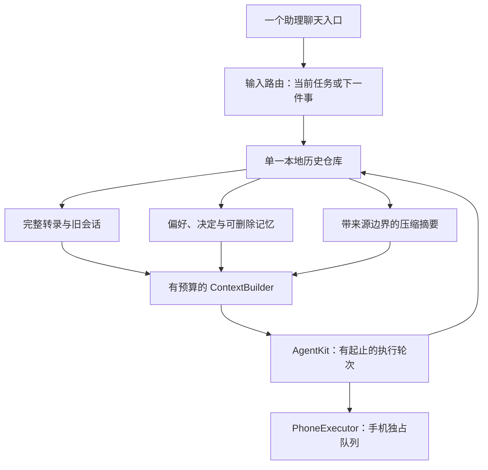

# 单入口与长期记忆技术方案

> 状态：设计中，推荐路线尚未实现
>
> 最后核对：2026-10-14
>
> 面向读者：PocketAgent iOS、AgentKit 集成与测试开发者
>
> 范围：同一个助理入口，跨天延续对话与记忆；复用现有手机执行链路
>
> 源码基线：`devicehub-control`，`abae3f67bd66f2434662a24251058fdaddee1227`

## 1. 需求与关联资料

用户确认目标为“单入口＋长期记忆”：再次打开 App 时直接回到同一个助理，换话题、换模型和跨天使用时仍能找回相关偏好与之前的决定。现有 PocketAgent 的主组织单位是独立会话，每条会话分别保存历史、模型和项目。推荐将产品入口收敛为一条主线，同时保留内部执行轮次、可检索的历史和独立的长期记忆。长期连续性来自数据与上下文管理，每轮仍是有起止的执行。首版沿用本机运行方式，不依赖常驻服务器。

| 类型 | 链接 | 说明 |
|---|---|---|
| 需求真源 | 用户于 2026-10-14 在本次探索中确认“单入口＋长期记忆” | 尚无独立需求文档 |
| Figma | 不涉及 | 先定义信息架构；实现阶段补界面稿 |
| 当前工程设计 | [engineering.md](engineering.md) | 历史完整性、配置冻结、动作队列、同步边界 |
| 手机后端设计 | [devicehub-control.md](devicehub-control.md) | DDI 默认与 WDA 可选的现有能力 |
| Muse | [Meta 官方介绍](https://about.fb.com/news/2026/09/introducing-muse-personal-ai-agent/) | 记住偏好与目标、长期协助的产品方向 |
| Grok Bot | [Grok Bot 101](https://x.ai/bot/guides/grok-bot-101) | 持续使用的助理、持久执行环境与 routines |
| OpenAI dot | [OpenAI Docs：Tasks and memory](https://learn.chatgpt.com/docs/dots/tasks-and-memory) | 一个助理协调多项责任；对话上下文与持久笔记分开 |
| iOS 生命周期 | [Apple：BGContinuedProcessingTaskRequest](https://developer.apple.com/documentation/backgroundtasks/bgcontinuedprocessingtaskrequest) | 用户在前台发起、可继续到后台的工作 |

本次交付是源码调研与可实施方案，不修改 App 行为。主动提醒、定时监控、持续语音和离开 App 后全天候工作属于后续扩展，没有被本次需求确认。

## 2. 技术调研结论

推荐采用“固定主会话＋完整历史＋独立长期记忆＋有预算的模型上下文”，保留当前 SwiftUI、AgentKit 和 PhoneExecutor。优先补齐宿主集成，无须先替换 AgentKit、引入向量数据库或搭建云端 agent。

1. 单入口先改变导航与默认落点；已有会话原样保留在历史入口，避免为了表面统一而拼接不同任务的工具转录。
2. 完整历史用于回看与检索，模型只接收相关记忆、压缩摘要和近期消息。不能无限重发整条历史，也不能用摘要覆盖原始消息。
3. 当前锁定的 AgentKit 已具备记忆和压缩原语，PocketAgent 尚未接入。核心工作是持久化、能力注册、预算控制和用户可见的记忆管理。
4. 首版仍按单轮串行执行。运行中输入要能表达“补充这件事”与“下一件事”，防止所有新话题都被当成 steering。
5. 单设备先交付体验；现有同步可继续保留历史，但“双设备共享同一个可并发编辑主线”需要额外定义，不能靠隐藏冲突副本实现。

调研详情、源码落点与拒绝方案

### 参照产品的可借鉴部分

| 产品 | 官方资料支持的特征 | 本项目采纳的部分 |
|---|---|---|
| Muse | 记住个人偏好；目标可以持续推进，后台工作依赖其云端环境 | 同一助理的长期连续性与可删除记忆 |
| Grok Bot | 持久云端电脑；聊天、routines、事件触发；可组合多个 bot | 对话入口与执行工作的分离，不要求首版复刻其后台服务 |
| OpenAI dot | 同一对话可切换任务；任务有各自上下文；持久笔记不同于完整转录 | 主线对话、任务状态、长期记忆分别管理 |

以上是对官方公开产品行为的归纳，不是这些产品内部实现的审计。推荐架构是根据 PocketAgent 源码作出的设计判断。

### 当前能力与具体缺口

会话/同步清单来源：peer；下列决定性落点已由主会话复核源码。

| 当前事实 | 源码位置（基线行号） | 对目标的影响 |
|---|---|---|
| 侧栏列出会话，右上角创建会话，模型/项目按会话选择 | `App/ChatRootView.swift:107-144` | 导航可以局部改造；模型切换无需创建新主线 |
| 启动恢复选中会话，本地历史为单个原子 JSON 文件 | `App/ChatSessions.swift:96-119,182-186` | 已有持久历史，需新增稳定主线身份与派生状态 |
| ChatJob 冻结历史、附件、模型配置、手机后端和项目 | `App/ChatSessions.swift:23-50` | 压缩、检索与模型选择必须遵守同样的入队边界 |
| 正在执行时 send 直接调用 steer | `App/ChatSessions.swift:366-372,411-442` | 单入口中应明确输入目标，避免独立请求串入当前任务 |
| 所有发送进入 queuedPhone，并受 foreground、engine.busy 控制 | `App/ChatSessions.swift:408,459-486` | 当前串行的是整个执行轮次；纯聊天/网络也不会天然并行 |
| 历史附件 hydration 限制图片数量，但文字从全部 prior 传入 | `App/Core/Attachments.swift:159-184` | 已有图片预算，缺少长期文字上下文预算 |
| 每轮新建 AgentRuntime，未传持久 repository、memory store 或自定义 context pipeline | `App/PhoneAgent.swift:71-92` | AgentKit 的可用能力不等于宿主已有长期记忆 |
| 模型构造只指定输入能力与 4096 输出 token，未传上下文窗口 | `App/Core/ProviderConfig.swift:144-165` | 自动压缩不能假定所有自定义模型的窗口大小 |
| 迁移保留真实 ID；进行中的状态变 interrupted；按调用修复结果邻接 | `App/Core/ChatHistory.swift:123-180` | 主线迁移不能排序重写消息或恢复执行旧动作 |
| 同 ID 历史是前缀时选较长，否则保存冲突副本 | `App/Core/PortableSync.swift:286-307` | 两设备并发追加同一主线会产生分支，现有算法没有统一时间线语义 |
| SwiftUI 懒加载行，但先为完整消息构造渲染项与进度 | `App/ChatTranscriptView.swift:17-52` | 长历史仍需窗口化；LazyVStack 不会消除全量预处理成本 |

### 可直接复用的 AgentKit 原语

已核实项目锁定的 `8108c9bb87c546860cfc1769571e115af919fe8a` 源码，依赖 checkout 无本地改动；没有依赖最新版本的未核实 API。

- [AgentCompaction / AgentCompactionService](https://github.com/AkinoKaede/AgentKit/blob/8108c9bb87c546860cfc1769571e115af919fe8a/Sources/AgentKit/Runtime/AgentCompactionService.swift)：安全切分历史、保留近期预算、限制摘要输入中的工具输出，并用无工具模型调用生成摘要。`shouldCompact` 在未知窗口时返回 false，宿主需要明确预算来源。
- [AgentContextPipeline](https://github.com/AkinoKaede/AgentKit/blob/8108c9bb87c546860cfc1769571e115af919fe8a/Sources/AgentKit/Runtime/AgentContextPipeline.swift)：只变换发送给模型的上下文，不改写保留的历史。默认 chat pipeline 修复工具语法并重放上下文快照，没有自动长期摘要。
- [AgentMemoryAccessing / AgentMemoryState](https://github.com/AkinoKaede/AgentKit/blob/8108c9bb87c546860cfc1769571e115af919fe8a/Sources/AgentKit/Core/AgentMemory.swift)：宿主提供读写与会话搜索；内置文本检索可作为首版起点。
- [MemoryTool / MemorySearchTool / SessionSearchTool](https://github.com/AkinoKaede/AgentKit/blob/8108c9bb87c546860cfc1769571e115af919fe8a/Sources/AgentKit/Tools/BuiltIn/Skills/AgentMemoryTools.swift)：持久事实更新、按需取回相关事实和历史窗口。需要在 PocketAgent 的工具注册与策略中显式接入。
- [AgentMemoryLearningService](https://github.com/AkinoKaede/AgentKit/blob/8108c9bb87c546860cfc1769571e115af919fe8a/Sources/AgentKit/Services/AgentMemoryLearningService.swift)：从有预算的对话窗口提取记忆操作；仍需宿主决定何时调用、如何审核与持久化。

### Rejected alternatives

- 只删除“新会话”按钮并永远重发历史：缺少文字预算、记忆检索和长期性能控制，无法完成目标。
- 把旧会话按时间拼成一条，或用摘要替换原文：破坏任务上下文、工具邻接或可回溯性；旧会话通过检索访问。
- 首版引入云端常驻 agent、向量数据库或新的执行框架：当前目标不依赖这些能力，增加运维、同步与迁移范围。

## 3. 技术方案总括

由一个主会话承接用户输入，历史与记忆仍由本地单一历史仓库持有。ContextBuilder 为每轮组装固定规则、当前任务信息、相关长期记忆、有效摘要和近期完整消息，AgentKit 执行当前轮次，PhoneExecutor 保持独占手机资源。模型可主动搜索更早记录；检索结果只提供事实参考，不构成执行授权。用户关闭 App 后再回来，恢复的是关系、历史与状态，已中断的手机动作仍需新指令与新观察。

详细落地方案与验证边界

### 信息架构与旧数据

- 首屏直接打开稳定的主会话，标题使用助理名称；删除主界面的新会话按钮。
- 原会话侧栏改成“历史 / 记忆 / 设置”。旧会话可阅读、检索和显式继续，不自动拼入主线；冲突副本有可见入口。
- 在 HistoryFile 内保存 `assistantProfile` 与 `primarySessionID`，将主线身份和原始记录一起原子写入；不要把它仅存为临时 selectedID。
- 当前设备的一次升级默认继续升级前有效的选中会话，并固化为主线；没有历史时只创建一次新主线。selectedID 仍可用于临时浏览旧记录，重启回主线。
- 单设备 MVP 的主线选择是本地状态，不声明它已实现多设备统一身份。需跨设备共享时再定义 portable assistant identity 与选择规则。
- 保留现有会话/消息 ID、顺序、内容、草稿、附件引用、归属和 provider 配置。迁移只针对当前安装数据的一次升级；不扩大已被用户取消的一般多版本兼容工程。

### 数据模型与存储 owner

新增类型均为设计建议，当前源码不存在：

| 模型 | 内容 | 持久化与生命周期 |
|---|---|---|
| AssistantProfile | 稳定助理身份、主线会话 ID、展示名称 | 本地 HistoryFile；首版不自动同步 |
| MemoryEntry | 偏好/决定/长期约束，来源消息 ID、作用域、更新时间、删除状态 | 与历史同一原子文件；默认本地 |
| CompactionRecord | 会话 ID、摘要、覆盖的消息边界与前缀散列、生成配置版本 | 仅为派生上下文；原始转录始终保留 |
| TurnRecord | prompt ID、run ID 映射、关联任务、终态 | 描述执行结果，不保存可重放动作或凭证 |
| PendingIntent | 后续请求的原始消息 ID、待用户继续状态 | 可保存请求；重启不恢复自动执行队列 |

由现有 ChatController 的持久化边界演进出一个 HistoryStore，提供主线程快照及满足 `AgentMemoryAccessing` 的 actor 安全适配。适配器将修改交回同一个 owner，不建立第二套 AgentKit JSON 历史仓库。新增重要字段用明确版本升级，未知版本继续拒绝覆盖。全文索引、显示窗口和摘要缓存均可重建，不能成为另一份事实源。

历史检索首版采用有界文本搜索与分页窗口，支持中文短词和同语言关键词；AgentKit 内置匹配需用中文跨天检索样例评估，若效果不足再扩展索引。是否需要 SQLite/FTS 或语义向量由实际召回和数据规模决定，不预先替换单一原子文件约束。

### 上下文与压缩

1. 在接受轮次时冻结历史边界、模型、凭证、项目、后端与输入图片，沿用 ChatJob 的现有语义。
2. ContextBuilder 使用已核实或用户明确配置的模型窗口，并预留规则、工具 schema、图片和输出开销。未知窗口提供显式预算配置/手动压缩，不能依赖 `shouldCompact` 自动工作，也不能把字符估算称为精确 token 计数。
3. 达到预算时调用 `AgentCompaction.cutIndex` 选安全边界，使用无工具摘要调用。保存摘要及覆盖边界，下一轮发送摘要＋近期原文；摘要不作为真实用户消息追加，不改变原 ID。
4. 对长执行轮次也在每次模型请求边界检查预算；仅在轮次结束时压缩无法防止一轮内大量工具结果超窗。宿主模型适配层负责异步摘要准备，同步 context pipeline 负责应用已准备的投影。
5. 异步摘要提交前核对来源前缀散列。发生同步分叉、删除或内容变更就使摘要失效并重建；新输入仍按 steering 的交付顺序进入当前轮次。
6. 摘要失败保留原文与已完成动作，报告无法继续组装上下文；不静默删历史，不重跑手机工具。更早细节通过 SessionSearchTool 取回，并注明来源会话/消息。
7. UI 只构建当前可见的近期窗口，向上分页；长历史的完整落盘仍保持单文件，先测量写入耗时和内存，再决定是否需要调整全局存储约束。

### 长期记忆

- 注册 memory、memory_search、session_search，并扩展 ToolCatalog 的实际能力/策略；当前注册器不会因为 AgentKit 提供这些类型就自动暴露它们。
- “记住……”和“忘记……”是首版明确入口；可用 learning service 生成持续偏好候选，但不从一次性工具输出自动提炼全局事实。
- 记忆区分全局个人偏好、项目决定、暂时任务信息；跨项目检索过滤作用域。来源、时间和有效性必须可查看、可编辑、可删除。
- 手机 node、snapshot_id、前台状态、坐标和暂时登录状态留在执行上下文中，每轮重新观察；不把它们记为长期可执行事实。
- 摘要记录短期进展，记忆保存长期事实；不能把“模型曾声称成功”提升为实际完成结果。决策和当前请求以用户最新表达为准。
- “忘记这条记忆”删除条目并保留删除标记，同时失效相关摘要/索引并抑制自动重新学习；“删除历史”是独立数据操作。单纯删除一条记忆而继续原样注入旧摘要不足以实现遗忘。
- 记忆默认本地，不把 Keychain、配对记录、设备配置或本地照片字节加入 portable snapshot。用户手动清理和忘记操作应能阻止 stale snapshot 将内容重新带回。

### 执行中继续聊天

保留当前“追加给当前任务”的能力，并在执行期间提供轻量输入目标：“当前任务 / 下一件事”。只有面向当前任务的输入调用 steer；独立请求形成 PendingIntent，在当前轮结束且前台可运行时，以新的冻结配置和上下文进入下一轮。轮次之间释放手机与清理资源。首版维持一个运行槽，避免为长期聊天同时引入并行工具、多个前台手机 owner 或后台任务系统。

清晰的“取消当前任务”只取消其 run；历史、长期记忆与后续请求继续保留。App 重启时运行/排队任务按现有规则标记 interrupted，等待用户继续；保存待办描述不意味着允许重放动作。

### 同步与平台边界

| 端/共享层 | 是否受影响 | 原因与兼容 |
|---|---|---|
| PocketAgent iOS | 受影响 | UI、HistoryFile、上下文投影与本地记忆；新版本一次迁移当前安装数据 |
| AgentKit | 适配层受影响 | 复用固定 revision 的公共接口，首版不要求升级依赖 |
| iCloud portable sync | 主线体验需评估 | 现有历史/冲突保留规则继续生效；首版不新增记忆同步，不承诺双设备并发主线自动合并 |
| Looktech Android/iOS App | 不受影响 | 本次仅改 PocketAgent 的助理组织方式，不改眼镜业务或 App↔设备协议 |
| 蓝牙/ISP/Wi-Fi 固件 | 不受影响 | 不改变固件通信、媒体或电源契约 |
| schema / rpc / lt-vad | 不受影响 | 无共享消息、音频算法或 binding 变化 |

后续跨设备统一主线要先确定写入协调和冲突可见性。可考虑按内部任务保留独立分支、主入口聚合其结果；如果引入服务器，则可由服务器顺序化。继续采用现有同 session 前缀合并时，必须如实展示冲突，不能按时间拼接工具结果。Portable schema 如新增助理身份/记忆需显式版本化、保持删除语义和当前版本客户端兼容窗口；只升级单个客户端不能被当作已完成跨设备迁移。

Apple 将当前后台 API 定义为前台用户动作发起的工作延续；本项目同时有 600 秒 watchdog 和系统 expiration 取消处理（`App/PhoneAgent.swift:83-87,138-154`）。它满足有限轮次延续的用途，不能被当作全天候调度设施。以后若加入主动跟进，可让受授权的云端/常在线 Mac 处理外部信息与提醒；手机动作仍需本机能力检查和新的屏幕观察。此扩展不阻塞本次单入口与记忆目标。

### 当前模块到目标模块

| 模块 | 关系 | 具体改造 |
|---|---|---|
| ChatRootView / ChatComposer | 迁移 | 固定主线入口、历史/记忆面板、执行期输入目标 |
| ChatTranscriptView / ChatPolicies | 扩展 | 有界显示窗口、日期/任务锚点，保留工具行与原消息顺序 |
| ChatSessions / ChatHistory | 扩展 | HistoryStore、主线身份、记忆/摘要、轮次映射与一次升级 |
| ProviderConfig / ProviderStore | 扩展 | 可验证/可配置的上下文预算，入队时冻结 |
| PhoneAgent / ToolCatalog | 扩展 | 记忆与历史搜索工具、模型请求预算层、摘要投影 |
| AgentRunner / PhoneExecutor / Native | 保持 | 后台生命周期、串行动作、fresh snapshot、取消与不重放 |
| PortableSync / CloudSync | 首版保持核心规则 | 显示已有冲突；新增 portable 语义另行实现与验证 |

### 验证范围

本次已完成源码与固定 AgentKit revision 的静态核对，未运行新的 App 构建、安装、iCloud 或实机验收；上表均是设计，不能描述为已交付功能。

实现时需覆盖：当前安装数据的一次升级保留；重启回到主线；模型切换不丢记忆；跨天偏好/决定检索；中文关键词；忘记后不被摘要重新注入；一轮内与跨轮压缩不破坏工具邻接；摘要失败不重放；新请求和 steering 分流；长历史滚动/落盘性能；同步分叉仍可见。交付沿用 core tests、iOS build、IPA inspection 和指定真实设备 exercise。新增 portable 语义再增加真实 iCloud/双设备验证，不为只读设计运行无关构建。

## 4. 资源与交付计划

推荐顺序为主线与迁移 → 上下文预算/压缩 → 记忆/历史检索 → 执行期输入分流与整体验证。四项组成单设备 MVP；多设备统一身份与主动后台工作单独规划。

| 需求模块 | 端/仓库 | 负责人 | 预计人日 | 开发分支 | 预期版本 | 提测时间 | 状态/最后核对 | 依赖 |
|---|---|---|---|---|---|---|---|---|
| 主线导航、显示窗口、一次数据迁移 | PocketAgent iOS | 待确认 | 待估算 | 待确认 | 待确认 | 待确认 | 设计中；2026-10-14 | 主线身份定义 |
| 请求预算、压缩与来源失效 | PocketAgent / AgentKit 适配 | 待确认 | 待估算 | 待确认 | 待确认 | 待确认 | 设计中；2026-10-14 | 模型窗口配置、HistoryStore |
| 本地长期记忆与旧历史检索 | PocketAgent iOS | 待确认 | 待估算 | 待确认 | 待确认 | 待确认 | 设计中；2026-10-14 | 原子存储、scope/遗忘语义 |
| 当前任务/下一件事分流、交付验证 | PocketAgent iOS | 待确认 | 待估算 | 待确认 | 待确认 | 待确认 | 设计中；2026-10-14 | 轮次映射、已有手机队列 |
| 双设备统一主线 / 记忆同步 | PocketAgent sync | 待确认 | 待估算 | 待确认 | 待确认 | 待确认 | 后续扩展 | portable 协议、并发协调 |
| 主动跟进与持续语音 | 待确认 | 待确认 | 待估算 | 待确认 | 待确认 | 待确认 | 未纳入本次需求 | 新的运行与授权设计 |

已确认的用户选择：单入口＋长期记忆。可由实现者自行解决：上述本地存储、上下文、检索与输入路由。后续仅用户可决定的范围：是否增加主动跟进、持续语音与云端数据托管；这些选择不阻塞当前推荐路线。暂无新运行故障的根因结论，本次记录的是已确认的源码能力与目标缺口。
