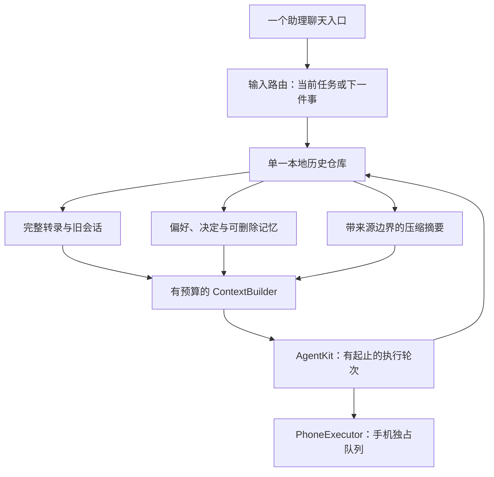

# 单入口与长期记忆技术方案

> 状态：公开资料与固定版本源码调研已完成；实现方案仍在设计中
>
> 最后核对：2026-10-14
>
> 面向读者：PocketAgent iOS、AgentKit 集成与测试开发者
>
> 范围：同一个助理入口，跨天延续对话与记忆；复用现有手机执行链路
>
> 源码基线：`devicehub-control`，`abae3f67bd66f2434662a24251058fdaddee1227`

## 1. 需求与关联资料

用户确认目标为“单入口＋长期记忆”：再次打开 App 时直接回到同一个助理，换话题、换模型和跨天使用时仍能找回相关偏好与之前的决定。现有 PocketAgent 的主组织单位是独立会话，每条会话分别保存历史、模型和项目。推荐将产品入口收敛为一条主线，同时保留内部执行轮次、可检索的历史和独立的长期记忆。长期连续性来自数据与上下文管理，每轮仍是有起止的执行。首版沿用本机运行方式，不依赖常驻服务器。

| 类型 | 链接 | 说明 |
|---|---|---|
| 需求真源 | 用户于 2026-10-14 在本次探索中确认“单入口＋长期记忆” | 尚无独立需求文档 |
| Figma | 不涉及 | 先定义信息架构；实现阶段补界面稿 |
| 当前工程设计 | [engineering.md](engineering.md) | 历史完整性、配置冻结、动作队列、同步边界 |
| 手机后端设计 | [devicehub-control.md](devicehub-control.md) | DDI 默认与 WDA 可选的现有能力 |
| Muse | [Meta 官方介绍](https://about.fb.com/news/2026/09/introducing-muse-personal-ai-agent/) | 记住偏好与目标、长期协助的产品方向 |
| Grok Bot | [Grok Bot 101](https://x.ai/bot/guides/grok-bot-101) | 持续使用的助理、持久执行环境与 routines |
| OpenAI dot | [OpenAI Docs：Tasks and memory](https://learn.chatgpt.com/docs/dots/tasks-and-memory) | 一个助理协调多项责任；对话上下文与持久笔记分开 |
| OpenClaw | [Home 主会话](https://github.com/openclaw/openclaw/blob/ddaa0bd2b0dd077c946ace62a4b87383f032e26e/docs/concepts/main-session.md) | 固定版本文档与 TypeScript 源码核验 |
| Hermes Agent | [Persistent Memory](https://github.com/NousResearch/hermes-agent/blob/d97007c32d6340f7ba79ac1dfb5773cc00846448/website/docs/user-guide/features/memory.md) | 固定版本文档与 Python 源码核验 |
| iOS 生命周期 | [Apple：BGContinuedProcessingTaskRequest](https://developer.apple.com/documentation/backgroundtasks/bgcontinuedprocessingtaskrequest) | 用户在前台发起、可继续到后台的工作 |

用户最新要求是“先做好调研”。本次交付是公开资料与固定版本源码调研；下文的实现建议保留为待讨论设计，不修改 App 行为。主动提醒、定时监控、持续语音和离开 App 后全天候工作属于后续扩展，没有被本次需求确认。

## 2. 公开项目调研与结论

调研确认这些项目都把持续使用的助理、当前工作上下文、持久记忆和历史记录分层管理。OpenClaw 当前直接提供 Home 主会话；Hermes 则更强调小容量个人记忆、按需历史检索和会话边界。Muse、Grok Bot、OpenAI dot 的公开信息能支持产品与部分运行架构判断，本次未取得三者完整的会话/记忆 harness 源码，不能据此声称复刻其内部算法。

1. 产品上的连续性可以由稳定助理身份和一个聊天入口承接。工作上下文可以原位压缩或在明确边界重建；后台 session ID 的生命周期不是产品入口的定义。
2. OpenClaw 是单入口交互的直接参考；Hermes 的小型偏好记忆＋历史按需检索更适合作为 PocketAgent 本机实现的参考。两者都保留压缩前记录供历史访问。
3. 当前两个固定版本都支持原位压缩；Hermes 当前默认 `in_place=true`。没有依据要求 PocketAgent 在每次压缩时建立新 session，也不应按旧教程默认每日清空。
4. 记忆学习、历史检索和压缩分别有触发与预算。保存事实由实际工具写入完成；记忆文件、摘要或模型声称“已记住”不能互相替代。
5. PocketAgent 已有固定 AgentKit 的记忆/压缩原语。下文保留适配建议供后续讨论；按用户“先做好调研”的要求，当前不开始实现，不引入新的后台服务。

公开资料、固定版本源码与差异核验

### 核验方法与证据范围

- 商业产品只采用官方产品文档、研究文章与官方仓库；不把泄露提示词、同名社区项目或模型的自述当作内部实现证据。
- OpenClaw 核验固定提交 [`ddaa0bd2b0dd077c946ace62a4b87383f032e26e`](https://github.com/openclaw/openclaw/commit/ddaa0bd2b0dd077c946ace62a4b87383f032e26e)，提交日期 2026-10-13。
- Hermes Agent 指 [NousResearch/hermes-agent](https://github.com/NousResearch/hermes-agent)，核验固定提交 [`d97007c32d6340f7ba79ac1dfb5773cc00846448`](https://github.com/NousResearch/hermes-agent/commit/d97007c32d6340f7ba79ac1dfb5773cc00846448)，提交日期 2026-10-13；与同名模型、其他 Hermes 项目区分。
- 两个开源清单初稿来源：peer；主会话复核路由/reset、默认压缩、记忆快照刷新和搜索等决定性源码。未安装、执行或连接用户部署，结论属于静态实现核验。

### 公开程度与共同思路

| 项目 | 本次获得的公开信息 | 连续性来自什么 | 尚未核实的边界 |
|---|---|---|---|
| Muse | 官方产品说明、安全运行架构、模型与硬件 SDK 公开资料 | 同一用户的 VM、文件/记忆、持久应用状态、子任务 | 具体记忆提炼、检索与压缩算法；完整个人助理 harness |
| Grok Bot | 官方 Bot 管理、聊天、电脑/任务文档 | 命名 Bot 的角色、偏好和工作摘要；持久云端电脑 | 记忆 schema、压缩触发、历史合并源码 |
| OpenAI dot | OpenAI Docs 的任务、记忆和跨渠道行为说明 | 同一 dot 的持久笔记；工作任务各自有上下文 | 笔记生成/召回和内部 session 生命周期源码 |
| OpenClaw | 官方文档与本次固定版本 TypeScript 源码 | Home 主会话、SQLite transcript、Markdown 记忆、检索和压缩 | 实际部署参数、长期召回质量与运行可靠性 |
| Hermes Agent | 官方文档与本次固定版本 Python 源码 | 稳定聊天路由、SQLite 历史、小容量个人记忆、原位压缩 | 用户部署行为、记忆学习及中文检索实际质量 |

### Muse：公开了真实运行架构，记忆算法披露仍有限

[Meta 的安全架构文章](https://research.meta.ai/blog/security-and-safety-for-ai-agents-our-approach-with-muse)说明客户端连接用户专属 VM；Hatch harness 与用户工作区位于 runtime container，持久应用状态位于独立 Postgres，凭证与外部动作控制在另外的服务中。文章也说明用户可查看、编辑、下载自己的文件与记忆，VM 可承载并发子 agent 和 cron。这里“机器内存/RAM”与“助理记忆”需要分别理解。

[Muse Wonder 官方介绍](https://about.fb.com/news/2026/10/introducing-muse-wonder-models/)于 2026-10-12 将 Active Memory 描述为跨对话保留重要信息并取回相关细节。这是公开能力描述，未说明记忆库 schema、召回索引、摘要边界或写入策略；不能据此认定记忆通过模型权重在线学习。

存在可核实的官方开放材料：[Muse Glimmer 开放模型权重](https://research.meta.ai/blog/introducing-muse-glimmer-open-agentic-model)与 [Muse Gadget SDK](https://github.com/facebookincubator/muse-gadget-sdk)。后者是 ESP32/Linux 硬件接入 SDK 和固件。它们分别提供模型或设备接入能力；本次没有在这些资料中拿到 Muse 个人助理完整的会话/长期记忆实现。

### Grok Bot：长期身份以 Bot 为单位，可有多个角色

[官方 overview](https://docs.x.ai/grok-bot/overview)说明同一账户的 Bots 共享云端电脑与文件/浏览器登录状态，但每个 Bot 的会话和学习上下文独立，记忆内容包括稳定偏好、角色信息和过往工作摘要。[Bot 管理文档](https://docs.x.ai/grok-bot/bots)把持久描述和任务消息区分，也明确复制 Bot 配置不复制其聊天历史与学习记忆。

因此可借鉴的是“固定助理身份拥有记忆，具体任务有范围”；该产品本身允许多个 Bot 和群聊，公开资料并没有要求一个账户只能有一条永久对话。[聊天文档](https://docs.x.ai/grok-bot/chat-and-collaboration)支持执行中继续发送指令、按消息回应和调整优先级。公开文档未给出其内部记忆更新和压缩实现。

### OpenAI dot：持久笔记与工作上下文明确分开

[OpenAI Docs：Tasks and memory](https://learn.chatgpt.com/docs/dots/tasks-and-memory)说明 dot 使用当前对话、相关 ChatGPT memory 和自己的持久笔记；笔记包含偏好、决定与进行中的工作，属于选取的信息，不是完整转录。它可以在同一对话中协调多项工作，任务有自己的上下文，不自动接收用户全部历史。跨渠道访问同一个 dot 会延续笔记，但不同渠道的可见消息仍分别保留。

这直接支持“一个助理入口＋按需上下文”的产品方向。公开说明不足以确认其内部如何做 token 预算、记忆写入、摘要持久化和冲突处理。

### OpenClaw：Home 长期主会话是当前直接参考

1. **稳定入口。** [main-session 文档](https://github.com/openclaw/openclaw/blob/ddaa0bd2b0dd077c946ace62a4b87383f032e26e/docs/concepts/main-session.md#L10-L28)把 Home 定义为个人助理默认入口，默认 DMs 汇入 `agent:<agentId>:main`，其他任务可在独立 threads 中工作并返回结果。源码 [DM routing](https://github.com/openclaw/openclaw/blob/ddaa0bd2b0dd077c946ace62a4b87383f032e26e/src/routing/session-key.ts#L215-L252)的默认 scope 是 main；[reset-policy.ts](https://github.com/openclaw/openclaw/blob/ddaa0bd2b0dd077c946ace62a4b87383f032e26e/src/config/sessions/reset-policy.ts#L26-L28)的默认 reset mode 为 none，daily/idle 是配置选择。
2. **当前存储。** [官方 store 文档](https://github.com/openclaw/openclaw/blob/ddaa0bd2b0dd077c946ace62a4b87383f032e26e/docs/reference/session-management-compaction/store.md#L9-L12)说明 session rows 与 transcript events 均位于每 agent 的 SQLite；历史有边界/树结构，包含原消息、工具结果和摘要。[SQLite 路径解析](https://github.com/openclaw/openclaw/blob/ddaa0bd2b0dd077c946ace62a4b87383f032e26e/src/config/sessions/session-sqlite-target-paths.ts#L17-L46)与此一致。旧 JSONL/`sessions.json` 是迁移或归档材料，不能用旧教程代替当前运行时说明。
3. **分层记忆。** [memory 文档](https://github.com/openclaw/openclaw/blob/ddaa0bd2b0dd077c946ace62a4b87383f032e26e/docs/concepts/memory.md#L20-L58)区分小型 USER.md、策展后的 MEMORY.md 和详细 daily notes。日记用于按需检索，近期日记可在 reset 后重新加载；完整日记不在每轮全量注入。
4. **检索能力。** 默认 plugin slot 是 [memory-core](https://github.com/openclaw/openclaw/blob/ddaa0bd2b0dd077c946ace62a4b87383f032e26e/src/plugins/slots.ts#L17-L20)。[搜索实现](https://github.com/openclaw/openclaw/blob/ddaa0bd2b0dd077c946ace62a4b87383f032e26e/extensions/memory-core/src/memory/manager-search-orchestration.ts#L398-L430)具备 keyword-only 分支；后续 [vector 与 hybrid 排序](https://github.com/openclaw/openclaw/blob/ddaa0bd2b0dd077c946ace62a4b87383f032e26e/extensions/memory-core/src/memory/manager-search-orchestration.ts#L512-L568)按配置与实际 provider 可用性工作。可选 LanceDB plugin 是另一种 memory provider，不能据此称默认实现必须依赖 LanceDB。
5. **学习与压缩。** [flush-plan 源码](https://github.com/openclaw/openclaw/blob/ddaa0bd2b0dd077c946ace62a4b87383f032e26e/extensions/memory-core/src/flush-plan.ts#L12-L28)给 pre-compaction flush 设定当天 daily note 的追加目标，并将 bootstrap 文件设为只读。Flush 是阈值维护；[dreaming consolidation](https://github.com/openclaw/openclaw/blob/ddaa0bd2b0dd077c946ace62a4b87383f032e26e/docs/concepts/memory.md#L51-L58)另行整理有用信息。写日记、整理长期记忆和摘要当前上下文是不同流程。

**本版文档差异：** main-session 文档称 reset 分配新的 live session ID；但 [session 初始化源码](https://github.com/openclaw/openclaw/blob/ddaa0bd2b0dd077c946ace62a4b87383f032e26e/src/auto-reply/reply/session.ts#L570-L583)对普通 durable session 沿用 transcript identity，并 [建立 reset boundary](https://github.com/openclaw/openclaw/blob/ddaa0bd2b0dd077c946ace62a4b87383f032e26e/src/auto-reply/reply/session.ts#L746-L753)。ACP 等路径可轮转。因此此研究采用“工作上下文重置、历史保留”的语义，不声称每次 reset 必换物理 ID。未运行重置复现，这属于源码与文档的范围差异核验。

### Hermes Agent：小型个人记忆与真实历史检索

1. **连续入口。** [gateway session key](https://github.com/NousResearch/hermes-agent/blob/d97007c32d6340f7ba79ac1dfb5773cc00846448/gateway/session.py#L685-L720)包含 profile、平台和聊天/thread 维度，每个稳定路由指向活跃工作 session。[显式 reset](https://github.com/NousResearch/hermes-agent/blob/d97007c32d6340f7ba79ac1dfb5773cc00846448/gateway/session.py#L1134-L1155)产生新 ID，并保留旧 parent。[用户文档](https://github.com/NousResearch/hermes-agent/blob/d97007c32d6340f7ba79ac1dfb5773cc00846448/website/docs/user-guide/features/memory.md#L59-L65)说明消息平台会话可跨重启持续，建议在自然任务边界 `/new`。
2. **小容量策展记忆。** [初始化代码](https://github.com/NousResearch/hermes-agent/blob/d97007c32d6340f7ba79ac1dfb5773cc00846448/agent/agent_init.py#L1297-L1334)的内置默认预算为 MEMORY.md 2,200 字符、USER.md 1,375 字符，可配置。超预算更新会拒绝，由模型整理条目。[memory tool](https://github.com/NousResearch/hermes-agent/blob/d97007c32d6340f7ba79ac1dfb5773cc00846448/tools/memory_tool.py#L374-L397)当前提供 add/patch/remove，而不是无边界堆积全部历史。
3. **更新触发。** 默认 nudge interval 为 10 个用户 turn；[turn 计数](https://github.com/NousResearch/hermes-agent/blob/d97007c32d6340f7ba79ac1dfb5773cc00846448/agent/turn_context.py#L753-L762)达到间隔后可启动后台 review，由模型决定是否实际调用 memory tool。公开的“学习”在这些已核验路径里体现为数据/工具操作，不代表每条消息都保存或模型权重持续训练。
4. **历史检索。** [`session_search` schema](https://github.com/NousResearch/hermes-agent/blob/d97007c32d6340f7ba79ac1dfb5773cc00846448/tools/session_search_tool.py#L651-L666)明确返回实际 SQLite 消息，无额外 LLM 摘要；[FTS5 结果处理](https://github.com/NousResearch/hermes-agent/blob/d97007c32d6340f7ba79ac1dfb5773cc00846448/tools/session_search_tool.py#L389-L431)允许按消息锚点继续读取。自动学习、历史搜索和上下文摘要不应合并为一个组件。
5. **当前默认原位压缩。** [`compression.in_place` 默认 true](https://github.com/NousResearch/hermes-agent/blob/d97007c32d6340f7ba79ac1dfb5773cc00846448/agent/agent_init.py#L1575-L1577)；[提交实现](https://github.com/NousResearch/hermes-agent/blob/d97007c32d6340f7ba79ac1dfb5773cc00846448/agent/conversation_compression.py#L3736-L3743)将旧消息 soft-archive，仍可检索，同时保存缩减后的活跃上下文。显式关闭 in_place 才使用可选的 parent→child 轮转路径；不能将旧版轮转描述为当前默认。

**本版记忆刷新边界：** [MemoryStore](https://github.com/NousResearch/hermes-agent/blob/d97007c32d6340f7ba79ac1dfb5773cc00846448/tools/memory_tool_store.py#L618-L621)在普通 turn 中使用冻结的 prompt snapshot，以保持缓存前缀。memory 文档说新写入在新 session 才注入；[prompt invalidation 源码](https://github.com/NousResearch/hermes-agent/blob/d97007c32d6340f7ba79ac1dfb5773cc00846448/agent/system_prompt.py#L808-L826)还在压缩边界重新加载记忆。因此“只能新 session 生效”范围不完整，普通 turn、成功压缩重建和新 session 应分别描述。PocketAgent 每轮创建 runtime，适合冻结当前轮并在下一轮重新取有效记忆。

### 相似性、差异与 PocketAgent 的取舍

共同模式可以归纳为四层：长期助理身份、有限工作上下文、持久事实/偏好、可追溯历史。原位压缩和切换工作段都是可能实现，连续 UI 不要求固定采用其中一个。主动调度依赖运行生命周期，应与记忆管理分开设计。

推荐借鉴 OpenClaw 的 Home 入口与历史窗口语义，借鉴 Hermes 的小型策展记忆＋按需取回原文，继续用现有 AgentKit 实现模型侧接口。先不复制 daily notes、dreaming、外部 memory provider 和多渠道 gateway 的全部复杂度，也不因为 OpenClaw 使用向量检索就把 embeddings 设为首版依赖。中文 FTS/文本与语义检索的实际召回需在实现阶段对照评估。

根许可证方面，本次固定版本的 [OpenClaw](https://github.com/openclaw/openclaw/blob/ddaa0bd2b0dd077c946ace62a4b87383f032e26e/LICENSE)与 [Hermes](https://github.com/NousResearch/hermes-agent/blob/d97007c32d6340f7ba79ac1dfb5773cc00846448/LICENSE)均为 MIT。此处只确认仓库文件；本次不复制代码，若后续直接复用需核对具体文件、第三方依赖与 notice。

### 当前能力与具体缺口

会话/同步清单来源：peer；下列决定性落点已由主会话复核源码。

| 当前事实 | 源码位置（基线行号） | 对目标的影响 |
|---|---|---|
| 侧栏列出会话，右上角创建会话，模型/项目按会话选择 | `App/ChatRootView.swift:107-144` | 导航可以局部改造；模型切换无需创建新主线 |
| 启动恢复选中会话，本地历史为单个原子 JSON 文件 | `App/ChatSessions.swift:96-119,182-186` | 已有持久历史，需新增稳定主线身份与派生状态 |
| ChatJob 冻结历史、附件、模型配置、手机后端和项目 | `App/ChatSessions.swift:23-50` | 压缩、检索与模型选择必须遵守同样的入队边界 |
| 正在执行时 send 直接调用 steer | `App/ChatSessions.swift:366-372,411-442` | 单入口中应明确输入目标，避免独立请求串入当前任务 |
| 所有发送进入 queuedPhone，并受 foreground、engine.busy 控制 | `App/ChatSessions.swift:408,459-486` | 当前串行的是整个执行轮次；纯聊天/网络也不会天然并行 |
| 历史附件 hydration 限制图片数量，但文字从全部 prior 传入 | `App/Core/Attachments.swift:159-184` | 已有图片预算，缺少长期文字上下文预算 |
| 每轮新建 AgentRuntime，未传持久 repository、memory store 或自定义 context pipeline | `App/PhoneAgent.swift:71-92` | AgentKit 的可用能力不等于宿主已有长期记忆 |
| 模型构造只指定输入能力与 4096 输出 token，未传上下文窗口 | `App/Core/ProviderConfig.swift:144-165` | 自动压缩不能假定所有自定义模型的窗口大小 |
| 迁移保留真实 ID；进行中的状态变 interrupted；按调用修复结果邻接 | `App/Core/ChatHistory.swift:123-180` | 主线迁移不能排序重写消息或恢复执行旧动作 |
| 同 ID 历史是前缀时选较长，否则保存冲突副本 | `App/Core/PortableSync.swift:286-307` | 两设备并发追加同一主线会产生分支，现有算法没有统一时间线语义 |
| SwiftUI 懒加载行，但先为完整消息构造渲染项与进度 | `App/ChatTranscriptView.swift:17-52` | 长历史仍需窗口化；LazyVStack 不会消除全量预处理成本 |

### 可直接复用的 AgentKit 原语

已核实项目锁定的 `8108c9bb87c546860cfc1769571e115af919fe8a` 源码，依赖 checkout 无本地改动；没有依赖最新版本的未核实 API。

- [AgentCompaction / AgentCompactionService](https://github.com/AkinoKaede/AgentKit/blob/8108c9bb87c546860cfc1769571e115af919fe8a/Sources/AgentKit/Runtime/AgentCompactionService.swift)：安全切分历史、保留近期预算、限制摘要输入中的工具输出，并用无工具模型调用生成摘要。`shouldCompact` 在未知窗口时返回 false，宿主需要明确预算来源。
- [AgentContextPipeline](https://github.com/AkinoKaede/AgentKit/blob/8108c9bb87c546860cfc1769571e115af919fe8a/Sources/AgentKit/Runtime/AgentContextPipeline.swift)：只变换发送给模型的上下文，不改写保留的历史。默认 chat pipeline 修复工具语法并重放上下文快照，没有自动长期摘要。
- [AgentMemoryAccessing / AgentMemoryState](https://github.com/AkinoKaede/AgentKit/blob/8108c9bb87c546860cfc1769571e115af919fe8a/Sources/AgentKit/Core/AgentMemory.swift)：宿主提供读写与会话搜索；内置文本检索可作为首版起点。
- [MemoryTool / MemorySearchTool / SessionSearchTool](https://github.com/AkinoKaede/AgentKit/blob/8108c9bb87c546860cfc1769571e115af919fe8a/Sources/AgentKit/Tools/BuiltIn/Skills/AgentMemoryTools.swift)：持久事实更新、按需取回相关事实和历史窗口。需要在 PocketAgent 的工具注册与策略中显式接入。
- [AgentMemoryLearningService](https://github.com/AkinoKaede/AgentKit/blob/8108c9bb87c546860cfc1769571e115af919fe8a/Sources/AgentKit/Services/AgentMemoryLearningService.swift)：从有预算的对话窗口提取记忆操作；仍需宿主决定何时调用、如何审核与持久化。

### Rejected alternatives

- 只删除“新会话”按钮并永远重发历史：缺少文字预算、记忆检索和长期性能控制，无法完成目标。
- 把旧会话按时间拼成一条，或用摘要替换原文：破坏任务上下文、工具邻接或可回溯性；旧会话通过检索访问。
- 首版引入云端常驻 agent、向量数据库或新的执行框架：当前目标不依赖这些能力，增加运维、同步与迁移范围。

## 3. 技术方案总括

由一个主会话承接用户输入，历史与记忆仍由本地单一历史仓库持有。ContextBuilder 为每轮组装固定规则、当前任务信息、相关长期记忆、有效摘要和近期完整消息，AgentKit 执行当前轮次，PhoneExecutor 保持独占手机资源。模型可主动搜索更早记录；检索结果只提供事实参考，不构成执行授权。用户关闭 App 后再回来，恢复的是关系、历史与状态，已中断的手机动作仍需新指令与新观察。

详细落地方案与验证边界

### 信息架构与旧数据

- 首屏直接打开稳定的主会话，标题使用助理名称；删除主界面的新会话按钮。
- 原会话侧栏改成“历史 / 记忆 / 设置”。旧会话可阅读、检索和显式继续，不自动拼入主线；冲突副本有可见入口。
- 在 HistoryFile 内保存 `assistantProfile` 与 `primarySessionID`，将主线身份和原始记录一起原子写入；不要把它仅存为临时 selectedID。
- 助理身份与入口指针分开：`primarySessionID` 表示当前主线落点，不要求所有内部运行永远共用一个工作上下文。首版可原位压缩；若以后增加 reset boundary 或工作段，仍保留助理身份、原始历史和可见连续性。
- 当前设备的一次升级默认继续升级前有效的选中会话，并固化为主线；没有历史时只创建一次新主线。selectedID 仍可用于临时浏览旧记录，重启回主线。
- 单设备 MVP 的主线选择是本地状态，不声明它已实现多设备统一身份。需跨设备共享时再定义 portable assistant identity 与选择规则。
- 保留现有会话/消息 ID、顺序、内容、草稿、附件引用、归属和 provider 配置。迁移只针对当前安装数据的一次升级；不扩大已被用户取消的一般多版本兼容工程。

### 数据模型与存储 owner

新增类型均为设计建议，当前源码不存在：

| 模型 | 内容 | 持久化与生命周期 |
|---|---|---|
| AssistantProfile | 稳定助理身份、主线会话 ID、展示名称 | 本地 HistoryFile；首版不自动同步 |
| MemoryEntry | 偏好/决定/长期约束，来源消息 ID、作用域、更新时间、删除状态 | 与历史同一原子文件；默认本地 |
| CompactionRecord | 会话 ID、摘要、覆盖的消息边界与前缀散列、生成配置版本 | 仅为派生上下文；原始转录始终保留 |
| TurnRecord | prompt ID、run ID 映射、关联任务、终态 | 描述执行结果，不保存可重放动作或凭证 |
| PendingIntent | 后续请求的原始消息 ID、待用户继续状态 | 可保存请求；重启不恢复自动执行队列 |

由现有 ChatController 的持久化边界演进出一个 HistoryStore，提供主线程快照及满足 `AgentMemoryAccessing` 的 actor 安全适配。适配器将修改交回同一个 owner，不建立第二套 AgentKit JSON 历史仓库。新增重要字段用明确版本升级，未知版本继续拒绝覆盖。全文索引、显示窗口和摘要缓存均可重建，不能成为另一份事实源。

历史检索首版采用有界文本搜索与分页窗口，支持中文短词和同语言关键词；AgentKit 内置匹配需用中文跨天检索样例评估，若效果不足再扩展索引。是否需要 SQLite/FTS 或语义向量由实际召回和数据规模决定，不预先替换单一原子文件约束。

### 上下文与压缩

1. 在接受轮次时冻结历史边界、模型、凭证、项目、后端与输入图片，沿用 ChatJob 的现有语义。
2. ContextBuilder 使用已核实或用户明确配置的模型窗口，并预留规则、工具 schema、图片和输出开销。未知窗口提供显式预算配置/手动压缩，不能依赖 `shouldCompact` 自动工作，也不能把字符估算称为精确 token 计数。
3. 达到预算时调用 `AgentCompaction.cutIndex` 选安全边界，使用无工具摘要调用。保存摘要及覆盖边界，下一轮发送摘要＋近期原文；摘要不作为真实用户消息追加，不改变原 ID。
4. 对长执行轮次也在每次模型请求边界检查预算；仅在轮次结束时压缩无法防止一轮内大量工具结果超窗。宿主模型适配层负责异步摘要准备，同步 context pipeline 负责应用已准备的投影。
5. 异步摘要提交前核对来源前缀散列。发生同步分叉、删除或内容变更就使摘要失效并重建；新输入仍按 steering 的交付顺序进入当前轮次。
6. 摘要失败保留原文与已完成动作，报告无法继续组装上下文；不静默删历史，不重跑手机工具。更早细节通过 SessionSearchTool 取回，并注明来源会话/消息。
7. UI 只构建当前可见的近期窗口，向上分页；长历史的完整落盘仍保持单文件，先测量写入耗时和内存，再决定是否需要调整全局存储约束。

### 长期记忆

- 注册 memory、memory_search、session_search，并扩展 ToolCatalog 的实际能力/策略；当前注册器不会因为 AgentKit 提供这些类型就自动暴露它们。
- “记住……”和“忘记……”是首版明确入口；可用 learning service 生成持续偏好候选，但不从一次性工具输出自动提炼全局事实。
- 记忆区分全局个人偏好、项目决定、暂时任务信息；跨项目检索过滤作用域。来源、时间和有效性必须可查看、可编辑、可删除。
- 手机 node、snapshot_id、前台状态、坐标和暂时登录状态留在执行上下文中，每轮重新观察；不把它们记为长期可执行事实。
- 摘要记录短期进展，记忆保存长期事实；不能把“模型曾声称成功”提升为实际完成结果。决策和当前请求以用户最新表达为准。
- 记忆版本在接受一轮时冻结；用户纠正或工具实际更新的有效记忆由下一轮重新获取。不能把显示层一条长期对话等同于永久冻结同一份个人记忆提示。
- “忘记这条记忆”删除条目并保留删除标记，同时失效相关摘要/索引并抑制自动重新学习；“删除历史”是独立数据操作。单纯删除一条记忆而继续原样注入旧摘要不足以实现遗忘。
- 记忆默认本地，不把 Keychain、配对记录、设备配置或本地照片字节加入 portable snapshot。用户手动清理和忘记操作应能阻止 stale snapshot 将内容重新带回。

### 执行中继续聊天

保留当前“追加给当前任务”的能力，并在执行期间提供轻量输入目标：“当前任务 / 下一件事”。只有面向当前任务的输入调用 steer；独立请求形成 PendingIntent，在当前轮结束且前台可运行时，以新的冻结配置和上下文进入下一轮。轮次之间释放手机与清理资源。首版维持一个运行槽，避免为长期聊天同时引入并行工具、多个前台手机 owner 或后台任务系统。

清晰的“取消当前任务”只取消其 run；历史、长期记忆与后续请求继续保留。App 重启时运行/排队任务按现有规则标记 interrupted，等待用户继续；保存待办描述不意味着允许重放动作。

### 同步与平台边界

| 端/共享层 | 是否受影响 | 原因与兼容 |
|---|---|---|
| PocketAgent iOS | 受影响 | UI、HistoryFile、上下文投影与本地记忆；新版本一次迁移当前安装数据 |
| AgentKit | 适配层受影响 | 复用固定 revision 的公共接口，首版不要求升级依赖 |
| iCloud portable sync | 主线体验需评估 | 现有历史/冲突保留规则继续生效；首版不新增记忆同步，不承诺双设备并发主线自动合并 |
| Looktech Android/iOS App | 不受影响 | 本次仅改 PocketAgent 的助理组织方式，不改眼镜业务或 App↔设备协议 |
| 蓝牙/ISP/Wi-Fi 固件 | 不受影响 | 不改变固件通信、媒体或电源契约 |
| schema / rpc / lt-vad | 不受影响 | 无共享消息、音频算法或 binding 变化 |

后续跨设备统一主线要先确定写入协调和冲突可见性。可考虑按内部任务保留独立分支、主入口聚合其结果；如果引入服务器，则可由服务器顺序化。继续采用现有同 session 前缀合并时，必须如实展示冲突，不能按时间拼接工具结果。Portable schema 如新增助理身份/记忆需显式版本化、保持删除语义和当前版本客户端兼容窗口；只升级单个客户端不能被当作已完成跨设备迁移。

Apple 将当前后台 API 定义为前台用户动作发起的工作延续；本项目同时有 600 秒 watchdog 和系统 expiration 取消处理（`App/PhoneAgent.swift:83-87,138-154`）。它满足有限轮次延续的用途，不能被当作全天候调度设施。以后若加入主动跟进，可让受授权的云端/常在线 Mac 处理外部信息与提醒；手机动作仍需本机能力检查和新的屏幕观察。此扩展不阻塞本次单入口与记忆目标。

### 当前模块到目标模块

| 模块 | 关系 | 具体改造 |
|---|---|---|
| ChatRootView / ChatComposer | 迁移 | 固定主线入口、历史/记忆面板、执行期输入目标 |
| ChatTranscriptView / ChatPolicies | 扩展 | 有界显示窗口、日期/任务锚点，保留工具行与原消息顺序 |
| ChatSessions / ChatHistory | 扩展 | HistoryStore、主线身份、记忆/摘要、轮次映射与一次升级 |
| ProviderConfig / ProviderStore | 扩展 | 可验证/可配置的上下文预算，入队时冻结 |
| PhoneAgent / ToolCatalog | 扩展 | 记忆与历史搜索工具、模型请求预算层、摘要投影 |
| AgentRunner / PhoneExecutor / Native | 保持 | 后台生命周期、串行动作、fresh snapshot、取消与不重放 |
| PortableSync / CloudSync | 首版保持核心规则 | 显示已有冲突；新增 portable 语义另行实现与验证 |

### 验证范围

本次已完成官方公开资料、两个开源固定提交及固定 AgentKit revision 的静态核对，未运行新的 App 构建、安装、iCloud 或实机验收；上表均是设计，不能描述为已交付功能。

实现时需覆盖：当前安装数据的一次升级保留；重启回到主线；模型切换不丢记忆；跨天偏好/决定检索；中文关键词；忘记后不被摘要重新注入；一轮内与跨轮压缩不破坏工具邻接；摘要失败不重放；新请求和 steering 分流；长历史滚动/落盘性能；同步分叉仍可见。交付沿用 core tests、iOS build、IPA inspection 和指定真实设备 exercise。新增 portable 语义再增加真实 iCloud/双设备验证，不为只读设计运行无关构建。

## 4. 资源与交付计划

实现方案确认后，推荐顺序为主线与迁移 → 上下文预算/压缩 → 记忆/历史检索 → 执行期输入分流与整体验证。四项组成单设备 MVP；多设备统一身份与主动后台工作单独规划。

| 需求模块 | 端/仓库 | 负责人 | 预计人日 | 开发分支 | 预期版本 | 提测时间 | 状态/最后核对 | 依赖 |
|---|---|---|---|---|---|---|---|---|
| 主线导航、显示窗口、一次数据迁移 | PocketAgent iOS | 待确认 | 待估算 | 待确认 | 待确认 | 待确认 | 设计中；2026-10-14 | 主线身份定义 |
| 请求预算、压缩与来源失效 | PocketAgent / AgentKit 适配 | 待确认 | 待估算 | 待确认 | 待确认 | 待确认 | 设计中；2026-10-14 | 模型窗口配置、HistoryStore |
| 本地长期记忆与旧历史检索 | PocketAgent iOS | 待确认 | 待估算 | 待确认 | 待确认 | 待确认 | 设计中；2026-10-14 | 原子存储、scope/遗忘语义 |
| 当前任务/下一件事分流、交付验证 | PocketAgent iOS | 待确认 | 待估算 | 待确认 | 待确认 | 待确认 | 设计中；2026-10-14 | 轮次映射、已有手机队列 |
| 双设备统一主线 / 记忆同步 | PocketAgent sync | 待确认 | 待估算 | 待确认 | 待确认 | 待确认 | 后续扩展 | portable 协议、并发协调 |
| 主动跟进与持续语音 | 待确认 | 待确认 | 待估算 | 待确认 | 待确认 | 待确认 | 未纳入本次需求 | 新的运行与授权设计 |

已确认的用户选择：单入口＋长期记忆。可由实现者自行解决：上述本地存储、上下文、检索与输入路由。后续仅用户可决定的范围：是否增加主动跟进、持续语音与云端数据托管；这些选择不阻塞当前推荐路线。暂无新运行故障的根因结论，本次记录的是已确认的源码能力与目标缺口。
