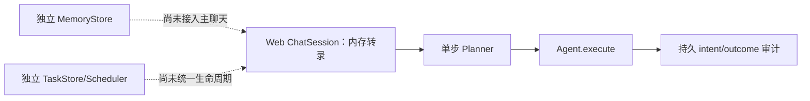
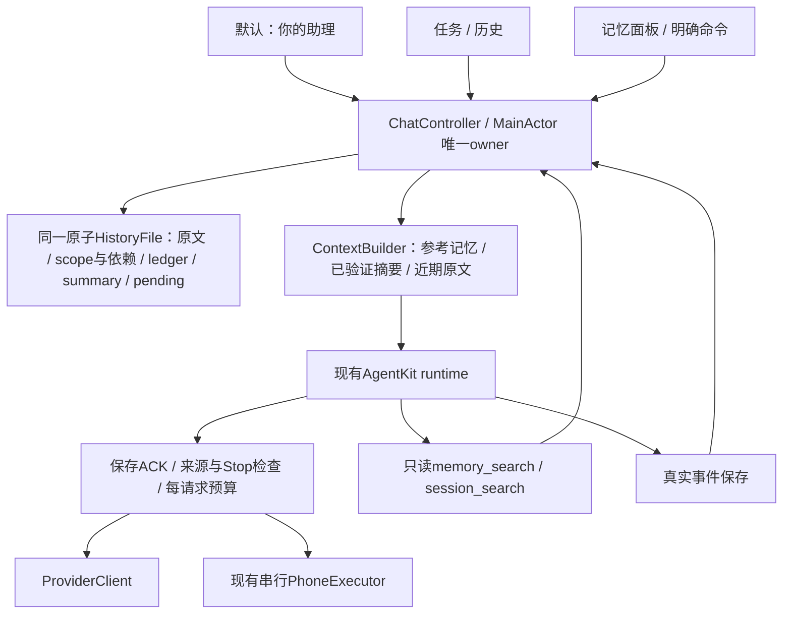

# 单入口与长期记忆技术方案

> 状态：P1–P4 已实现（分支 `codex/long-lived-assistant-implementation`），AgentKit 固定到已发布 fork `Borealin/AgentKit@e1c81c9`（含窄 bounded `consume` API 与裸SSE `error` 帧失败）；模型服务复用App通用设置；Core 测试、iOS 构建/IPA 检查与 iPhone 12 mini 真实模型场景通过，未覆盖项见第 3 节“验证范围”
>
> 最后核对：2026-10-15（实现与验证范围；整文件写入优化、维护期限/真实流停止/脚本助手/错误形状的12 mini验收）
>
> 面向读者：PocketAgent iOS、AgentKit 集成与测试开发者
>
> 范围：同一个助理入口，跨天延续对话与记忆；复用现有手机执行链路
>
> 源码基线：`devicehub-control`，`abae3f67bd66f2434662a24251058fdaddee1227`

## 1. 需求与关联资料

用户确认目标为“单入口＋长期记忆”：再次打开 App 时直接回到同一个助理，换话题、换模型和跨天使用时仍能找回相关偏好与之前的决定。现有 PocketAgent 的主组织单位是独立会话，每条会话分别保存历史、模型和项目。新增默认“你的助理”独立入口，并提供本版本内的任务/历史区；继续用 AgentKit，补齐宿主的主线、记忆、上下文与输入队列。长期连续性来自数据与上下文管理，每轮仍是有起止的执行。首版沿用本机运行方式，不依赖常驻服务器。

| 类型 | 链接 | 说明 |
|---|---|---|
| 需求真源 | 用户于 2026-10-14 在本次探索中确认“单入口＋长期记忆” | 尚无独立需求文档 |
| Figma | 不涉及 | 先定义信息架构；实现阶段补界面稿 |
| 当前工程设计 | [engineering.md](engineering.md) | 历史完整性、配置冻结、动作队列、同步边界 |
| 手机后端设计 | [devicehub-control.md](devicehub-control.md) | DDI 默认与 WDA 可选的现有能力 |
| Muse | [Meta 官方介绍](https://about.fb.com/news/2026/09/introducing-muse-personal-ai-agent/) | 记住偏好与目标、长期协助的产品方向 |
| Grok Bot | [Grok Bot 101](https://x.ai/bot/guides/grok-bot-101) | 持续使用的助理、持久执行环境与 routines |
| OpenAI dot | [OpenAI Docs：Tasks and memory](https://learn.chatgpt.com/docs/dots/tasks-and-memory) | 一个助理协调多项责任；对话上下文与持久笔记分开 |
| OpenClaw | [Home 主会话](https://github.com/openclaw/openclaw/blob/ddaa0bd2b0dd077c946ace62a4b87383f032e26e/docs/concepts/main-session.md) | 固定版本文档与 TypeScript 源码核验 |
| Hermes Agent | [Persistent Memory](https://github.com/NousResearch/hermes-agent/blob/d97007c32d6340f7ba79ac1dfb5773cc00846448/website/docs/user-guide/features/memory.md) | 固定版本文档与 Python 源码核验 |
| OpenMuse 同名项目 | [CopilotKit](https://github.com/CopilotKit/openmuse)、[tuxevil](https://github.com/tuxevil/openmuse)、[tahodev](https://github.com/tahodev/openmuse) | 同名项目逐一核对，保留 jerelvelarde 历史版本对照 |
| OpenMuseAgent 后继 | [nanoMuse](https://github.com/nano-muse/nanoMuse) | Python、OpenMinis iOS 与桌面 Harness 分别核验 |
| iOS 生命周期 | [Apple：BGContinuedProcessingTaskRequest](https://developer.apple.com/documentation/backgroundtasks/bgcontinuedprocessingtaskrequest) | 用户在前台发起、可继续到后台的工作 |

用户已明确“目前不需要做版本兼容，迁移什么的可以不做，直接 breakingchange”。本期按新格式从空助理主线开始，不自动迁入旧聊天、草稿、选择或配置；旧版本本地文件与云端目录不作为新版本数据源。此前多模型审查中的旧记录升级与兼容约束已撤销。用户随后授权按本方案完整实现 P1–P4（2026-10-14），由 Opus 5.5 xhigh 实施、主会话只读核验。

方案阶段由主会话与 Opus 5.5 xhigh、DeepSeek Flash high、Grok 4.7 high 整体讨论，再由 GPT-6 Astra xhigh 与 Fable 5.1 xhigh 审查并确定技术细节及实施步骤；实施阶段的主会话核验问题与修复见第 3 节“已确认问题与修复”。主动提醒、定时监控、持续语音和离开 App 后全天候工作属于后续扩展，没有被本次需求确认。

## 2. 公开项目调研与结论

本轮已沿入口、会话 admission、模型/工具循环、历史与记忆、取消和重启路径深化源码分析，并纳入四条主要 OpenMuse 路线及其不同版本。项目提出的分层思路相近，实际接线与完成度不同：有的已把记忆接入聊天，有的仍是独立模块或设计文档。OpenClaw 提供 Home 主会话；Hermes 提供策展记忆与历史检索；nanoMuse/OpenMinis 的 iOS 主线与摘要投影是直接相关的手机端参考。Muse、Grok Bot、OpenAI dot 的公开信息能支持产品与部分运行架构判断，本次未取得三者完整的会话/记忆 harness 源码，不能据此声称复刻其内部算法。

1. 产品上的连续性可以由稳定助理身份和一个聊天入口承接。工作上下文可以原位压缩或在明确边界重建；后台 session ID 的生命周期不是产品入口的定义。
2. 重点借鉴 nanoMuse/OpenMinis iOS 的主会话指针与非破坏摘要投影、Hermes 的小型偏好记忆与历史检索、OpenClaw 的 Home/工作 thread 分层。CopilotKit OpenMuse 的 rich chat/worker 适合作为应用分层参考，但当前依赖外部 Intelligence。
3. OpenClaw与Hermes的当前两个固定版本都支持原位压缩；Hermes 当前默认 `in_place=true`。没有依据要求 PocketAgent 在每次压缩时建立新 session，也不应按旧教程默认每日清空。
4. 记忆学习、历史检索和压缩分别有触发与预算。保存事实由实际工具写入完成；记忆文件、摘要或模型声称“已记住”不能互相替代。
5. PocketAgent 已有固定 AgentKit 的记忆/压缩原语。下文的宿主适配契约已按此实现，未引入新的后台服务。

### 本轮收敛：入口、记忆与执行引擎分别选型

采用“独立助理入口＋现有 AgentKit＋宿主补齐长期记忆”，并已按此实现。

| 路线 | 改动与收益 | 主要代价 | 本轮建议 |
|---|---|---|---|
| 固定当前某条会话，隐藏其他会话 | 导航改动小 | 易继承旧项目/一次性任务；仍需记忆、预算和队列改造 | 不作为主方案 |
| 新增默认“你的助理”，本版本任务/历史共存，继续 AgentKit | 默认入口稳定；复用执行链路；宿主分别管理记忆和上下文 | 新增主指针、数据扩展、请求投影与运行宿主 | 推荐 |
| 替换成 OpenMinis 类自有 loop | 可控制整个循环，与上游机制一致 | 替换模型适配、事件、工具调度、取消、生命周期；仍须接入 DDI/WDA | 当前收益不足，后置评估 |

独立入口与保留 AgentKit 可以同时成立。固定版本 AgentKit 已有非破坏请求 pipeline、记忆协议/工具和无工具摘要服务；PocketAgent 尚未把这些接成长期助理。新增入口给用户一个稳定落点，宿主改造让这个落点真正有长期记忆。

[OpenAI Docs](https://learn.chatgpt.com/docs/dots/tasks-and-memory)明确区分助理笔记与工作任务自己的上下文，也支持从同一助理进入可见任务。本方案借鉴这一信息架构；普通聊天与手机轮次如何运行，仍由 PocketAgent 的本机生命周期决定。OpenMinis 的摘要投影机制适合借鉴，但它的 Swift loop、SQLite、同步及工具能力是一个整套宿主实现，不构成必须替换 AgentKit 的依据。


<details>
<summary>公开资料、固定版本源码与差异核验</summary>

### 核验方法与证据范围

- 商业产品只采用官方产品文档、研究文章与官方仓库；不把泄露提示词、同名社区项目或模型的自述当作内部实现证据。
- OpenClaw 核验固定提交 [`ddaa0bd2b0dd077c946ace62a4b87383f032e26e`](https://github.com/openclaw/openclaw/commit/ddaa0bd2b0dd077c946ace62a4b87383f032e26e)，提交日期 2026-10-13。
- Hermes Agent 指 [NousResearch/hermes-agent](https://github.com/NousResearch/hermes-agent)，核验固定提交 [`d97007c32d6340f7ba79ac1dfb5773cc00846448`](https://github.com/NousResearch/hermes-agent/commit/d97007c32d6340f7ba79ac1dfb5773cc00846448)，提交日期 2026-10-13；与同名模型、其他 Hermes 项目区分。
- 两个开源清单初稿来源：peer；主会话复核路由/reset、默认压缩、记忆快照刷新和搜索等决定性源码。未安装、执行或连接用户部署，结论属于静态实现核验；下方继续给出关键架构调用链与同名项目分析。

### 公开程度与共同思路

| 项目 | 本次获得的公开信息 | 连续性来自什么 | 尚未核实的边界 |
|---|---|---|---|
| Muse | 官方产品说明、安全运行架构、模型与硬件 SDK 公开资料 | 同一用户的 VM、文件/记忆、持久应用状态、子任务 | 具体记忆提炼、检索与压缩算法；完整个人助理 harness |
| Grok Bot | 官方 Bot 管理、聊天、电脑/任务文档 | 命名 Bot 的角色、偏好和工作摘要；持久云端电脑 | 记忆 schema、压缩触发、历史合并源码 |
| OpenAI dot | OpenAI Docs 的任务、记忆和跨渠道行为说明 | 同一 dot 的持久笔记；工作任务各自有上下文 | 笔记生成/召回和内部 session 生命周期源码 |
| OpenClaw | 官方文档与本次固定版本 TypeScript 源码 | Home 主会话、SQLite transcript、Markdown 记忆、检索和压缩 | 实际部署参数、长期召回质量与运行可靠性 |
| Hermes Agent | 官方文档与本次固定版本 Python 源码 | 稳定聊天路由、SQLite 历史、小容量个人记忆、原位压缩 | 用户部署行为、记忆学习及中文检索实际质量 |

### Muse：公开了真实运行架构，记忆算法披露仍有限

[Meta 的安全架构文章](https://research.meta.ai/blog/security-and-safety-for-ai-agents-our-approach-with-muse)说明客户端连接用户专属 VM；Hatch harness 与用户工作区位于 runtime container，持久应用状态位于独立 Postgres，凭证与外部动作控制在另外的服务中。文章也说明用户可查看、编辑、下载自己的文件与记忆，VM 可承载并发子 agent 和 cron。这里“机器内存/RAM”与“助理记忆”需要分别理解。

[Muse Wonder 官方介绍](https://about.fb.com/news/2026/10/introducing-muse-wonder-models/)于 2026-10-12 将 Active Memory 描述为跨对话保留重要信息并取回相关细节。这是公开能力描述，未说明记忆库 schema、召回索引、摘要边界或写入策略；不能据此认定记忆通过模型权重在线学习。

存在可核实的官方开放材料：[Muse Glimmer 开放模型权重](https://research.meta.ai/blog/introducing-muse-glimmer-open-agentic-model)与 [Muse Gadget SDK](https://github.com/facebookincubator/muse-gadget-sdk)。后者是 ESP32/Linux 硬件接入 SDK 和固件。它们分别提供模型或设备接入能力；本次没有在这些资料中拿到 Muse 个人助理完整的会话/长期记忆实现。

### Grok Bot：长期身份以 Bot 为单位，可有多个角色

[官方 overview](https://docs.x.ai/grok-bot/overview)说明同一账户的 Bots 共享云端电脑与文件/浏览器登录状态，但每个 Bot 的会话和学习上下文独立，记忆内容包括稳定偏好、角色信息和过往工作摘要。[Bot 管理文档](https://docs.x.ai/grok-bot/bots)把持久描述和任务消息区分，也明确复制 Bot 配置不复制其聊天历史与学习记忆。

因此可借鉴的是“固定助理身份拥有记忆，具体任务有范围”；该产品本身允许多个 Bot 和群聊，公开资料并没有要求一个账户只能有一条永久对话。[聊天文档](https://docs.x.ai/grok-bot/chat-and-collaboration)支持执行中继续发送指令、按消息回应和调整优先级。公开文档未给出其内部记忆更新和压缩实现。

### OpenAI dot：持久笔记与工作上下文明确分开

[OpenAI Docs：Tasks and memory](https://learn.chatgpt.com/docs/dots/tasks-and-memory)说明 dot 使用当前对话、相关 ChatGPT memory 和自己的持久笔记；笔记包含偏好、决定与进行中的工作，属于选取的信息，不是完整转录。它可以在同一对话中协调多项工作，任务有自己的上下文，不自动接收用户全部历史。跨渠道访问同一个 dot 会延续笔记，但不同渠道的可见消息仍分别保留。

这直接支持“一个助理入口＋按需上下文”的产品方向。公开说明不足以确认其内部如何做 token 预算、记忆写入、摘要持久化和冲突处理。

### OpenClaw：Home 长期主会话是当前直接参考

1. **稳定入口。** [main-session 文档](https://github.com/openclaw/openclaw/blob/ddaa0bd2b0dd077c946ace62a4b87383f032e26e/docs/concepts/main-session.md#L10-L28)把 Home 定义为个人助理默认入口，默认 DMs 汇入 `agent:<agentId>:main`，其他任务可在独立 threads 中工作并返回结果。源码 [DM routing](https://github.com/openclaw/openclaw/blob/ddaa0bd2b0dd077c946ace62a4b87383f032e26e/src/routing/session-key.ts#L215-L252)的默认 scope 是 main；[reset-policy.ts](https://github.com/openclaw/openclaw/blob/ddaa0bd2b0dd077c946ace62a4b87383f032e26e/src/config/sessions/reset-policy.ts#L26-L28)的默认 reset mode 为 none，daily/idle 是配置选择。
2. **当前存储。** [官方 store 文档](https://github.com/openclaw/openclaw/blob/ddaa0bd2b0dd077c946ace62a4b87383f032e26e/docs/reference/session-management-compaction/store.md#L9-L12)说明 session rows 与 transcript events 均位于每 agent 的 SQLite；历史有边界/树结构，包含原消息、工具结果和摘要。[SQLite 路径解析](https://github.com/openclaw/openclaw/blob/ddaa0bd2b0dd077c946ace62a4b87383f032e26e/src/config/sessions/session-sqlite-target-paths.ts#L17-L46)与此一致。旧 JSONL/`sessions.json` 是迁移或归档材料，不能用旧教程代替当前运行时说明。
3. **分层记忆。** [memory 文档](https://github.com/openclaw/openclaw/blob/ddaa0bd2b0dd077c946ace62a4b87383f032e26e/docs/concepts/memory.md#L20-L58)区分小型 USER.md、策展后的 MEMORY.md 和详细 daily notes。日记用于按需检索，近期日记可在 reset 后重新加载；完整日记不在每轮全量注入。
4. **检索能力。** 默认 plugin slot 是 [memory-core](https://github.com/openclaw/openclaw/blob/ddaa0bd2b0dd077c946ace62a4b87383f032e26e/src/plugins/slots.ts#L17-L20)。[搜索实现](https://github.com/openclaw/openclaw/blob/ddaa0bd2b0dd077c946ace62a4b87383f032e26e/extensions/memory-core/src/memory/manager-search-orchestration.ts#L398-L430)具备 keyword-only 分支；后续 [vector 与 hybrid 排序](https://github.com/openclaw/openclaw/blob/ddaa0bd2b0dd077c946ace62a4b87383f032e26e/extensions/memory-core/src/memory/manager-search-orchestration.ts#L512-L568)按配置与实际 provider 可用性工作。可选 LanceDB plugin 是另一种 memory provider，不能据此称默认实现必须依赖 LanceDB。
5. **学习与压缩。** [flush-plan 源码](https://github.com/openclaw/openclaw/blob/ddaa0bd2b0dd077c946ace62a4b87383f032e26e/extensions/memory-core/src/flush-plan.ts#L12-L28)给 pre-compaction flush 设定当天 daily note 的追加目标，并将 bootstrap 文件设为只读。Flush 是阈值维护；[dreaming consolidation](https://github.com/openclaw/openclaw/blob/ddaa0bd2b0dd077c946ace62a4b87383f032e26e/docs/concepts/memory.md#L51-L58)另行整理有用信息。写日记、整理长期记忆和摘要当前上下文是不同流程。

**本版文档差异：** main-session 文档称 reset 分配新的 live session ID；但 [session 初始化源码](https://github.com/openclaw/openclaw/blob/ddaa0bd2b0dd077c946ace62a4b87383f032e26e/src/auto-reply/reply/session.ts#L570-L583)对普通 durable session 沿用 transcript identity，并 [建立 reset boundary](https://github.com/openclaw/openclaw/blob/ddaa0bd2b0dd077c946ace62a4b87383f032e26e/src/auto-reply/reply/session.ts#L746-L753)。ACP 等路径可轮转。因此此研究采用“工作上下文重置、历史保留”的语义，不声称每次 reset 必换物理 ID。未运行重置复现，这属于源码与文档的范围差异核验。

### Hermes Agent：小型个人记忆与真实历史检索

1. **连续入口。** [gateway session key](https://github.com/NousResearch/hermes-agent/blob/d97007c32d6340f7ba79ac1dfb5773cc00846448/gateway/session.py#L685-L720)包含 profile、平台和聊天/thread 维度，每个稳定路由指向活跃工作 session。[显式 reset](https://github.com/NousResearch/hermes-agent/blob/d97007c32d6340f7ba79ac1dfb5773cc00846448/gateway/session.py#L1134-L1155)产生新 ID，并保留旧 parent。[用户文档](https://github.com/NousResearch/hermes-agent/blob/d97007c32d6340f7ba79ac1dfb5773cc00846448/website/docs/user-guide/features/memory.md#L59-L65)说明消息平台会话可跨重启持续，建议在自然任务边界 `/new`。
2. **小容量策展记忆。** [初始化代码](https://github.com/NousResearch/hermes-agent/blob/d97007c32d6340f7ba79ac1dfb5773cc00846448/agent/agent_init.py#L1297-L1334)的内置默认预算为 MEMORY.md 2,200 字符、USER.md 1,375 字符，可配置。超预算更新会拒绝，由模型整理条目。[memory tool](https://github.com/NousResearch/hermes-agent/blob/d97007c32d6340f7ba79ac1dfb5773cc00846448/tools/memory_tool.py#L374-L397)当前提供 add/patch/remove，而不是无边界堆积全部历史。
3. **更新触发。** 默认 nudge interval 为 10 个用户 turn；[turn 计数](https://github.com/NousResearch/hermes-agent/blob/d97007c32d6340f7ba79ac1dfb5773cc00846448/agent/turn_context.py#L753-L762)达到间隔后可启动后台 review，由模型决定是否实际调用 memory tool。公开的“学习”在这些已核验路径里体现为数据/工具操作，不代表每条消息都保存或模型权重持续训练。
4. **历史检索。** [`session_search` schema](https://github.com/NousResearch/hermes-agent/blob/d97007c32d6340f7ba79ac1dfb5773cc00846448/tools/session_search_tool.py#L651-L666)明确返回实际 SQLite 消息，无额外 LLM 摘要；[FTS5 结果处理](https://github.com/NousResearch/hermes-agent/blob/d97007c32d6340f7ba79ac1dfb5773cc00846448/tools/session_search_tool.py#L389-L431)允许按消息锚点继续读取。自动学习、历史搜索和上下文摘要不应合并为一个组件。
5. **当前默认原位压缩。** [`compression.in_place` 默认 true](https://github.com/NousResearch/hermes-agent/blob/d97007c32d6340f7ba79ac1dfb5773cc00846448/agent/agent_init.py#L1575-L1577)；[提交实现](https://github.com/NousResearch/hermes-agent/blob/d97007c32d6340f7ba79ac1dfb5773cc00846448/agent/conversation_compression.py#L3736-L3743)将旧消息 soft-archive，仍可检索，同时保存缩减后的活跃上下文。显式关闭 in_place 才使用可选的 parent→child 轮转路径；不能将旧版轮转描述为当前默认。

**本版记忆刷新边界：** [MemoryStore](https://github.com/NousResearch/hermes-agent/blob/d97007c32d6340f7ba79ac1dfb5773cc00846448/tools/memory_tool_store.py#L618-L621)在普通 turn 中使用冻结的 prompt snapshot，以保持缓存前缀。memory 文档说新写入在新 session 才注入；[prompt invalidation 源码](https://github.com/NousResearch/hermes-agent/blob/d97007c32d6340f7ba79ac1dfb5773cc00846448/agent/system_prompt.py#L808-L826)还在压缩边界重新加载记忆。因此“只能新 session 生效”范围不完整，普通 turn、成功压缩重建和新 session 应分别描述。PocketAgent 每轮创建 runtime，适合冻结当前轮并在下一轮重新取有效记忆。

### 架构深化：入口、运行 owner 与持久化边界

本轮范围扩展到消息入口→会话 admission/队列→模型循环→工具执行→结果持久化→记忆召回→后续轮次，并补查取消与重启路径。它是围绕单入口/长期记忆的架构静态核验，不是所有 connector、所有模型 provider 或所有平台的完整审计。未运行外部项目；“存在恢复代码”不等于外部副作用已经证明恰好执行一次。

**OpenClaw 的主线控制路径：** `runPreparedReply → prepareReplyRunContext/admission → executePreparedReplyRun → runReplyAgent → embedded candidate → runEmbeddedAgentEntry/runEmbeddedAgent → session lane + global admission → harness attempt → transcript/terminal settlement`。入口在 [get-reply-run.ts](https://github.com/openclaw/openclaw/blob/ddaa0bd2b0dd077c946ace62a4b87383f032e26e/src/auto-reply/reply/get-reply-run.ts#L10-L28)，执行层可处理 steer/follow-up，[run-entry](https://github.com/openclaw/openclaw/blob/ddaa0bd2b0dd077c946ace62a4b87383f032e26e/src/agents/embedded-agent-runner/run-entry.ts#L73-L114)保留同一逻辑轮次的 admission 与 lifecycle generation，[lane controller](https://github.com/openclaw/openclaw/blob/ddaa0bd2b0dd077c946ace62a4b87383f032e26e/src/agents/embedded-agent-runner/run/lane-controller.ts#L282-L313)把等待/超时取消纳入队列控制。Gateway 持有会话事实，模型运行时通过 harness/plugin 接口接入；Home、工作 threads 与工具资源不必共用一个永久进程对象。

**Hermes 的主线控制路径：** `Gateway inbound → routing key/active-turn claim → session transcript load → cached AIAgent → per-turn runner → run_conversation → tool round → canonical DB append → tool execution → finalizer/persist`。源码的 [inbound admission](https://github.com/NousResearch/hermes-agent/blob/d97007c32d6340f7ba79ac1dfb5773cc00846448/gateway/run_inbound.py#L1285-L1359)在第一次 await 前占用会话；[agent resolution](https://github.com/NousResearch/hermes-agent/blob/d97007c32d6340f7ba79ac1dfb5773cc00846448/gateway/run_turn_runner.py#L1139-L1176)可复用 agent cache，但每条消息创建独立 turn。`state.db` 是 [可重放 transcript 的 canonical 来源](https://github.com/NousResearch/hermes-agent/blob/d97007c32d6340f7ba79ac1dfb5773cc00846448/gateway/session_transcript.py#L631-L652)；[tool round](https://github.com/NousResearch/hermes-agent/blob/d97007c32d6340f7ba79ac1dfb5773cc00846448/agent/turn_tool_round.py#L145-L174)要求先成功持久化 assistant/tool-call 行再执行工具。Cron 另起 task session，不能据此要求主聊天 agent 承载全部后台工作。

对 PocketAgent 的含义：应把 UI 主线、运行 admission、历史 owner、记忆接口和手机资源 owner 分开。长期聊天可以复用 agent 或每轮新建 runtime；现有 PocketAgent 每轮新建 AgentRuntime 的方式本身不阻止长期连续性。

### 同名 OpenMuse：关系、固定版本与实现状态

用户确认“同名项目都比较”。本轮逐一读取下列源码；GitHub fork 标志不能替代提交历史或代码归属核验。提交 compare 确认 CopilotKit 当前版本包含 jerelvelarde 所查提交，二者是同一历史的不同阶段；其余候选不能按同名归为一个项目。旧 OpenMuseAgent 项目的 [README](https://github.com/OpenMuseAgent/OpenMuse)明确指向 nanoMuse，并称旧仓库是 0.1.0–0.6.0 历史存档；没有把它与其他同名项目视作同一实现。

| 项目 | 固定提交 | 当前许可文件/声明 | 已核实主要边界 |
|---|---|---|---|
| [tuxevil/openmuse](https://github.com/tuxevil/openmuse) | `0dd00b46920407276ce0ca7c69e9dfc0b9ef7767` | 尚未选择许可；README 明示 | Phase 1/2 持久控制面与模型 adapter，后续 memory/Sentinel/runtime 多为设计 |
| [tahodev/openmuse](https://github.com/tahodev/openmuse) | `e96d76aafcc538706b61b56f48649df128fca983` | MIT | host policy/audit/approval 有接线；memory/task 模块尚未接入正式 Web chat |
| [jerelvelarde/openmuse](https://github.com/jerelvelarde/openmuse) | `61796eb2f1dee6bb5479a9023caa94f9daa89355` | MIT | React Native/CopilotKit 主聊天与 SQL lease worker 分离；后台注入记忆；主聊天可经状态工具读取 |
| [CopilotKit/openmuse](https://github.com/CopilotKit/openmuse) | `1ac68f3909f2478ab6280883f1ab5ea65eb5719d` | MIT；Intelligence 是外部服务 | 同一历史的后续版本；Intelligence 必需，模型循环改用 TanStack adapter |
| [nano-muse/nanoMuse](https://github.com/nano-muse/nanoMuse) | `58b9346f3d8a130c226beef5f906277af350dcb5` | 当前 GPL-3.0-or-later；README/notice | Python agent、OpenMinis 手机宿主、DeepSeek Harness 桌面插件分别实现 |

OpenMuse/nanoMuse 三份 reader 清单来源：peer；以下决定性 composition、上下文和持久化路径由主会话复核。许可在此仅记录仓库声明，本次没有复制实现代码。

### tuxevil/openmuse：持久任务骨架，长期记忆还在设计层

实际链路为 `API/CLI → ControlPlaneRepository → goal/task/schedule/execution → AgentHarness.run → ContextBuilder → ModelAdapter.complete → ToolRegistry → checkpoint/finish_execution`。

- [ContextBuilder](https://github.com/tuxevil/openmuse/blob/0dd00b46920407276ce0ca7c69e9dfc0b9ef7767/src/openmuse/context.py#L16-L35)重建的是 goal、task、prior executions 元数据。没有读取 conversation messages 或持久个人记忆；名为 bounded 的上下文只明确输出/时限字段，没有在这里做输入 token 裁切或摘要。
- [Harness](https://github.com/tuxevil/openmuse/blob/0dd00b46920407276ce0ca7c69e9dfc0b9ef7767/src/openmuse/harness.py#L81-L122)默认最多 8 个模型步，执行中的局部 transcript 在内存；checkpoint 保存近期状态。控制面 [事务性 schedule delivery](https://github.com/tuxevil/openmuse/blob/0dd00b46920407276ce0ca7c69e9dfc0b9ef7767/src/openmuse/repository.py#L127-L165)有 dedupe/claim，不能由此推导出完整 crash 后工具结果 reconciliation。
- [实际 CLI demo](https://github.com/tuxevil/openmuse/blob/0dd00b46920407276ce0ca7c69e9dfc0b9ef7767/src/openmuse/cli.py#L51-L58)使用 FakeModelAdapter；HTTP API 主要创建控制面实体。`MEMORY.md`、`SENTINEL.md` 是设计文档，不是已接入的记忆库/宿主权限服务。
- [README 许可段](https://github.com/tuxevil/openmuse/blob/0dd00b46920407276ce0ca7c69e9dfc0b9ef7767/README.md#L147-L149)明示尚未选择许可。本次按“公开代码研究对象”处理。

可参考：goal/task/execution 的分层与事务性 delivery key。不能据此选为已经具备单长期会话和个人记忆的现成底座。

### tahodev/openmuse：精确动作边界较具体，聊天连续性未贯通

实际链路为 `HTTP /api/chat → ChatSession.handle → OpenAICompatiblePlanner.plan → Agent.execute → result event → assistant text`。Web 的 conversation transcript 是 [进程内 dict](https://github.com/tahodev/openmuse/blob/e96d76aafcc538706b61b56f48649df128fca983/src/openmuse/web_chat.py#L91-L133)，每轮只读最近 12 条 user/assistant entry；当前消息的工具结果另存局部列表。这里限制历史长度的方式是窗口截取，源码未见摘要压缩。

- [Planner](https://github.com/tahodev/openmuse/blob/e96d76aafcc538706b61b56f48649df128fca983/src/openmuse/providers/openai_compatible.py#L14-L31)通过标准库 HTTP 获取单步 JSON action；[Agent.execute](https://github.com/tahodev/openmuse/blob/e96d76aafcc538706b61b56f48649df128fca983/src/openmuse/core.py#L24-L53)执行前写 intent，结果审计写入失败会返回 unknown 且不可重试。这个动作边界适合参考。
- MemoryStore 的 remember/search/forget 有独立实现，但在所查 Web composition 和 Agent/planner 入口中无调用；同样 TaskStore 与 Scheduler 尚未成为 ChatSession 的生命周期 owner。[架构文档](https://github.com/tahodev/openmuse/blob/e96d76aafcc538706b61b56f48649df128fca983/docs/architecture.md#L74-L84)也承认这些层未统一。
- 审批记录持久化，等待 map 与 token authority 属于进程内；重启后遗留 pending 被标为 interrupted。TaskStore 的 cancel 是状态写入，未接入 Web 运行中取消信号；模块存在不等于聊天执行会遵从它。



可参考：明确 Action/Result、unknown effect 与审批记录；当前聊天历史与记忆接线不足以直接承接 PocketAgent 的目标。

### jerelvelarde/openmuse 历史版本：聊天协调器与持久 worker 两条链

实际聊天链路为 `Expo ChatScreen → ConversationQueue → CopilotKit runAgent → Hono/CopilotRuntime → ConversationAgent/BuiltInAgent`；任务链路为 `delegate_task → SQL records → lease worker → task-specific BuiltInAgent → tools → state/checkpoint/events`。模型 loop/AG-UI 来自 CopilotKit，自有部分包括任务、worker、记录存储、审批和 Docker Computer。

- [聊天 agent](https://github.com/jerelvelarde/openmuse/blob/61796eb2f1dee6bb5479a9023caa94f9daa89355/apps/server/src/engine/conversation.ts#L89-L150)提供 remember_fact，却未把 memories 读入 prompt；[后台任务 agent](https://github.com/jerelvelarde/openmuse/blob/61796eb2f1dee6bb5479a9023caa94f9daa89355/apps/server/src/engine/model.ts#L275-L304)每次读取 owner 全部记忆，连同 task state/evidence/artifacts 一起注入。主聊天的 agent_status 会经 [service.snapshot](https://github.com/jerelvelarde/openmuse/blob/61796eb2f1dee6bb5479a9023caa94f9daa89355/apps/server/src/engine/service.ts#L124-L146) 返回 memories，因此已有工具式读取路径；这里的缺口是自动相关性召回和 token 预算，不应误称主聊天完全无法使用记忆。
- 未启用 Rich Threads 时是 owner 下的单条 conversation 记录；客户端在轮次退出后尝试保存。Rich Threads/额外重放依赖 CopilotKit Intelligence 的外部服务，不能把它视作此仓库独立自托管实现。
- [worker](https://github.com/jerelvelarde/openmuse/blob/61796eb2f1dee6bb5479a9023caa94f9daa89355/apps/server/src/engine/worker.ts#L64-L115)会重领 lease 过期的 running 任务；部分工具收据或 operations checkpoint 能去重，但并非所有外部效果都被同一原子提交覆盖。因此这种恢复策略不能整体迁入 PocketAgent 的“中断手机动作不重放”契约。
- [默认配置](https://github.com/jerelvelarde/openmuse/blob/61796eb2f1dee6bb5479a9023caa94f9daa89355/apps/server/src/config.ts#L35-L41)为 sample；live/model 模式才走真实模型。OpenBot 是可选 adapter seam，不能把 README 的 future backend 当作已经连接的能力。

可参考：主聊天协调工作、任务有独立持久状态与 UI 活动记录。Node worker、Docker Computer 与 React Native/CopilotKit 状态不适合直接取代 iPhone 本机执行链。

### CopilotKit 官方 OpenMuse：必须按后续版本重新评价

[提交比较](https://github.com/CopilotKit/openmuse/compare/61796eb2f1dee6bb5479a9023caa94f9daa89355...1ac68f3909f2478ab6280883f1ab5ea65eb5719d)确认旧 jerelvelarde 提交是当前固定版本的祖先。当前代码路径仍为主聊天协调器与 SQL worker 分层，但 [配置](https://github.com/CopilotKit/openmuse/blob/1ac68f3909f2478ab6280883f1ab5ea65eb5719d/apps/server/src/config.ts#L69-L86)以及 readConfig 要求 `CPK_INTELLIGENCE_API_KEY`，不再采用旧版本的可选 Rich Threads 自托管回退。

[ConversationAgent](https://github.com/CopilotKit/openmuse/blob/1ac68f3909f2478ab6280883f1ab5ea65eb5719d/apps/server/src/engine/conversation.ts#L366-L393)仍提供 remember_fact；主 prompt 没有预先注入个人事实，agent_status 可读取 [包含 memories 的完整状态](https://github.com/CopilotKit/openmuse/blob/1ac68f3909f2478ab6280883f1ab5ea65eb5719d/apps/server/src/engine/service.ts#L136-L158)；[任务 agent](https://github.com/CopilotKit/openmuse/blob/1ac68f3909f2478ab6280883f1ab5ea65eb5719d/apps/server/src/engine/model.ts#L316-L340)读取 owner 全部记忆和 task state 后运行。模型轮次改经 `tanstackAgent`，它用 CopilotKit BuiltInAgent factory 接入 TanStack AI 与 provider adapters，再提供 AG-UI 事件。旧版直接构造 BuiltInAgent 的调用方式不能当作当前完整循环。

还需分别看主聊天与任务运行：停止主聊天不等于取消已委派任务；worker 对过期 lease 可重领运行，外部 action 则有 outcome_unknown 的独立恢复保护。新版本可选 E2B desktop provider 有真实接线，默认 Docker；不要沿用旧版本“E2B 不存在”的判断。

此官方版本必须纳入应用信息架构比较，尤其是持久主 thread、后台 task 和界面结果卡片；它包含外部 Intelligence 持久化依赖，和 PocketAgent 本机目标的运行方式不同。下方对 nanoMuse 的评价仍按其独立实现，而非依赖此服务。

### nanoMuse：最相关的手机端参考，需要分别理解三套实现

| 端 | 实际 runtime/owner | 历史与工作上下文 | 长期记忆 |
|---|---|---|---|
| Python server | NanoMuseApp 共享 stores；MuseService 每 thread 创建 MuseAgent/worker | 独立 session JSON 与 timeline；默认近期 80 条请求窗口 | SQLite；按请求关键词＋可用 embeddings 召回，记忆工具写入；后台 tidy 是另一流程 |
| iOS | OpenMinis Swift AIChatViewModel 自有 loop，nanoMuse hooks 扩展 | ChatStore SQLite 全历史；compact marker 投影到模型请求 | GLOBAL.md、近期日记、nanoMuse USER.md；两套同步分别处理记忆和主/旁聊 |
| Desktop | DeepSeek Harness sessionController＋nanoMuse Rooms plugin | Harness 管理的主/旁 session | rooms.json 文本条目，最多最近 60 条注入；不同于 Python SQLite recall |

Python [composition root](https://github.com/nano-muse/nanoMuse/blob/58b9346f3d8a130c226beef5f906277af350dcb5/nanomuse/app.py#L82-L100)创建共享记忆/工具；[per-thread factory](https://github.com/nano-muse/nanoMuse/blob/58b9346f3d8a130c226beef5f906277af350dcb5/nanomuse/server/service.py#L825-L885)创建独立 agent 和文件。[recall_for](https://github.com/nano-muse/nanoMuse/blob/58b9346f3d8a130c226beef5f906277af350dcb5/nanomuse/agent/core.py#L255-L266)逐轮召回；[context_messages](https://github.com/nano-muse/nanoMuse/blob/58b9346f3d8a130c226beef5f906277af350dcb5/nanomuse/agent/core.py#L362-L378)主要裁切近期窗口，不能将 iOS 的摘要 marker 算法归到这个 Python 路径上。

iOS 的实际链路为 `NanoMuseMainChat → ChatStore/AIChatViewModel load → send/queue → OpenMinis runAgentLoop → provider stream/tools → persist → nmAfterTurn`：

- [主会话指针](https://github.com/nano-muse/nanoMuse/blob/58b9346f3d8a130c226beef5f906277af350dcb5/android/src/ios/NanoMuse/NanoMuseShell.swift#L227-L271)跨启动恢复，账号切换另有 owner 对应指针；稳定的是聊天落点，VM/Task 可以重建。
- [完整 agent history 保留](https://github.com/nano-muse/nanoMuse/blob/58b9346f3d8a130c226beef5f906277af350dcb5/android/src/ios/Agent/Chat/AIChatViewModel+Persistence.swift#L415-L425)；[请求投影](https://github.com/nano-muse/nanoMuse/blob/58b9346f3d8a130c226beef5f906277af350dcb5/android/src/ios/Agent/Chat/AIChatViewModel+Persistence.swift#L1625-L1685)用摘要 marker 的消息锚点、近期原文与后续消息组成上下文，不删除旧聊天。这里对 PocketAgent 最有参考价值。
- [Swift loop](https://github.com/nano-muse/nanoMuse/blob/58b9346f3d8a130c226beef5f906277af350dcb5/android/src/ios/Agent/Chat/AIChatViewModel.swift#L4729-L4759)属于 OpenMinis 复用的宿主；nanoMuse 通过 hooks 加主入口、个人资料、goal/feed 与同步，不能将整套执行引擎归为 nanoMuse 从零自研。
- [记忆注入](https://github.com/nano-muse/nanoMuse/blob/58b9346f3d8a130c226beef5f906277af350dcb5/android/src/ios/Agent/Chat/AIChatViewModel+MemoryTools.swift#L9-L60)读取完整 GLOBAL.md 和近 30 天中最近 3 个有内容日期的日记，各日最多 200 行；USER.md addendum 有 4000 字符限制。这些预算与 Python/desktop 不同。
- OpenMinis [iCloud V2](https://github.com/nano-muse/nanoMuse/blob/58b9346f3d8a130c226beef5f906277af350dcb5/android/src/ios/Agent/Sync/V2/ChatStoreSyncHydrators.swift#L143-L157)注册 GLOBAL/daily memory 数据类型；nanoMuse Cloud 另同步 ChatStore 主/旁聊。不能根据 NanoMuseSync 没有 memory 字段就断言 iOS 没有记忆同步，也不能把两路同步混成一个状态 owner。
- [iOS 屏幕操作 slot](https://github.com/nano-muse/nanoMuse/blob/58b9346f3d8a130c226beef5f906277af350dcb5/android/src/ios/NanoMuse/NanoMuseModelsView.swift#L80-L90)指向电脑能力，手机端入口禁用；shell 工具运行在 iSH sandbox。它没有在本次核验中提供与 PocketAgent DDI/WDA 本机跨 App 操作等价的替换链路。iPhone routine 也受 App 打开与系统后台时间限制，不能泛化桌面/Python 的常在线能力。

当前源码 [第三方致谢](https://github.com/nano-muse/nanoMuse/blob/58b9346f3d8a130c226beef5f906277af350dcb5/README.md#L167-L174)明确 OpenMinis、DeepSeek Harness 和 UI-TARS 的复用关系。当前 GPL 许可与早期 OpenMuse MIT 版本需分别看；本次只借鉴架构，不复制相关实现。

### 深化后的选型结论

在当前“单入口＋长期记忆”范围，优先学习 nanoMuse/OpenMinis iOS 的主会话指针与非破坏摘要投影、Hermes 的小型个人记忆与可追溯历史检索、OpenClaw 的 Home/工作 thread 分层。继续保留 PocketAgent 的 AgentKit、原子历史存储和手机资源 owner。

其他 OpenMuse 候选提供具体的控制面、审批或后台 worker 参考，但本次发现的主聊天记忆接线缺口、云端运行假设和未完成层级，使它们不宜直接作为已满足目标的现成架构。功能模块、正式 composition 和交付验证需要分别评价；实现阶段仍需针对目标 iPhone 的长期对话、记忆更新/删除、摘要失效和手机操作不重放完成验收。

### 相似性、差异与 PocketAgent 的取舍

共同模式可以归纳为四层：长期助理身份、有限工作上下文、持久事实/偏好、可追溯历史。原位压缩和切换工作段都是可能实现，连续 UI 不要求固定采用其中一个。主动调度依赖运行生命周期，应与记忆管理分开设计。

推荐借鉴 OpenClaw 的 Home 入口与历史窗口语义，借鉴 Hermes 的小型策展记忆＋按需取回原文，继续用现有 AgentKit 实现模型侧接口。先不复制 daily notes、dreaming、外部 memory provider 和多渠道 gateway 的全部复杂度，也不因为 OpenClaw 使用向量检索就把 embeddings 设为首版依赖。中文 FTS/文本与语义检索的实际召回需在实现阶段对照评估。

根许可证方面，本次固定版本的 [OpenClaw](https://github.com/openclaw/openclaw/blob/ddaa0bd2b0dd077c946ace62a4b87383f032e26e/LICENSE)与 [Hermes](https://github.com/NousResearch/hermes-agent/blob/d97007c32d6340f7ba79ac1dfb5773cc00846448/LICENSE)均为 MIT。此处只确认仓库文件；本次不复制代码，若后续直接复用需核对具体文件、第三方依赖与 notice。


### 多模型讨论、双模型审查与主审裁决

主会话与 Opus 5.5 xhigh、DeepSeek Flash high、Grok 4.7 high 分别形成第一轮意见，再交换分歧做第二轮讨论。GPT-6 Astra xhigh、Fable 5.1 xhigh 对同一冻结候选独立审查，主会话按固定源码逐条核验并修订，再复审差异。Astra/Fable完成了此前含升级约束候选的差异复审；其余核心接线结论沿用。当前 breaking 数据边界按用户最新决定替换升级约束，未重复模型复审。模型意见来源：peer；结论是静态设计审查，不是编译、运行或设备证明。外部参考仍依据前文的固定版本核验，并非每位模型重新完整审计全部外部仓库。

| 分歧 / 审查点 | 最终裁决与理由 |
|---|---|
| 替换 AgentKit 或增加独立入口 | 保留 loop，新增默认主入口；当前缺口在宿主数据、上下文和执行边界 |
| 自由注册 memory 写工具、关键词/子串 grant | MVP 不注册写工具；宿主精确面板/命令提交，模型只读召回；避免登记时机与授权歧义 |
| 待处理请求接受时直接插入、失败撤回原 prompt | detached→promoted两阶段；真实原文一旦移入历史就保留，未授权失败可继续或放弃 |
| runStarted 回调、storageError 标志作为保存保证 | 启动前持久 permit，轮内 awaited commit barrier；异步UI事件不能充当保存 ACK |
| 原生 old_text 作为指定记忆 ID | UI先ID/revision定位，replace/remove仅单条原生投影，避免substring匹配多条 |
| 两层摘要来源 hash、全局forget epoch失效 | 一个inputDigest+输出recordDigest、完整prefix覆盖和父链；仅相关来源/依赖失效 |
| 未知窗口24k硬cap、UTF8字节直接当token | 24k软整理目标；known/显式cap才硬检查，同一估计器与实测usage校准 |
| 静默摘要截断、仅限宿主text就称内存有界 | 拒绝length/缺终态/溢出；自组摘要，窄provider callback在producer限额，不换loop |
| 纠正与遗忘混用 | replace升revision、下一请求刷新，不撤销读者或停当前任务；只有显式forget才屏蔽依赖闭包，并在提交前显示连带影响 |
| 遗忘只删条目/旧摘要 | 持久依赖闭包，屏蔽已知检索副本，命中active root则停止；保原文、说明整段连带排除 |
| 旧格式自动迁入/升级 | 用户明确采用breaking；删除旧版本decoder、字段回填、去重迁入及升级副本，当前格式严格校验 |
| 主线被删/分叉任意挑分支 | 显示恢复态，用户选保留分支或新空主线；不同步本机主指针/记忆 |

实际调用与报告、冻结稿hash和审查闭环引用只保留本地，未把模型原始输出、配置或成功证明放进Git。首版关键规则、实际落地形状与测试契约在下文。

### 当前能力与具体缺口

会话/同步清单来源：peer；下列决定性落点已由主会话复核源码。

| 当前事实 | 源码位置（基线行号） | 对目标的影响 |
|---|---|---|
| 侧栏列出会话，右上角创建会话，模型/项目按会话选择 | `App/ChatRootView.swift:107-144` | 导航可以局部改造；模型切换无需创建新主线 |
| 启动恢复选中会话，本地历史为单个原子 JSON 文件 | `App/ChatSessions.swift:96-119,182-186` | 已有持久历史，需新增稳定主线身份与派生状态 |
| ChatJob 冻结历史、附件、模型配置、手机后端和项目 | `App/ChatSessions.swift:23-50` | 压缩、检索与模型选择必须遵守同样的入队边界 |
| 正在执行时 send 直接调用 steer | `App/ChatSessions.swift:366-372,411-442` | 单入口中应明确输入目标，避免独立请求串入当前任务 |
| 所有发送进入 queuedPhone，并受 foreground、engine.busy 控制 | `App/ChatSessions.swift:408,459-486` | 当前串行的是整个执行轮次；纯聊天/网络也不会天然并行 |
| 历史附件 hydration 限制图片数量，但文字从全部 prior 传入 | `App/Core/Attachments.swift:159-184` | 已有图片预算，缺少长期文字上下文预算 |
| 每轮新建 AgentRuntime，未接记忆工具/仓库适配，未配置持久 repository 或自定义 context pipeline | `App/PhoneAgent.swift:71-92` | AgentKit 的可用能力不等于宿主已有长期记忆 |
| 后端在 PhoneExecutor.ready 才连接，但 beginAgent 对每次发送提交系统后台任务 | `App/PhoneAgent.swift:328-334`、`App/AgentRunner.swift:28-56` | 现有按需连接复用；前台聊天宿主可后置，不能把入口独立等同于后台能力改变 |
| 未知工具被 reducer 默认计入手机动作 | `App/Core/ExecutionStatus.swift:110-115` | 注册 memory 工具还要补工具类型与状态展示 |
| 模型构造只指定输入能力与 4096 输出 token，未传上下文窗口 | `App/Core/ProviderConfig.swift:144-165` | 自动压缩不能假定所有自定义模型的窗口大小 |
| 基线有旧格式迁移；重启会将进行中状态变 interrupted | `App/Core/ChatHistory.swift:123-180` | breaking版删除旧格式迁移；仅保留当前格式重启中断与不重放规则 |
| 同 ID 历史是前缀时选较长，否则保存冲突副本 | `App/Core/PortableSync.swift:286-307` | 两设备并发追加同一主线会产生分支，现有算法没有统一时间线语义 |
| SwiftUI 懒加载行，但先为完整消息构造渲染项与进度 | `App/ChatTranscriptView.swift:17-52` | 长历史仍需窗口化；LazyVStack 不会消除全量预处理成本 |

### 可直接复用的 AgentKit 原语

方案阶段核实了当时锁定的上游 `8108c9bb87c546860cfc1769571e115af919fe8a` 源码；实现后依赖固定为 fork `Borealin/AgentKit` 的 `e1c81c911564c39d5f78ccec6808ba96c1acd2e8`（上游该提交＋窄 `consume` API＋裸SSE `error` 帧使流失败，未改其他 API；由 `22fc575` 快进发布）。

- [AgentCompaction / AgentCompactionService](https://github.com/AkinoKaede/AgentKit/blob/8108c9bb87c546860cfc1769571e115af919fe8a/Sources/AgentKit/Runtime/AgentCompactionService.swift)：安全切分历史、保留近期预算、限制摘要输入中的工具输出，并用无工具模型调用生成摘要。`shouldCompact` 在未知窗口时返回 false，宿主需要明确预算来源。
- [AgentContextPipeline](https://github.com/AkinoKaede/AgentKit/blob/8108c9bb87c546860cfc1769571e115af919fe8a/Sources/AgentKit/Runtime/AgentContextPipeline.swift)：只变换发送给模型的上下文，不改写保留的历史。默认 chat pipeline 修复工具语法并重放上下文快照，没有自动长期摘要。
- [AgentMemoryAccessing / AgentMemoryState](https://github.com/AkinoKaede/AgentKit/blob/8108c9bb87c546860cfc1769571e115af919fe8a/Sources/AgentKit/Core/AgentMemory.swift)：宿主提供读写与会话搜索；内置文本检索可作为首版起点。
- [MemoryTool / MemorySearchTool / SessionSearchTool](https://github.com/AkinoKaede/AgentKit/blob/8108c9bb87c546860cfc1769571e115af919fe8a/Sources/AgentKit/Tools/BuiltIn/Skills/AgentMemoryTools.swift)：持久事实更新、按需取回相关事实和历史窗口。需要在 PocketAgent 的工具注册与策略中显式接入。
- [AgentMemoryLearningService](https://github.com/AkinoKaede/AgentKit/blob/8108c9bb87c546860cfc1769571e115af919fe8a/Sources/AgentKit/Services/AgentMemoryLearningService.swift)：从有预算的对话窗口提取记忆操作；仍需宿主决定何时调用、如何审核与持久化。

### Rejected alternatives

- 只删除“新会话”按钮并永远重发历史：缺少文字预算、记忆检索和长期性能控制，无法完成目标。
- 把旧会话按时间拼成一条，或用摘要替换原文：破坏任务上下文、工具邻接或可回溯性；旧会话通过检索访问。
- 首版引入云端常驻 agent、向量数据库或新的执行框架：当前目标不依赖这些能力，增加运维、同步与迁移范围。

</details>

## 3. 技术方案总括

**已决定采用“默认你的助理入口＋现有 AgentKit＋本地长期记忆”。** 本版本独立任务保留在任务/历史区，主线固定身份，模型每轮runtime仍可销毁。长期连续性由原始消息、有效记忆、摘要和按需检索承接；运行继续沿用一个活动槽、串行手机队列与现有DDI/WDA。

ChatController/MainActor是新命名空间内唯一原子HistoryFile的owner。新格式从空主线开始，不自动接收旧版本数据；历史只支持当前格式，portable同步用新目录与generation隔离旧客户端；模型服务设置不在新命名空间内，原地复用App通用的version-1设置文件。新增文件层主指针、scope/已知依赖、记忆账本、摘要及一个pendingNext；显式记忆由宿主提交，模型只有只读记忆/历史工具。启动许可、轮内保存屏障和遗忘撤销都在实际模型/工具边界落实。纠正记忆只刷新未来请求；显式遗忘才按已知依赖排除历史，并在最终操作面板显示连带影响。首版是单设备本机MVP；跨设备统一助理、自动学习、并行与全天候工作后置。

| 层 | 复用 | 新增 / 必要改造 |
|---|---|---|
| 入口与展示 | ChatRootView/Composer/Transcript、Markdown、附件、模型选择 | 主入口、任务区、记忆面板/回执、输入目标、恢复/待处理卡片 |
| 数据与提交 | 原子历史文件、真实ID、附件/attribution、portable原文冲突算法 | 新一代严格格式、唯一throwing保存边界、scope/dependency、ledger/summary/pending、启动与保存屏障 |
| 模型循环 | AgentRuntime、provider编码/解析、steer/cancel、工具调度/语法修复 | ContextBuilder、统一Estimator、每请求wrapper、无工具摘要编排与真实进度 |
| 记忆/搜索 | AgentMemoryAccessing、Operation/Scanner/applying、SearchQuery、只读工具 | ID/revision定位、scope/来源、已知副本遗忘、exact宿主写入与受限搜索 |
| 手机执行 | PhoneExecutor串行owner、DDI/WDA、fresh snapshot、脚本lease、取消清理 | commit gate接到所有入口，同一deadline；不替换后端/loop |
| AgentKit依赖 | 固定公开API与loop | 窄producer callback维护接口 `consume(_:limits:onEvent:)` 已发布于 fork `Borealin/AgentKit` 分支 `codex/pocketagent-bounded-consume`（`e1c81c9`），PocketAgent 已固定该不可变提交；公开API与loop保留，默认stream/complete的错误解析已补齐（裸 `error` 帧使流失败） |

实现状态：P1–P4 已落在 `App/Core`（纯逻辑与可 fake 的 owner/屏障）和 `App/`（ChatController 扩展与界面），Core 测试覆盖格式、事务、屏障（经真实 AgentRuntime）、scope/DAG/遗忘、上下文与摘要（含经 fork 真实 `consume` 的流式整理）、记忆与搜索、pending 崩溃点与 sync 交叉。



<details>
<summary>具体数据、接口、状态流程与实施验收</summary>

### 数据与提交点

新一代本地格式标识为 `generation="assistant-v1"`、`schemaVersion=1`，只读写这个组合，不提供旧版本分支。HistoryFile.assistant 为必填 AssistantState，scopeIndex也在文件层，不再靠nil推断是否升级。ChatSession复用原文/附件/selection等数据形状，但本版本codec要求当前schema字段存在；可选业务值显式nullable，不用缺字段默认值兼容旧记录。AssistantState存主线身份/notice、MemoryLedger、StoredCompaction、PendingNext，无独立TaskStore。

应用本地根下使用 `assistant-v1/history.json`（唯一权威历史）和对应附件目录；所选iCloud根下仅使用`assistant-v1/`的当前portable envelope。旧历史目录不扫描、不升级、不复制、不自动清除；首次新命名空间不存在时，一次原子初始化空主线和完整必填状态。

模型服务设置不属于该历史命名空间：设置页、助理与独立任务共用App通用设置文件 `providers.json`（version 1），原地读写。原providerID、模型、默认选择、删除tombstone、Keychain条目（service `PocketAgent.ProviderKey`、account=providerID）与key origin绑定原样生效，无需重新配置、不复制或读取密钥值。读取规则与早期version-1一致（可选键可缺省）；新增本机 `budgetOverrides` 为可缺省附加键，早期version-1读取方忽略它；`legacySecretPending` 按原值写回，但不执行任何旧版endpoint/model/Keychain迁移。其他版本、无法解码或校验失败的文件报错并保持原样，此后不再写入设置。加载不写盘。主线selection为空时取设置中的默认模型（启动时及默认值被赋值时），不覆盖已有选择，也不算显式元数据编辑；助理没有第二套设置页或store。配对记录和PhoneExecutor后端不参加本次数据格式改造。

```swift
// 以下为当前格式要求；不提供legacy decoder或缺字段默认回填。
struct HistoryFile: Codable {
    var generation: String // 必须为assistant-v1
    var schemaVersion: Int // 必须为1
    var selectedID: UUID? // key必填，值可以是null
    var sessions: [ChatSession]
    var deletedSessions: [Tombstone]
    var assistant: AssistantState // 必填；初次创建与空主线同事务
}
```

```swift
// 新设计形状；具体 Sendable/Codable conformances 在实现时验证
struct AssistantState: Codable {
    var primarySessionID: UUID
    var primaryNotice: PrimaryNotice? // missing / remoteDeleted / diverged(localCopyIDs)
    var memory: MemoryLedger
    var compactions: [StoredCompaction]
    var pendingNext: PendingNext?
    var scopeIndex: ScopeIndex
    var memoryReceipts: [MemoryReceipt] // 最近64条，只有身份/结果，不保记忆明文
}
enum WorkScope: Codable, Hashable { case general, workspace(UUID) }
// 权威磁盘形状用rows，decoder先拒绝重复messageID/rootPromptID再建内存map。
// 内存投影可以是[UUID: UUID]/[UUID: ScopedRoot]，不能自动Codable这些字典。
struct ScopeIndex: Codable {
    var dependencyRevision: UInt64 // 任何read-set/membership/mask变动均递增；溢出拒绝事务
    var messageRoots: [MessageRootRow]
    var roots: [ScopedRootRow]
}
struct MessageRootRow: Codable { var messageID: UUID; var rootPromptID: UUID }
struct ScopedRootRow: Codable { var rootPromptID: UUID; var root: ScopedRoot }
struct ScopedRoot: Codable {
    var scope: WorkScope; var sourceSessionID: UUID
    var segmentDigest: String // 当前该根段的真实消息内容，复制/同步后须核对
    var dependencies: RootDependencies
    var abandonedUnstarted: Bool
    var dispatchAuthorized: Bool // permit提交点置true，不依赖runStarted UI回调
    var verified: Bool // 段digest/来源不符或源历史已删但仍被读者引用时为false：只保身份/图，不作自动上下文
}
// ScopeIndex另有 maskedRoots / maskedMessages 两组 MaskRow{id, tombstoneID}：遗忘按ID屏蔽，覆盖冲突副本
// decoder拒绝重复行、成员指向不存在的root、root的原始请求属于其他root、依赖边指向不存在root或成环（迭代Kahn校验）
struct RootDependencies: Codable {
    var memoryReads: [MemoryReadRevision] // entryID + revision
    var rootReads: [UUID] // 直接依赖DAG，不每轮复制全量祖先
    var historicalMessageReads: [UUID] // unknown历史的明确引用，不能猜root
}
struct MemoryReadRevision: Codable { var entryID: UUID; var revision: UInt64 }
struct MemoryLedger: Codable {
    var revision: UInt64; var forgetEpoch: UInt64
    var active: [MemoryRecord]; var tombstones: [MemoryTombstone]
}
struct MemoryRecord: Codable {
    var id: UUID; var target: AgentMemoryTarget; var scope: MemoryScope
    var content: String; var revision: UInt64; var origin: MemoryOrigin
    var sourceRootPromptIDs: [UUID]; var sourceMessageIDs: [UUID]
    var createdAt: Date; var updatedAt: Date
}
struct MemoryTombstone: Codable {
    var id: UUID; var entryID: UUID; var throughRevision: UInt64
    var target: AgentMemoryTarget; var scope: MemoryScope
    var contentDigest: String; var sourceRootPromptIDs: [UUID]; var sourceMessageIDs: [UUID]; var revision: UInt64
    var forgottenAt: Date // 不保content
}
struct StoredCompaction: Codable {
    var id: UUID; var record: AgentCompactionRecord; var sessionID: UUID
    var scope: WorkScope; var sourceRootPromptIDs: [UUID]; var sourceMessageIDs: [UUID]
    var predecessorID: UUID?; var predecessorDigest: String?
    var inputDigest: String; var recordDigest: String
    var builderVersion: Int; var summaryPromptVersion: Int
    var forgetEpoch: UInt64 // 仅记录生成时信息
    var summaryModel: String
}
struct PendingNext: Codable {
    var sessionID: UUID; var prompt: PendingPrompt
    var selection: ModelSelection; var workspaceID: UUID?
    var backend: PhoneBackendKind; var clipboardAllowed: Bool
    var acceptedOrdinal: UInt64; var state: PendingState
    var references: [HistoryReference] // 非portable，UI明确引用范围
    var acceptedAt: Date
}
struct MemoryReceipt: Codable {
    var id: UUID; var entryIDs: [UUID]; var action: String
    var scope: MemoryScope; var createdAt: Date; var result: String
}
struct HistoryReference: Codable {
    var sessionID: UUID; var firstMessageID: UUID; var lastMessageID: UUID
    var expectedContentDigest: String // 用户选定的安全窗口，sync变化须重新选择
}
enum PendingPrompt: Codable {
    case detached(message: AgentTranscriptMessage, attachments: [ChatAttachment])
    case promoted(promptID: UUID) // 原文已在messages，不复制也不撤回
}
enum PendingState: Codable { case queued, held(reason: String), needsResume }
```

当前格式使用明确CodingKeys和严格decoder：generation/schemaVersion、必填key或字段类型不符即拒绝，不调用旧HistoryMigration、不按版本回填selection，也不自动去重、修复或备份后迁入旧原文。业务nullable字段区分null与缺key，编码端明确写null、解码端用decode(Optional<T>.self, forKey:)；不能让synthesized encodeIfPresent省略key后被自己的严格decoder拒绝。没有文件时才初始化新状态，已有当前格式损坏文件不能当空文件覆盖。已有主指针失踪进入运行数据恢复态，不选sessions.first。严格拒绝会话内真实消息重复、会话ID重复、ledger/tombstone ID重复或非法pending双重所有权；当前generation的不同conflict副本间同一消息ID允许且保留。复用PortableCodec的当前数据校验与合并原理，current-generation remote重复仍拒绝；旧云格式不参与解码或merge。派生摘要坏锚点/失效链可丢弃，不影响当前格式原文。当前文件恢复与明确重置只作用当前命名空间，不承接旧格式导入。 decode为纯读取；当前格式重启后的running/pending状态由owner恢复事务处理，保存成功才发布中断/needsResume状态，不重新调度已授权phone动作。

读取失败loadBlocked禁止任何覆盖，当前格式文件恢复或用户明确重置后才解除；保存失败saveDirty可显式重试。所有新操作用 MainActor `transact`：从当前已确认状态复制candidate → 同步validate/apply → throwing 编码与写入（会话在前、文件字段在后的稳定布局；文件仍是本writer最后发布的那份时克隆、设定尺寸、只写从变化处或首个移动会话起的区间并rename，否则整文件原子写；启动时同一身份读取并严格解码的文件，逐条重编码后整字节相等才被采用为已发布）→ 成功publish（无await）。失败不发布记忆/主指针/pending候选，不返回工具成功。现有event/edit/sync须共用保存边界；若现有事件落盘失败，保留可见未保存事件、暂停后续执行并标storageError，禁止新接受/事务/sync直到最新完整状态成功flush，不能回滚掉可能已发生的手机结果。flush只恢复存储能力，不自动resume动作。

新增TranscriptCommitBarrier（ChatController持有、非第二writer）：成功write后推进原始消息ID/结构内容digest与tool-result水位，等待者由owner恢复。saveDirty采用cancel-at-boundary并清理owned runtime/context task/script，不声称暂停后可原地恢复；保dirty事件待flush。现有AgentEventChannel.emit只yield，不是ACK。保留loop.toolExecution=.sequential/maxConcurrency=1：RegistryApproval.authorize/willExecute在每个tool dispatch前await sourceMessageID对应assistant已保存及其前序call结果已保存；前序结果以逐call的toolFinished事件（executor finish:369；现有ChatSessions:534–539已按事件append）落盘推进水位，禁止等scheduler.run批末才追加的snapshot results（Runtime:303–313），否则第二call会死锁；模型wrapper在phone.prepare前await当前run新增的真实输入已保存。PreparedContext单列synthetic IDs（summary/repair），不要求它们落入raw；对真实消息不能仅拿“ID存在”替代当前正确内容已保存。屏障按runID/jobEpoch+必要IDs判定；owner替换/移除job时立即拒绝对应epoch全部waiters，不让被忽略旧event等到timeout，每次await后复核Stop/storage/jobepoch；save失败、cancel、timeout解除等待并拒绝。storageDirty检查同时进入PhoneExecutor.checkDeadline（script内部helper复用该检查）；关闭所有新模型/tool副作用；脚本lease内部phone helper同样查共享健康/撤销状态，不能只靠外层script一次批准。in-flight动作不能撤销，保其真实或unknown结果；不自动重发。复用现有awaitedapproval/hooks与wrapper，不需要改SDKloop。现有persist吞错/永久early-return不能当提交API；不新增第二writer。

### scope、召回和记忆权限

接受根prompt记录scope；steer继承活动job的root/scope，即使UI切项目；assistant/tool按job根归属。membership写入与真实事件同事务。切片以root段且包含完整call/result组，不能把每条user（含steer）当新段，也不能按timestamp排序。当前scope只自动读取同scope、已提交启动许可（真正开始过）的完整段；permit前失败、未启动的待处理请求和已放弃请求的原文保留可见，但不进自动上下文、摘要与自动历史检索（显式引用时标“未开始执行”），草稿归还后重发的同文本只按新ID出现一次；permit后失败的真实结果与未知结果仍保留并按确定性修复投影。global个人偏好可跨scope注入。general不自动吸入其他项目。unknown只在用户明确选择历史/引用时授权读取；模型自行指定session_id不能越过此边界。HistoryReference冻结进AcceptedJob和pending，精确限定用户选定的完整call/result安全窗口并校验内容digest；不把整旧session自动授权。unknown原文以带来源/状态的quoted reference数据读取，不猜工作scope、不作为新的执行请求、不放sessionContext。scope只控制信息归属，不授予文件/手机能力。

MVP 的记忆写入由宿主完成：
- 记忆面板直接add/replace/remove，用户选择scope/target和具体记录。
- 输入框“记住”模式（主线输入栏书签开关，`rememberMode`）：开启后发送普通文本只打开预填该文本的记忆编辑器，用户点“保存”才以一次宿主事务写入（选择的类型/范围，origin沿用panel，不改格式）；同一次写入只在草稿文本、本机编辑计数与会话都未变时清空草稿，之后的编辑、别的会话草稿或已清空的对话不受影响；取消、校验拒绝或写失败保留草稿与编辑器选择。不发模型、不建BG任务、不做手机动作、不进工具组。严格 `记住：<完整原文>` / `/remember <完整原文>` 是宿主记忆命令：整段余文作为exactpayload直接提交，不启动run/BG任务，也不append进活动工具组；展示本地回执，MemoryReceipt和ledger同事务存AssistantState（最近64条只记ID/操作/结果，无content副本），从composer状态卡/记忆面板查看；不塞ChatSession.messages，不portable/不自动发给模型。保存失败不清命令输入，不能出现成功回执。普通自然语言“记住X”仍是聊天，气泡可显示“存为记忆”候选chip，点击后以原文预填面板并一次提交，不能声称未点击已记住。默认memory target，当前项目scope，无项目global。个人核心user target只由UI明确选择global。
- 自然语言修改/忘记（`MemoryIntent`）：主线输入以编辑/遗忘动词开头（可带“请/帮我/麻烦”）且含“记忆”，或 `/forget …`，才识别为记忆请求，发送时改为打开候选选择表（可滚动sheet，medium/large，关闭即取消；五条长候选、键盘与较大字号都不挤压输入栏与状态条）；“我忘记带钥匙”“你忘记了…的记忆”等仍是普通消息。候选来自当前范围可见账本的词法匹配（二字以上词或整句命中，最多5条），每次渲染按最新账本与当前范围重算，更正/遗忘/切换项目立即反映。用户点选：更正打开预填编辑器（按卡片显示的revision CAS，“改成…”给出的新文本预填），遗忘进入既有最终影响预览再提交；不自动修改、不给模型写权限，无匹配时说明并保留草稿；“取消”保留草稿，“作为普通消息发送”按原文发送；完成后仅在草稿未变时清空。不引入LLM解析或向量依赖。
- 本期仅向主线注册 memory_search/session_search；不注册可由模型自由批量写入的原生memory工具。复用原生AgentMemoryOperation/operationSchema/content校验/applying与搜索协议，未来如开放写工具须有 exact grant（operation kind/content/entryID/expectedRevision/scope）和commit二次校验，不能仅关键词/substring/模型claim。独立任务本期不加记忆工具。

`PocketMemoryAdapter: AgentMemoryAccessing` 回到owner读最新ledger。add按scope分区使用原生AgentMemoryState.applying做内容校验/去重；replace/remove由owner先用entryID+expectedRevision定位，再仅对该单条AgentMemoryEntry投影调用原生applying并按ID合回。原生oldText substring可能同时命中“北京”和“北京出差”，不能用完整原文猜定位。暂存所有差异、检查容量/指纹/并发后一次原子commit；相同文本不同scope保留不同ID。正常run注入快照与search实际返回均记录entryID/revision read-set；任何未来模型replace/remove须expectedRevision匹配，add须scope/contentDigest+forgetEpoch有效；未来旧run不能覆盖用户修正；模型写授权/乐观写回接口后置，本期读取依赖仍完整登记。明确UI写入用UI展示版本做CAS，过期刷新再编辑。

初值：active上限200条/总content64KiB，单条2,000 Unicode scalar；核心user注入上限2,000 scalar，相关memory注入上限6,000 scalar/8条，完整条目纳入不截断。超存储容量明确报错；zero-match不补无关最新条目（不直接用原生referenceEntries）。memory_search返回scope/entryID/revision/next_offset，同语言词法/NLTokenizer起步，不依赖embedding。
session_search仅在同scope有资格的原文中做有限关键词搜索，或带用户明确历史引用授权；限制单次5段、8,000 scalar、返回稳定sessionID/rootPromptID/messageIDs+next_offset。缺项目、受屏蔽、unknown未授权返回明确原因，不能所有session扫描后塞入prompt。搜索复用原生offset/limit参数，不虚构原生cursor API；同run的query/scope/grants键冻结有资格ID列表，offset在该列表上分页。返回前重验与登记是同一个owner事务（`ReadCommitGate`/`HistoryFile.commitRead`）：快照只用于按身份规划本页（条目ID/revision，或段的session/root/消息IDs/digest），事务内对最新文件核对条目仍有效且revision、scope、target一致，段的消息与引用digest、遮罩、同scope/已授权/未放弃/非当前root/非活动会话末段，显式引用仍与用户选择一致，当前root仍是冻结的已启动轮次（scope、permit、verified一致、未被遮罩），然后登记实际返回的entry版本与roots/unknown消息，并从同一份最新文件取出返回内容；事务前提交的遗忘使本页stale，事务后提交的遗忘会把本轮当作读者停止。来源改变返回stale_search要求重新搜索，不能静默换到另一批条目。登记写失败、job被替换/取消/撤销/终止或当前root不符时不返回内容，并令本轮commit epoch失败（AgentKit会把工具抛错转成普通错误结果，因此由屏障拒绝之后所有工具调度并使下一次模型请求失败）；失败的写不发布、不改变存储健康（事务语义）。查询索引只缓存IDs/评分可重建，内容实时读取并限额；一次安全组本身超过响应预算则返回too_large及UI定位，不静默截断已授权事实；too_large只返回session/root/消息ID（元数据，不含正文、不登记、未经事务重验）。中文召回质量需要实现验证。

删除记忆：clear明文active条目→tombstone（tombstone有自己的UUID，entryID引用被删除条目，throughRevision控制旧读取）；递增forgetEpoch，只失效来源与本次屏蔽/依赖闭包有交集的摘要；known sourceRootPromptIDs从未来自动上下文、摘要与模型session_search排除，跨同ID冲突副本也排除。当前run下一模型请求前刷新有效memory块/摘要/来源投影；已发出去的请求无法撤回，回包不自动写新记忆。

RootDependencies保存已知回流路径：每次真正model dispatch前，将注入entryID/revision、实际原文roots和summary覆盖roots的read-set归并；memory_search/session_search在把结果交给runtime前原子登记读取entry版本和来源roots。图只指向已存在根，排除self/cycles，以可达性归并冗余祖先（A已由B可达则只存B），不每轮复制全量祖先；运行时逆向索引可重建。来源登记写失败，read工具不返回内容/模型不dispatch。unknown历史不用推测root，登记exact historicalMessageReads；tombstone保sourceMessageIDs，屏蔽含被撤销ID的整个安全窗口/已知root。原ID跨冲突副本同样适用。只有显式forget按entryID及throughRevision种子、原来源roots种子递归屏蔽依赖root，包含后来保存成tool/assistant的已知副本；forget提交前展示ForgetPreview：被选entry/revision、闭包受影响root数、是否停止当前任务、保留原文/仅本机范围；throughRevision明确覆盖该entry所有≤当前revision的已知读者；该预览与条目选择放在同一个最终操作面板，不增加通用工具审批；面板显示的是预览计算时的条目原文与revision（`ForgetPreview.shown`，与提交校验同一快照），打开时所选revision已变或条目已不存在即拒绝并显示最新列表，确认时任何变化都会刷新为最新条目、revision与数字并要求重新确认，条目已不存在则不可确认。明确说明链式依赖可能覆盖之后全部同scope历史；预览捕获ledger.revision+scopeIndex.dependencyRevision，提交前重算闭包；任一版本不符、root集合或当前任务停止状态变化即拒绝并刷新，不能默默套旧数字。登记read-set不更新ledger时仍须推进dependencyRevision。被mask/放弃root不作为当前模型请求，原文仍可手动查看。forget事务先完成依赖闭包与mask，再删除受影响摘要正文。对摘要读者，展开其验证过的coverage roots并归并到直接依赖图；源图只保身份不保旧明文，不能删除仍被未屏蔽root引用的来源元数据。active root指引擎正在执行的主线轮次（准备上下文或运行中，permit前后均算）；排队中的主线请求尚未读取任何内容，正在运行的独立任务也不会因遗忘被停止。若命中当前active root，ContextSourceRevoked非retry停止该轮、保原文/已发生结果、pending held，要求新prompt；不得删当前目标/结果后继续推断。UI原文仍可查看并标“已排除出助理上下文”；删历史是独立操作。再次明确记住建新ID，旧来源屏蔽不解除。UI纠正仅replace：同ID升revision，旧版本不供未来读取，既有读者不被撤销、不中断任务、不触发forget闭包，也不递增forgetEpoch。保存来源沿革但注明它不证明新编辑值；最新active用户偏好优先于历史同项旧值，不能作为动作授权。任何ledger revision改变在下一model边界重组memoryBlock并登记新read-set，已发请求不回改；add/replace不停止进行中的script。只有用户显式forget才写tombstone并以entryID+throughRevision覆盖该记录历史读者。精确指纹NFC+CRLF统一+首尾空白trim后SHA256，禁止模糊大小写/标点删除导致不同事实误合并；不承诺语义同义内容、未登记重复来源、provider或其他设备副本完全遗忘。tombstone/mask不能因容量自动淘汰。

### ContextBuilder与摘要

ContextBuilder纯函数输入：原文+membership、当前scope、ledger快照、摘要候选、根promptID/已完成边界、budget policy、附件meta/digests；输出PreparedContext（同scope有资格历史、有效summary、memoryBlock、revision/forgetEpoch、SummaryPlan、SourceReadSet）。不await、不改原文。runtime首次prior来自此投影；当前run消息在每个实际请求边界重新按forget过滤，保留安全完整组。主线自定义pipeline顺序：PocketSnapshotStripAndModelTextProjection → AgentUnansweredToolCallRepair → AgentToolResultOrdering → AgentOrphanedToolResultRepair；不SnapshotCapture/Replay。snapshot清空必须同时令发送text=modelText??text，否则会丢SDK原有modelText语义。raw历史保持。loop.contextSnapshot可以仍产生空snapshot，发送侧统一剥除；memory/system规则只在fresh systemPrompt，不sessionContext。独立任务继续原pipeline。

memoryBlock连同AgentMemoryContext.policy显式放入systemPrompt，放能力说明之后、当前rules之前，注明参考数据，附ID/revision/scope，不成为执行授权。任意ledger revision变化在下一model边界刷新memoryBlock，显式search也读新状态；只有forget触发来源撤销/停止和受影响摘要失效，并剔除被屏蔽来源与旧摘要，不能仅删systemmemory后继续用包含旧内容的summary。

StoredCompaction复用原生record、summary指令和安全cut逻辑，宿主独立验证/拼装投影，不采用nil或失踪anchor导致全量回退。summary synthetic消息只在请求，不成为原文真实用户发言。
- 一个inputDigest：版本化throwing DTO包含builder/summaryPromptVersion/toolResultLimit/scope、有序source真实IDs、经过同一snapshot/modelText/scope/mask投影后的实际serialized UTF8、附件元数据/contentDigest、父recordDigest与父summary文本；编码失败抛错。不为摘要没有看到的providerItems/原snapshot单独存第二来源hash。附件只表明存在/内容身份，不能宣称摘要读过图片视觉内容。
- recordDigest=SHA256(inputDigest+record.summary/anchor/sourceIDs/父recordDigest)，父摘要必须连输出内容一起核验。record.forgetEpoch仅记录生成时信息，不做全局相等才能复用的条件；当前eligible coverage及inputDigest决定失效。摘要模型ID/预算保存为生成信息，不要求换模型即废弃内容；summaryPromptVersion发生变化才失效。
- 摘要正确性DTO不用UUID-keyed dictionary（JSON可能编码成无序数组）；用有序数组、UUID规范字符串、Int64毫秒时间与String-keyed JSON.sortedKeys后SHA256；编码失败抛错，不用StableHash.canonical的空Data fallback。链式父摘要记录全部验证，anchor必存在于当前投影；
- 覆盖不变式：从当前有资格投影重新推导anchor前有序真实prefix，根记录sourceIDs或父覆盖+本次sourceIDs必须无缺口/重复地恰等于它，anchor是最后真实消息；不是按record列出的IDs逐个取出hash后就算有效。新有效段插入、scope授权或引用变化、覆盖重复/漏段均失效，父链拒绝环且深度≤128。每条记录列出的sourceRootPromptIDs必须恰为其覆盖消息的roots（无缺失、无幽灵、无重复），否则遗忘边会丢失；整个候选父图做一次迭代无环检查，处于或通向环的记录（含checkpoint）都无效；每条记录只按父到子顺序检查一次（不再对每个tip重走整条链）。
- 深度上限：本轮fold会让有效链尾深度超过128时，维护先提交一个checkpoint——宿主复制收据，不发模型请求（0 token、不重发前缀）：summary与anchor逐字节等于已验证链尾，sourceMessageIDs恰为截至该anchor的有序eligible前缀（不能裹入链尾未覆盖的新段），sourceRootPromptIDs为该前缀全部roots，父ID/父digest仍指向链尾（旧链原样保留作证据），以builderVersion 1002标记（格式不变，其他版本只会把它当无效记录忽略）。它只经与摘要相同的CAS提交，且只在链尾此刻是有效链尾时（即刚对当前原文完整重验过整条父链）提交。此后校验信任这份已封存的收据而不再重走旧父链：重算当前原文前缀指纹（与“根摘要覆盖该前缀”同一投影的inputDigest）、父记录由其存储正文重算的recordDigest、收据digest（存于inputDigest字段，是来源指纹，不是模型输入），并核对anchor相等、summary字节相等、有序前缀与roots。来源改写/遗忘使收据失效后，回退到仍有效的较短链。覆盖相同的有效tip中深度小者优先，因此下一fold接在checkpoint上（深度从1重新计）。source被sync改写、与mask有交集的forget或scope变更使其失效；无关forget不使摘要全量失效。异步摘要提交回MainActor再CAS最新source digest/当前eligible coverage/session，变化就丢弃候选，不能覆盖最新记录。
- 仅摘要当前根prompt之前已开始的根（permit已提交）。摘要覆盖有资格消息的一个精确前缀，止于安全切点：段末，或某个root内部的一点——两侧分别repair与整段repair逐条相等（含synthetic ID），永不切在工具结果上；段内有脱离其调用连续结果的“迟到”结果时该段无内部切点。原文从该点精确续接，同一root可以一部分在摘要、一部分为原文（摘要与原文roots都列出它）。builderVersion 2（checkpoint 1002）；其他版本的旧摘要留在文件中但不再使用，从原文重新整理（每轮至多3个fold，追赶期间已知上限仍可能拒绝主请求）；遗忘预览的“将失效”只计当前版本。规划按本轮校准后的同一估计：recent保留35%目标内的完整段，最新一段单独超过时保留其最长的完整组后缀（至少一组）；较早部分由最老起至多3个fold，整段能放下就整段放，过大的段按完整组切成窗口（第一个窗口可补满当前fold）。每个fold的payload不超过目标的60%（宿主打包窗口，不是服务商上限）；第一个fold的完整请求（固定提示、实际上一摘要、分隔与取整）不超过目标；之后的fold只以窗口开启、余量按4,000 token的上一摘要估计，发送前再用实际返回的摘要检查，因此不保证进度。单个不可分的组超过窗口，或（第一个fold）超过实际上一摘要留下的余量时，在它之前停止并给出类型化说明（MaintenanceRefusal，状态里显示“未截断、未跳过”）；上一摘要与固定提示本身达到目标才是`previousSummaryTooLarge`。第一个fold的实际请求估计在规划时核对一次。不拆消息、不截断、不跳过；synthetic repair IDs不当真实sourceIDs；禁止摘要尚活动的未完root。不能只对整历史直接summarize。原文保留。
- 遗忘使本次请求所带的摘要失效时，请求同时去掉该摘要覆盖过的roots在原文中的所有片段（root内部切开的后半，或交错root后来的一段），不发送缺少开头的片段；历史不变，读取只登记仍在请求中的roots，状态显示“因遗忘…已排除”并记一条 `context_exclusion` 元数据。
- 不在当前未完run内自动折叠任意tool输出；超限只有明确请求投影或停止。摘要失败/取消不改历史不重放动作；同一run相同source/budget失败不由model retry重复付费，可手动下一轮重试。

### 每请求预算与流式维护

通用ProviderFile（version 1）以附加键保存本机ContextBudgetOverrides（providerID/modelID），portable只投影明确的provider/model字段。ProviderStore.load/persist/applySync完整带回override与其余本机字段，保存model列表或同步provider不得归零本地预算；同一provider/model重复设置视为无效文件。接受时freeze到RunConfiguration；knownWindow配置来自用户/已验证能力，inputCeiling=W-4096-max(2048,ceil(0.08W))；输入预算<=0拒绝。未知窗口用24k估计作为自动整理软目标（宿主策略，不声称provider窗口），只对knownWindow或用户明确输入inputCeiling实施hardguard；输出仍4096。估计未知默认不把大手机观察直接停在24k，用户可设定硬上限。模型可能实际更小：provider的上下文超限拒绝映射为 `ProviderContextLimit`（主请求在CommitGatedModel内、摘要请求在维护producer内映射），终止本轮、不重试、不降级模型、不重放动作；摘要请求被拒同样停止本轮（主请求只会更大）。只认400/413/422响应或流内失败，且需明确的溢出码（context_length_exceeded等）或溢出语义（maximum context length is…、prompt is too long、exceeds the maximum number of tokens…，或“上下文/输入长度”与“超过/超出/too long”同时出现）；仅出现context_length/context window等字段名的参数错误、401/403/429/5xx、限流/配额、网络错误均保持原处理。413或请求体积码（request_too_large）且无上下文码时归为“请求体积”（建议减少图片/附件、缩短输入）。文案只给HTTP状态、已知码与服务报告的上限数字，不含响应正文/key/endpoint；说明拒绝后不再执行新的手机动作、此前动作和结果保留，新一轮会“尝试”按上限整理（无安全切点或单段过大时仍可能超限）。流内失败经 `StreamFailureBridge` 读取AgentKit内部类型 `AgentKit.AgentProviderStreamFailure{code: String?, message}` 的私有形状（依赖固定修订e1c81c9；形状变化时退化为通用失败文本），以真实SSE/JSON/Responses夹具经固定客户端验证；该修订下Chat Completions流开始后无事件名/type的裸 `error` 对象或非空字符串同样是流内失败，只在流以缺终态结束时不推断为超限。任何默认都不能证明兼容未知provider。

Estimate v1：CJK每Unicode scalar计2估计token，其余UTF8每3字节计1，另加结构headroom；这是待实测估算而非token上界证明，图片按config模型估计/未知按每张4,096 token工程初值，最多沿用现有attachment cap；使用同一provider/model/input-mode的真实usage作有界校准（初值1，范围0.5–2，异常样本不用于调整），不据usage推窗口/自动抬hardcap；工程估计不宣称token上界。主线状态条显示本轮冻结的模型名与预算（已确认窗口的输入上限、本机输入上限，或“窗口未知：按约24000 token软目标整理，不是模型上限”）以及最近一次完整请求的估计（取自phone.prepare、图片、当前记忆块与旧观察投影之后、硬上限检查之前，因此超上限拒绝也显示数字）；不是进度也不是provider usage，停止/结束后保留，界面切换模型不改变运行中轮次的标签，不额外估算。70%触发准备期摘要，recent目标35%；有known/显式inputCeiling时final hardguard不允许估计超过它；未知只保持同样的软目标整理和图片限制，实际超长错误不可重试并提示配置窗口。中文/大量JSON/图片路径必须有provider实测用例，无法tokenizer精确证明。

主线每实际provider请求的顺序：custom pipeline已完成 → phone.prepare（最新截图/请求计数）→ latest ledgerRevision/forgetEpoch、有效memory刷新和完整组过滤 → 仅旧phone-screen JSON投影（必要时）→最终system/schema/message/image估算→client.stream。禁止把主请求在wrapper中重跑phone.prepare后无边界摘要；准备期摘要只在首次phone.prepare前，summary调用不走phone.prepare。安全cut候选可复用AgentCompaction.cutIndex，但其默认4字符/token不是本机CJK估计；recent选择以宿主同一Estimator沿完整root边界重算，不直接混用两个预算单位。有hardcap的current request若仍超预算，ContextBudgetError不retry，已完成action/result保留。provider重试保持现有不重跑tool语义；summary错误也不自动重试。

旧屏幕投影只针对phone工具已知screen/element内容，最多保留最新2个完整观察；旧结果保ok/error/code/message/action_issued/action_outcome/replay_allowed/input_method/input_verified和工具结构，删除旧snapshot节点/坐标并明确“过期观察，重新observe”。不能裁其他file/network/script结果；最新screen仍唯一动作依据，projection不改PhoneExecutor授权。

上游AgentKit的client.stream是unbounded AsyncThrowingStream且SSE无总byte cap，仅宿主text64KiB上限不能证明总内存有界。因此P2做了一个窄依赖变更：AgentKit provider层新增 `AgentProviderClient.consume(_:limits:onEvent:)` 与 `AgentResponseLimits`（总transport 16MiB、单SSE line 256KiB、最多65,536 events），callback在producer task中同步调用、不累计事件数组，必须收到provider终态，callback抛错即停止读取并取消传输；复用现有request encoder/transport/parser，loop不变，未复制provider解码器（其后的e1c81c9只补齐了stream/complete对裸 `error` 帧的错误解析），未新增本地化字符串（超事件数复用responseTooLarge）。该提交发布在 fork `Borealin/AgentKit`（parent AkinoKaede/AgentKit）分支 `codex/pocketagent-bounded-consume`，PocketAgent在Package.swift/Package.resolved/project.yml/Xcode工程与lockfile/dependencies.json中固定不可变revision `e1c81c911564c39d5f78ccec6808ba96c1acd2e8`；SwiftSoup仍锁2.13.9（2.14.2与ScrubberKit的平台声明在当前工具链下无法解析）。

整理链路：每个fold用 `SummaryRequest`（AgentCompaction.serialized + AgentCompactionService.systemPrompt，上一摘要折叠）经 `consume(limits: .maintenance)` 进入Core `SummaryCollector`：只保text（≤64KiB，textDelta追加、textSnapshot覆盖，空snapshot不清除已收文本），reasoning不保正文；只有新的非空内容计为真实工作（整个响应的snapshot以16字节digest去重，上限即事件上限，重复/交替/循环/空snapshot都不刷新idle）；tool call/超限立即拒绝并停止producer；只接受finished(.completed)，`.length`/缺终态/空文本拒绝；宿主校验完整结果后经CAS保存，不采用Service.summarize的静默截断。

每个fold真正发出前由Core `SummaryMaintenance` 依次检查：存储健康 → 显式遗忘（当前root、fold来源root/消息、父摘要coverage；父摘要在维护期间因遗忘被删也算）→ 父摘要仍是有效链尾，且fold恰为其覆盖之后的连续有资格消息（内容相同、各片属本root、止于安全切点）→ 用本轮同一校准Estimator估计完整SummaryRequest（system、previous summary、serialized历史）不超过冻结预算target（known窗口/显式上限即hard ceiling；未知窗口为24k软目标，仅宿主策略、不是token上界证明）→ 把本fold roots（按序去重）与父摘要coverage roots原子登记为当前promptID的读取（写失败不发送）→ dispatch。规划器为后续fold假设的4,000 token只是规划估计，实际上一摘要可达64 KiB，以发送前估计为准。fold返回后提交前再查一次遗忘，然后CAS提交；提交写失败按存储失败处理。存储/登记失败、显式遗忘与整轮deadline停止整轮（permit前即按未启动路由）；超预算、历史或链尾变化只是本轮不产生新摘要，不重试。由于登记先于发送，维护期间打开的遗忘预览能看到正在准备的轮次是受影响读者。

最多3个fold共享一个 `MaintenanceDeadline`：自开始150秒且不超过整轮剩余；若到期的是整轮deadline则抛 `TurnDeadlineReached` 停止整轮，否则本轮不使用新摘要、不重试；每次尝试45秒idle只由真实增量刷新。进度经 `ProgressCoalescer` 至多一个待处理MainActor投递，按真实计数累加workObserved并上报系统任务进度；准备阶段显示.preparingContext，不增modelResponses/phoneActions，不生成伪心跳。Stop/系统到期在runtime建立前取消准备Task，URLSession取消等传输错误统一以CancellationError传播，未授权permit即按未启动路由：系统到期时本轮以系统原因失败、普通发送归还草稿、待处理请求held，不发出主请求也不重放。进度只反映真实增量；provider约30秒无任何输出时iOS仍可能到期，这不被描述为保活。known/显式窗口仍由每请求hardguard清晰报错，unknown按软目标继续主请求。整轮600秒只使用一个TurnDeadline（TurnStatus.started起算），PhoneExecutor.remainingTime/checkDeadline、watchdog、摘要准备与脚本lease共用。

### 一个下一件事的状态机

新增InputTarget.send/steer/next：主线活动时默认next（不依赖job.ready），steer仍原readiness；有待处理就新输入留草稿，不覆盖。独立任务send即steer保持。进程内全局acceptedOrdinal用于所有已接受ChatJob和pending，公平队列按序，不抢占正在运行job；重启后原运行队列不恢复，pending显式继续按新的接受时刻取ordinal，无需持久全局计数器。接受配置/model/credential/workspace/backend/clipboard/attachments全部复制freeze到内存AcceptedJob；磁盘只存非secretselection/workspaceID/backend/clipboard/原文附件，不持久新endpoint/path/device/secret。

1. acceptNext：生成真实UUID user message（forHistory去除images，attachments仅文件引用；validator硬拒绝detached.images、snapshot及providerItems的图片/上下文载荷；宿主prompt规范要求snapshot=nil、providerItems=[]）和acceptedOrdinal，detached pending + scope + frozen内存配置候选，原子save成功后清草稿/附件；不插在活动tool组。失败保草稿、不返回接受成功。
2. finish前件：终态/清理与事件消费完成、in-flight steer lease都已结算、engine不忙；只有completed、foreground、stopEpoch没有变化且autoAdvance仍有效时activate；其他保持held（包括Stop后race完成、失败、取消、expiration）。Stop先MainActor增加epoch并禁autoAdvance，再请求cancel。
3. activate：此时取前件真实完成历史为prior，验证项目/附件/冻结配置，原子同事务append原ID prompt+attachments/membership、pending detached→promoted、session.queued；内存再放入jobs与公平队列。不能先publishjob再save；write失败留detached。准备完成后、调用runtime.start之前，由宿主await `commitDispatchPermit(jobID, expectedStopEpoch)`：原子清promoted receipt、ScopedRoot.dispatchAuthorized=true、session置running并标明本轮已授权dispatch，成功才准许runtime.start及任何主模型/phone调用。此处是安全启动提交点，不依赖runStarted异步事件先后；channel发出runStarted并不等于宿主已落盘。失败不启动，receipt仍在。
4. promoted但没有commitDispatchPermit时BG submit/prepare失败：原prompt永留history，receipt改held，仅在用户显式resume时用同promptID构造job，prior取该prompt之前（不重复append，不包含后来输入）；pending仍占槽，禁止同会话更晚send，草稿可编辑。重试未启动不复用上一次actions：receipt存续且dispatchAuthorized=false证明宿主没有授权主runtime dispatch（维护摘要可以调用无工具模型，不是phone执行）；任何不明启动状态不自动resume。
5. abandonUnstarted：仅promoted且没有dispatchPermit时可原子清receipt、将ScopedRoot.abandonedUnstarted=true、保原prompt并释放冻结配置/重算GC，取消准备Task并撤销jobEpoch后才能新发送。不走DraftRestore；该root默认不进入自动上下文/摘要/search，UI保原文及“未启动已放弃”。explicit历史引用返回原文与未执行状态，不把旧请求升级成授权。detached取消可直接移回空草稿或删除待处理，不删已执行历史。
6. commitDispatchPermit后任务按现有状态进行；failure/cancel保原prompt和结果，receipt已clear，不把它当未启动任务重试/重放。用户发送新prompt继续观察/规划。
7. 重启：queued/running/cancelling→interrupted；任何pending→needsResume，不重建运行队列。detached可用户明确继续（重新选择/展示当前provider/model配置与scope，secret重新resolve）、移回空草稿、删除；promoted若能证明未启动，仅显式以同ID resume（卡片显示将使用的当前项目；重排与root的scope更新在同一次写入里完成，已登记依赖、原ID原文与mask不变），否则保留原文、解释可能中断并要求新prompt继续。启动许可提交时核对job冻结scope与root记录的scope一致，不一致即不启动。磁盘以ScopedRoot.dispatchAuthorized与promoted receipt存续区分permit前后：receipt存续且dispatchAuthorized=false可显式继续未授权请求；receipt已清则即使尚未发出runStarted也按可能中断处理，只能新prompt继续。permit后crash宁可失去同ID续跑便利，也不能猜测重放。派生内存配置不保存；恢复不是自动重放。
8. pending/resume origin始终不走DraftRestore.apply，避免复制或覆盖后来草稿。明确路由：queued或已进入prepare但未permit的promoted，用户cancel均abandonUnstarted；未permit且非cancel失败则held；permit后cancel按中断已执行轮处理。ChatSessions:498按origin/dispatchAuthorized/cancelled三元组判断，:449对pending origin的.cancelling预写合入同一abandon事务，不能先旧的非事务persist再清receipt；事务失败留receipt/dirty状态并取消准备，重启needsResume，不假定放弃成功。本版本普通独立任务DraftRestore保持原prompt事实；它当前并不删除prompt。

pending附件加入cleanupAttachments引用union；pending.sessionID/promoted或摘要准备中的session加入sync deferred；删除主线/占用项目检查计入pending/jobs。no concurrent mutation在MainActor、保存点与事件回调间需要epoch/ID验证，onIdle发生在自动advance检查之后，避免sync抢跑。scope/forget更新可取消摘要，但不使请求无故丢失。steer在await runtime.steer之前登记内存lease（messageID/root/附件refs），两条接受/steeringDelivered路径共用幂等ID事务；回调必须校验jobEpoch，附件lease进GC。自动activate等所有steer lease落盘/拒绝后才取prior，避免delivered先于steer返回造成附件/段归属缺失或晚回调覆盖下一轮状态。detached pending没有在raw中，因此不把其ID当既有before边界；promotion后也不允许旧job迟到append到新root后面。

### 同步与恢复

首版primary/memory/summary/pending/scope/budget均本地；portable复用原文前缀/冲突/tombstone合并算法，但使用assistant-v1目录及严格generation/schema envelope（主线消息仍同步），不读取旧目录或保留旧schema兼容，不承诺双设备一助理。同generation导入需严格验证；旧generation/缺标识/未知schema只报不支持，不转换、不合并。applySync从最新local fullfile起复制再合入portable session，不新建只含旧字段的HistoryFile。若明确replaced[primary]（远端删本地编辑另存copy），显示恢复态和本地copy选项；不自动切指针。若出现conflictOf==primary的副本，或主线不是本地历史的严格前缀延长，主线notice阻止自动advance/新执行，提供原/本机copy选择。changedSinceBase可以保本地原ID或远端原ID，不能把原ID总归remote当事实。原主线被远端删无本地编辑或无法确认归属，显示恢复态，用户可建立新空主线（记忆保留，旧主线留任务/历史、旧compactions失效，待处理请求先明确放弃或留旧会话，不能隐式搬目标）或选择有效session；不静默赢家。选择后scopeIndex按root/sourceID与整个段segmentDigest一致才保留；仅ID相同而内容变化也归unknown，远端新增段unknown；旧summary全部重验。mask以rootPromptID为键，原与conflict copy仍生效。

“清空对话，保留记忆”：抽屉中“你的助理”行的左滑与长按菜单提供入口，确认用 alert 同时显示“清空对话，保留记忆”与“取消”，并写明删除范围（主线全部对话、草稿、引用、对话摘要与只属于它的图片，不可撤销，同步时其他设备也删除）和保留范围（已保存记忆、遗忘记录、当前模型与项目、模型服务、其他任务）。主线正在准备/排队/运行或正在结算追加消息、存在待处理请求、有恢复提示或存储不可用时，UI给出原因、Core同样拒绝。一次事务（`HistoryFile.clearPrimaryConversation`）用新ID的空主线替换（沿用标题、模型、项目），旧主线写会话tombstone；空主线同样替换，因为本地空会话不导出，同ID远端或飞行中的旧计划会把历史并入原地清空的空会话。删除旧主线摘要，按现存消息修剪scope成员，并做来源核对：来源会话已不存在的root（即使冲突副本仍含同ID消息）标为unknown，不进自动上下文与历史检索，身份与读取边保留供遗忘闭包。记忆条目、版本、来源、tombstone与mask、其他会话、provider/Keychain/配对不变；写入失败不发布任何变化；事务后按当前引用回收附件。清空前算好的同步计划在清空后应用时，本地tombstone使旧主线不被重新加入；下一轮合并用tombstone覆盖远端旧副本。

已有sync在后台基于snapshot生成plan：deferred集合在出发和apply两端重查（generation+currentjob/pending/preparation）；新pending/运行在sync飞行期间出现，不能apply过期覆盖。必要时标rerun，不自行改merge算法；所有保留字段/失效摘要/指针回写一次事务。attachments GC必须在成功apply与运行终态后重新取当前引用集，不能用旧snapshot删除新pending附件。

### 实施落点与测试

| 阶段 | 主要文件 | Core 测试（`Tests/PocketAgentCoreTests`） |
|---|---|---|
| P1 格式/保存/身份 | `Core/AssistantState.swift`、`ChatHistory.swift`（严格codec）、`HistoryStorage.swift`、`HistoryOwner.swift`、`HistoryFileEncoder.swift`、`HistoryLayout.swift`（会话在前、文件字段在后的稳定布局、从首个移动会话起的补丁计划、启动采用校验、并行编码）、`HistoryPatchStore.swift`（克隆补丁写、尺寸变化、身份守卫、启动按同一身份读取）、`HistoryEdits.swift`、`CanonicalDigest.swift`、`TranscriptCommitBarrier.swift`、`TurnGates.swift`；`App/ChatSessions.swift`、`ChatTurns.swift`、`AgentRunner.swift`、`PhoneAgent.swift` | AssistantHistoryCodecTests、HistoryOwnerTests、HistoryFileEncoderTests、HistoryLayoutTests/PatchingHistoryWriterTests（与codec同一JSON值、随机编辑下补丁结果逐字节等于整文件、写入中途ENOSPC/短写/EINTR/fsync与rename失败/不支持克隆/保护级别未确认/文件被外部改动、属性保留、owner闸门）、TurnGateRuntimeTests（真实AgentRuntime：replay/修复历史、未保存assistant不执行、provider-native与本地call混合） |
| P2 预算/上下文/摘要 | `Core/ContextBudget.swift`、`AgentContextBuilder.swift`（有效链与checkpoint）、`ProviderContextLimit.swift`、`AssistantRequestProjection.swift`、`StreamingSummary.swift`、`SummaryMaintenance.swift`（逐fold发送前检查与读集登记）；`App/AssistantTurnSupport.swift`；`ProviderConfig.swift`（通用设置文件与 `ProviderSettingsStorage`）/`ProviderStore.swift`/`ProviderViews.swift`/`AssistantViews.swift`（本机预算） | ContextBuilderTests、SummaryChainDepthTests（127/128/129、checkpoint与伪造/环/roots失败、维护重建期变化不提交、最老3fold）、ProviderContextLimitTests（真实客户端夹具）、ContextBudgetLabelTests、SummaryDispatchGuardTests（大中文上一摘要不调用producer、遗忘/存储失败不再发送）、ContextEstimatorTests、ProviderConfigTests（早期version-1文件ID/origin/默认/预算保留）、StreamingSummaryTests、ConsumeIntegrationTests（fork真实 `consume`） |
| P3 记忆/搜索/遗忘 | `Core/MemoryLedger.swift`、`PocketMemoryAdapter.swift`、`ReadCommit.swift`、`MemoryIntent.swift`、`ToolCatalog.swift`（ToolKind.memory）、`ExecutionStatus.swift`；`App/ChatMemory.swift`、`AssistantViews.swift`（面板/预览） | MemoryLedgerTests（含12k根长链）、MemoryAdapterTests、ReadCommitTests/ReadCommitRuntimeTests（两种检索经真实AgentRuntime：遗忘前后、单次登记写失败后事件写成功仍停轮且不再调度）、RememberModeTests、MemoryIntentTests |
| P4 pending/恢复/sync/长历史 | `Core/PendingEdits.swift`（重排时root随确认scope移动）、`ClearPrimary.swift`（清空对话保留记忆）、`TurnLifecycle.swift`、`SyncApply.swift`、`PortableSync.swift`（envelope）；`App/CloudSync.swift`（`assistant-v1/`子目录）、`ChatComposer.swift`、`ChatRootView.swift`、`ChatTranscriptView.swift`（分页） | PendingLifecycleTests（含跨scope继续）、ClearPrimaryTests、AssistantSyncTests、PortableMergeTests、LongHistoryBenchmarkTests（opt-in量测） |

实现与原形状的差异：checkpoint以builderVersion 1001标记、不新增字段；只读检索结果经 `ReadPlan`→`ReadCommitResult`；记住模式与候选卡共用 `ComposerDraft` 草稿引用；ScopedRoot增加 `verified`；屏蔽集合为ScopeIndex的maskedRoots/maskedMessages行；StoredCompaction增加summaryPromptVersion/summaryModel；PendingNext增加acceptedAt；MemoryTombstone增加forgottenAt。工具调度的保存水位是逐call `ResultKey(runID, callID)`（本地结果保存或provider-native ACK），而非依赖结果消息UUID。启动失败的设备复现用仅限启动参数 `-PocketAgentInjectStartFailure` 的注入（App内不可开启）；本地验收另有同样仅限启动参数的 `-PocketAgentLongHistoryBenchmark`（沙盒合成历史经生产writer的写入量测）、`-PocketAgentViewportBenchmark`（只读控制器上的真实转写视图）、`-PocketAgentHoldMaintenanceDispatch`（每个维护fold登记读取后、发送前可取消地等待20秒的故障注入）、`-PocketAgentRecordMaintenanceStream`（只记录每个fold实际收到的事件种类、数量与时间，不含内容）、`-PocketAgentInjectSlowSummaryStream`（故障注入：fold不发请求，每3秒收到新的摘要文本，用真实150秒期限结束）、`-PocketAgentStopAtFirstSummaryText`（在服务商流的第一段非空摘要文本时走停止按钮的同一路径）、`-PocketAgentDirtyAfterFirstScriptCall`（故障注入：运行的第一次脚本手机调用后，下一次历史写入失败一次）、`-PocketAgentScriptGateProbe`（嵌入Linux运行时与真实bridge对隔离owner的准入探针，放行的调用不做设备动作）、`-PocketAgentProviderLimitProbe`（隔离URLProtocol夹具经固定客户端与两条路径的错误映射）、`-PocketAgentSummaryMaintenanceProbe`（隔离owner经生产writer写临时文件，真实 `SummaryMaintenance.run` 与固定客户端 `consume` 读注入响应：成功两fold、摘要超限、流中停止、流中撤销、来源改写CAS拒绝，及E的单个大root分两轮推进）、`-PocketAgentRefuseNextDDIDispatch <op>`（故障注入：下一次该操作在交给设备前被拒）与 `-PocketAgentForgetDuringRun <PKATEST_标记>`（运行中经真实预览与提交遗忘一条自有条目，见待验收）。

Looktech Android/iOS业务、BT/ISP/WiFi、schema/rpc/lt-vad不受影响，无共享通信变更。资源负责人/人日/版本/提测待确认，不猜测排期。

### 闸控编码与错误路由
所有闸控摘要值（summary input/record、segmentDigest、HistoryReference expectedContentDigest、barrier content receipt）统一使用同一版本化 throwing canonical UTF8+SHA256。不能调用现有StableHash.canonical空Data fallback或FNV digest；UUID字典只用于内存，磁盘authority index用可检查duplicate的rows后重建map，hash用稳定有序rows/规范UUID字符串。failed encode中止gate。

wrapper.shouldRetry先判ContextBudgetError/ContextSourceRevoked/StorageCommitError/SummaryPreparationError/ProviderContextLimit为false，再转发client.shouldRetry。sourceMessageID已由AgentToolInvocation公开，hooks参数已由AgentRuntime.init公开；无需复制loop。summary systemPrompt已是public static，复用可核验。核心测试增加：改core资料不中断current turn但下次请求用新revision；explicitforget显示closure数量并只在最终面板提交；取消queued promoted不restoreDraft；detached编码零图片字节；segment/reference/barrier digest跨进程稳定和encode失败拒绝；job替换waiters即时失败。

### 宿主接口

ChatController（MainActor）持有唯一 `HistoryOwner`：`transact` 复制已确认状态、校验、写盘成功后才发布；`record` 记录已发生事件，写失败保留可见事件、置saveDirty、令全部屏障等待失败并停止当前轮，之后即便写成功也只有显式重试（flush）恢复存储能力。`TranscriptCommitBarrier` 与 `CommitGatedModel`/`CommitGatedApproval` 在Core中可fake测试；`commitPermit` 在 `runtime.start` 前提交；`AssistantTurnSupport` 负责准备期上下文、每请求记忆刷新/遗忘过滤/旧屏投影/估算与hardguard/读集登记，以及只读 `memory_search`/`session_search`（AgentKit原生工具 + `PocketMemoryAdapter`，`applyMemory` 恒拒绝）。记忆写入只经 `editMemory`（面板/对话chip）、严格 `记住：`/`/remember` 命令、记住模式与候选卡的编辑器确认（`commitComposerMemory`），遗忘经 `forgetPreview` → `commitForget`（提交时重算，任何差异拒绝并刷新面板）。只读检索经 `ReadCommitGate` 一个事务重验+登记+取内容。

必要原文IDs只包含实际进入raw history的消息。provider-native结果不append本地tool消息，以逐call ACK推进水位；相关assistant/provider payload随assistant消息的保存回执确认（请求视图digest含providerItems与图片附件ID）。

### 影响面与验证边界

| 端 / 共享层 | 影响 | 原因 |
|---|---|---|
| PocketAgent iOS | 受影响 | 入口、唯一历史数据、上下文、记忆、输入调度；已实现 |
| AgentKit | 窄provider API受影响 | fork `Borealin/AgentKit@e1c81c9`：新增 `consume`，裸SSE `error` 帧使流失败；PocketAgent已固定；现有loop/手机后端保留 |
| PortableSync / iCloud Drive | 新格式隔离与apply回归 | 新目录/generation仅接同格式客户端，不同步助理身份/ledger/scope/屏蔽集 |
| Looktech Android / iOS App | 不受影响 | 独立PocketAgent，不改眼镜业务 |
| 蓝牙 / ISP / Wi-Fi | 不受影响 | 无设备通信、媒体、电源或固件变化 |
| schema / rpc / lt-vad | 不受影响 | 无共享消息、音频算法或binding变化 |

验证范围（2026-10-14；补缺口六项与跨天/长历史为2026-10-15）：

| 层 | 结果 | 范围 |
|---|---|---|
| Core 测试 | 通过 | 381 项/77 组（macOS 主机，mock transport；2026-10-15，含E：修复等价切点的随机性质测试、单个大root多轮推进与精确分区、超窗口组与上一摘要余量的类型化说明、校准0.5/1/2、不安全切点的伪造记录、部分覆盖的127/128/129 checkpoint、交错root、遗忘时去掉依赖片段，以及准备挂起期间停止不发送；writer、provider/consume套件另在Release优化下通过；writer覆盖随机编辑含前插/删除/溢出的尺寸变化补丁逐字节等于整像、截断与写入中途失败、启动采用的拒绝情形（他种布局、同值异空白、同长同值换键序）与采用后补丁）；Chat Completions流开始后的裸 `error` 对象/字符串经固定客户端在主请求（AgentRuntime终态为超限说明、只发一次、不重试）与整理请求上映射，缺终态、非超限错误与 `error:null` 不误判（在旧pin `22fc575` 上这4项失败）；两种只读检索经固定AgentRuntime与模型/工具闸：快照与登记之间遗忘→stale且不发明文、登记后遗忘→下一请求前停轮、登记写一次失败而后续事件写成功→本轮epoch失败、同消息内后续手机调用被拒、无下一请求；摘要链127/128/129、checkpoint的伪造/父正文/roots/环与来源变化失败、重建期遗忘/写失败不提交、最老3fold；provider上下文超限经固定客户端真实HTTP/SSE/JSON夹具映射、字段名参数错误与401/429/5xx不误判；生产路径 `AssistantRequestPreparer` 经Runtime：运行中更正后下一请求带新revision、遗忘已读条目则停轮；脚本助手真实Python+Bridge+共享准入+真实owner：存储变脏/遗忘已读条目后的下一次调用被拒未执行、无关遗忘不停；中文词法召回评估表（见下）；DDI原生 24 项（主机 cargo test）；屏障经固定版本 AgentRuntime 实跑；pending 崩溃点、sync 交叉、12k 根依赖链、固定 digest 值；早期version-1设置文件的ID/origin/默认/tombstone/预算保留与拒读文件不变；发送前检查（约60 KB中文上一摘要在未知软目标与已知窗口下均不调用producer、维护中遗忘与存储失败不再发送、维护期遗忘预览显示正在准备的轮次受影响）；未启动请求不进自动上下文/摘要/自动检索（归还草稿+同文本新ID重发只投影一次、覆盖未启动root的旧摘要失效、permit后失败结果保留）；跨scope继续 |
| iOS 构建 / IPA | 通过 | Release unsigned（`build.py --skip-bootstrap --app-only`）与开发签名构建；仓库 inspector 检查 Release IPA（无描述文件/团队权限/本机路径） |
| 指定设备（iPhone 12 mini，开发签名同身份覆盖安装） | 通过（物理UI＋真实模型） | 代码ae324d3的开发包上：主界面直接显示设置中的模型，主线selection取设置默认值；原设置文件原有键值不变（启动时iCloud同步写回一次，仅新增空的 `budgetOverrides`）；`记住：` 只写记忆不启动；真实模型按记忆回答；面板遗忘（预览1段）后模型以中文 `memory_search`/`session_search` 检索未找回并回答不知道；重启后历史/遗忘标记保留；下一件事在前台完成后自动推进，运行中Stop后held并可移回草稿；启动失败注入归还草稿且不授权；第一次真实整理。代码841d3c0的最终开发包上：未启动的promoted请求held后把主线改到已有项目再继续，root随之移到该项目、同ID一条、结果归属该root；真实整理经 `consume` 完成并CAS提交（第二个fold正确接链；整理中途杀进程后不重放，待处理请求needsResume）。最终包（代码7fd93a8）上：启动失败注入→草稿归还且该prompt未授权，正常重启后同文本以新ID重发，真实模型只回答一次，追问“此前该消息出现几次”答1；新生成的摘要来源不含未启动root，覆盖未启动root的旧摘要不再采用；连接已有LocalDevVPN后，独立任务中真实读取应用清单（find_apps）、打开“设置”并新鲜观察首页成功；执行中途杀进程后任务为interrupted，25秒内无任何新动作（不重放） |
| DDI 自身页面观察（修复包 5250b2d→7169080→最终2c47dcf，同一原生库） | 通过（物理UI＋真实模型） | 键盘显示系统粘贴建议时，长主线与全新空任务的 observe_screen 均成功（outside_app_elements=1，约50节点；三个包都跑过，最终包复测）；5250b2d：打开“设置”、滑动、点进“通用”每步后观察成功；7169080：让模型 tap_point 粘贴建议位置被触摸前拒绝（target_covered，未执行，随后新观察，输入框无粘贴），手机任务中途杀进程→interrupted、25秒内无新动作，新请求只做新观察，运行中Stop（按新截图确认停止键可见才点）→已取消、之后无动作、未打开设置 |
| 清空对话，保留记忆（Core＋设备，代码f65aba9） | 通过 | Core：清空范围与保留字段、上下文/检索/飞行中同步计划/下一轮合并不复活、冲突副本root转unknown、清空后记忆召回与遗忘、运行/待处理/恢复提示拒绝、写失败原子、空主线同ID远端不回填（对照组会回填）、当前格式重启往返。12 mini物理UI＋真实模型：alert取消后内容不变（仅主线updatedAt不同）；准备中与待处理请求挂起时均被拒绝并显示原因；确认后主线换新ID且为空、模型与项目不变、3个独立任务与验收前备份一致、记忆账本与遮罩不变、设置文件原有键值不变；杀进程重启仍为空，真实模型按记忆答出测试口令；模型三次 session_search 均未找回清空对话的标记并回答没有；新消息只出现一次，只读观察成功；测试记忆已遗忘，验收后再次清空（第二次同样新ID）。飞行中同步计划、同ID远端回填、冲突副本与写失败原子性只在Core验证；设备上只观察到每次安装后的启动同步没有改变会话与设置 |
| 整轮600秒期限（设备） | 通过 | 测试数据任务持续调用wait（每次回复4个，均低于本轮请求/工具上限）：7169080上85次调用/22次回复在600.2秒停止，原因显示笼统；最终包2c47dcf上84次/21次在600.6秒停止，原因为“本轮已达到 10 分钟上限”；未完成的wait报已取消、无重放 |
| 补缺口六项（12 mini，开发签名同身份覆盖安装，真实UI＋真实模型；代码04db862起，最终6c3dd52） | 通过 | 跨天召回（跨过一次本地午夜，不证明多天稳定性）、记住模式、候选选择表（五条长条目＋键盘）、更正后按新revision召回、运行中新增记忆被同一轮后续请求使用、只读观察、冻结预算行、宿主超上限拒绝、Stop/重启不重放、清空对话保留记忆、超预算摘要拒发、维护准备期遗忘（故障注入）；后两项的范围见下节。测试记忆已遗忘，设置文件与独立任务与验收前备份一致；逐项记录留在本地 |
| AgentKit e1c81c9 接入（12 mini，开发签名同身份覆盖安装，真实UI＋真实模型；代码c23d5ec） | 通过 | 安装与启动后历史除一条清空记录的时间被启动同步规整到整毫秒外不变；真实模型回复、严格 `记住：` 后由真实模型召回且登记读取；测试条目经面板遗忘、测试对话清空后，独立任务与设置文件与验收前一致，原有记忆账本与遮罩保留，仅新增该测试条目的遗忘记录及其保存/遗忘回执。该包上裸 `error` 帧的超限映射只经主机固定客户端夹具验证（设备夹具见下一行），未用真实服务诱发超限 |
| 维护期限、真实流停止、脚本助手与错误形状（12 mini，开发签名同身份覆盖安装，真实UI＋真实模型；代码逐项见右） | 通过（注入与诊断已标明） | 代码843f252的开发包上（脚本与维护的安全代码与61e901a相同，5cb5314/843f252只改准入探针）——150秒：故障注入的慢流（不发请求，每3秒新文本）由真实期限在150.05秒结束，界面显示“上下文整理超过 150 秒，本轮不使用新的摘要”，无新摘要。真实流停止：配置的服务商流在第一段非空文本（8.4秒）时经停止按钮路径停止，传输以取消结束，无新摘要、无主请求。脚本助手：真实模型 `run_script` 经 `PhoneExecutor.executeScript`；注入的一次写失败使存储变脏后先撤销授权再终止脚本，第二次调用未发生，显式重试保存恢复；在输入框遗忘该轮已读的测试记忆，影响页显示任务将被停止，确认后脚本在第二次调用前取消、根被屏蔽。隔离准入探针另见变脏与遗忘后的调用被拒。代码d3dfec0的开发包上——错误形状：设备上隔离夹具经固定客户端，主请求（AgentRuntime）与整理（`StreamingSummary` 的producer，未经完整 `SummaryMaintenance` CAS）两条路径把裸 `error` 对象/字符串映射为超限说明、不重试，截断流、非超限错误与 `error:null` 不误判；真实服务未诱发超限；最后的真实模型smoke与清理也在此包上。088b211（被遗忘停止的已授权轮次显示遗忘原因）只有Core回归，新文案未在设备上复测。测试项目、记忆与预算已清理，独立任务、设置与原有账本保持 |
| 设备长历史（12 mini，Release配置开发包，仅启动参数；沙盒临时文件或只读控制器，不碰真实历史/同步；补丁写量测代码61e901a；整写按区域流式写入后另以8bccbdd三次量测） | 补丁写通过；整写仍高于0.2秒 | 写入（`-PocketAgentLongHistoryBenchmark`，owner经生产writer，合成10k/50k条，三次）：补丁事件p95 50k 0.107–0.109秒、10k 0.02秒，文件逐字节等于发布的布局整像并解码为owner状态。整写（8bccbdd，按布局区域流式写入独占的C级临时文件后fsync、关闭、改名，不再拼整像）：无法采用的首次写50k 0.64–0.83秒（其中规划0.41–0.45秒）；热整写0.27–0.46秒（规划0.07秒、生成0.013–0.015秒、30次写调用0.14–0.29秒、fsync 0.013–0.056秒，剩余成本是写入123 MB），同一布局的成对样本（Foundation原子写、区域写入、显式调用下限）0.19–1.15秒随设备写速波动、无稳定差异；其中周期整写是量测把采用后writer的整写间隔设为4、第4次补丁后提前触发的同一整写路径（生产默认仍为每512次补丁，设备上未连续写512次），另一种是文件被外部改动后的整写；启动采用（启动后台0.48–0.58秒，在1.9秒严格加载之后）后首次写是0.10–0.11秒补丁；末尾追加会话与后面会话溢出约0.085秒补丁（一次0.37秒）。绘制（`-PocketAgentViewportBenchmark`）：真实转写视图挂在只读控制器上，10k/50k上脚本滑动前后可见行移动，写入0次、存储为loadBlocked，真实历史前后一致 |
| 停止、拒发与诊断（12 mini，代码df53187开发包同身份覆盖安装，真实UI＋真实模型；注入已标明，部分由主会话执行） | C项通过；运行中遗忘未过 | 准备期停止：发送前等待20秒（注入）时fold读取已登记、未授权，按停止键后详情与界面为“已在准备阶段停止：本轮主请求未开始，不会再有新的手机操作。草稿已恢复。”，无主请求、无摘要、草稿逐字恢复；配置的服务商摘要流在第一段文本时经停止路径停止（诊断开关，非人工时机）：收到20个文本事件后传输取消、无终态、未提交、无主请求，文案相同。真实执行器拒发（`-PocketAgentRefuseNextDDIDispatch tap`）：真实tap的工具结果为错误，含“本轮剩余时间不足…未执行”，原生日志无该tap进入。主请求与摘要请求的 `model_stream` 元数据只含允许字段（完成；停止为取消、URL错误码−999）。隔离夹具：裸SSE错误形状与 `SummaryMaintenance` 五例通过（注入响应，非真实服务拒绝）。运行中遗忘未过：轮次已授权、已读测试记忆、正在wait时，验收工具未打开记忆面板，不计；工具实际报出的拒绝为“子元素属于其他进程”（键盘弹出时）与“按压目标不是框中心命中的元素，未发送”；截图中有系统后台任务横幅覆盖导航栏区域，但这些失败与一次以系统结束原因停止的尝试的确切因果未定位。准备期遗忘的两次尝试也未打开面板、未遗忘，不计。清理后原3个任务、设置、项目与原有账本行保留；一条旧删除记录的deletedAt原始值变化0.361毫秒（规范毫秒值相同，原始行不逐字节相等） |
| 设备未覆盖 / 边界 | 未验证或环境边界 | 改模型后召回：设备上的服务商只配置1个模型且没有模型目录地址，App内“连接并加载模型”不可用；要发现第二个模型只能新填目录地址（等于编造端点并改动用户配置），未做；真实服务的上下文超限未诱发（错误形状由设备上的隔离夹具验证）；灵动岛机型的任务面板收起手势只有原生边界测试（未用灵动岛设备）；被观察App在前台时SpringBoard系统弹窗上的坐标点击现在会被归属检查拒绝，未实测。“天气”首次运行欢迎页没有天气App进程：启动返回CoreDevice 10004（报为未确认），前台进程无法识别时观察按设计拒绝 |
| 长历史 | 主机量测 | scope行复用后每事件写入 p95：10k 条约0.02秒、50k 条约0.12秒（110 MB）；含 scope/DAG 形状时读集登记 3/74 毫秒、遗忘闭包 0.7/3 毫秒；设备量测见上 |
| bounded streaming 维护 | 主机＋设备 | 经 fork 真实 `consume` 的Core集成测试：跨fold共享deadline、URLSession取消传播、超长SSE行拒绝、终态必需；设备上一次真实整理成功 |

跨天只证明一次本地午夜后的保持与召回；后台到期与 iOS 系统任务行为没有虚构证明；系统任务与进度仍受 OS 到期约束，首版没有常驻保证。

### 未实现与待验收（对照本节与第4节逐条核对）

2026-10-14 列出的六项缺口均已实现并有Core回归：只读检索返回前重验与同事务登记、摘要链128层checkpoint、provider上下文超限映射、每轮估计与冻结预算显示、输入框记住模式、自然语言更正/遗忘候选选择表。设备上（真实UI＋真实模型）验收的是可直接操作的范围：记住模式、候选选择表、更正后召回、运行中新增记忆被下一请求使用、冻结预算行、宿主超上限拒绝、只读观察、Stop/重启、清空保留记忆、跨天召回、超预算摘要拒发、维护准备期遗忘（故障注入）；本轮另有（代码843f252的开发包上）：150秒维护期限（故障注入的慢流，由真实期限结束）、真实服务商摘要流在第一段文本时停止（诊断开关走停止按钮路径）、脚本助手经 `PhoneExecutor.executeScript` 在存储变脏（注入一次写失败）与遗忘该轮已读记忆（真实UI）后不再发生下一次调用，以及（代码d3dfec0的开发包上）设备上隔离夹具经固定客户端的裸SSE错误形状映射。只在主机验证的是：127/128/129与checkpoint、检索在快照与登记之间的竞态、经完整 `SummaryMaintenance` CAS 的超限映射（设备夹具的整理路径止于 `StreamingSummary` 的producer映射），以及真实HTTP响应夹具的超限映射；真实服务的上下文超限未诱发。

待处理项与验收边界：
- 中文召回为词法匹配（NLTokenizer词＋查询中每段中文的相邻二字＋整句），无向量。评估表（15条合成记忆、31个问题，经 `memory_search` 排序与自动记忆块两条路径）在单字不再计分后：关键词10/10、作用域5/5、遗忘2/2、无关问题0/4、带额外条目3/31（都是真实共享词），同义改写1/7（修正前4/7，差额只靠单字巧合命中）。同义改写是词法召回的真实边界，不是语义支持。
- 单个不可分的组（一条消息，或一个调用及其连续结果）大于60%窗口时不拆，规划在它之前停止并给出说明；它之前的安全单位（包括它所在root的开头）仍可整理。追赶期间较早原文仍按硬上限拒绝过大请求。设备上（旧规划）本机上限1000–3000时没有fold；新规划在设备上尚未验证。
- 部分root覆盖（builderVersion 2）：Core回归与5项突变检查通过；设备上隔离探针第6例与真实服务商是否接受“从root中间开始、首条为带服务商条目的assistant消息”的原文后缀，待最终包验证。之后fold的进度不保证（发送前按实际摘要检查）。中文召回保持词法：繁简脚本转换没有可测收益（评估表全为简体），且有一对多歧义、检索成本与设备可用性风险，未采用；评估表作回归，结果不变。
- 整文件写仍高于0.2秒：补丁事件在50k时p95约0.11秒；整写已不再拼整像（区域流式写入、显式fsync），但无法采用的首次写（50k 0.64–0.83秒，规划占0.41–0.45秒）与热整写（每512次补丁、文件被外部改动、首个会话移动；50k 0.27–0.46秒，主要是写入123 MB）仍按整文件成本，仅为这些策略与这几次运行的量测；容量使50k文件由110 MB增至123 MB。后续可选方向（未实现）：减少整写次数或每次整写的字节数。
- 12 mini上一轮脚本任务停在“正在停止”十分钟以上，重启App后为中断、不重放。设备上的元数据运行日志把停滞定位到开发者磁盘映像安装检查（`hasDDI`→cryptexd）的等待范围：隧道连接后9分53秒无事件、600秒期限触发后无工具/脚本/终态事件；该检查当时没有任何超时，脚本停止路径又在等待这次手机请求。cryptexd或隧道为何不应答、原生调用内停在何处仍未知；此前“wait后的读屏没有返回”的描述没有日志支持。现在映像检查、缺失映像的下载与挂载、App清单读取都有发出前固定、受整轮结束约束的期限（检查15秒、下载与挂载共180秒且挂载至多120秒、清单15秒）；打开DDI会话仍用其原有30秒原生期限，停止在其前后检查。DDI调用也有期限、通道重同步、停止与清理分离和输入释放未确认锁存（见engineering）。12 mini（698b4fa开发包，注入已标明）：注入停滞时停止40毫秒内返回、期限5/35秒按时结束、同会话重连恢复、真实释放后丢弃确认触发锁存且新连接下拒绝输入而观察可用、脚本停止0.24–0.34秒结束且无第二次调用；原始停滞未复现，cryptexd不应答的原因仍未知。
- 准备期被停止的轮次详情改为“已在准备阶段停止：本轮主请求未开始，不会再有新的手机操作。”（不声称没有发出摘要请求，路由不变）；设备上以发送前等待与真实流第一段文本两种时机验证。
- 改模型后召回：设备上只有1个模型且无模型目录地址，未做（需要新填端点）。
- 超预算摘要拒发在设备上以本机上限4000验证（宿主规划器在拉回的历史上算出：1000–3000没有fold，3500–4999有一段fold且整段整理请求超过上限）：界面显示整理请求估计超过输入上限、未发送不重试的说明，该轮未登记fold读取、无新摘要、无回复，随后主请求被硬上限拒绝；“未发送”依据源码顺序（预算检查在登记读取与producer之前），不是抓包。
- 维护中遗忘仍只以故障注入（发送前等待）验证准备期（较早的包）；df53187包上两次尝试未打开面板，未计。真实服务商流的停止用停止按钮的同一路径在第一段文本时触发（诊断开关），不是人工点击时机。
- 已授权后因遗忘停止的轮次的原因文案（`StartedTurnOutcome`）仍未在设备上验证：验收工具在运行中未能打开面板（实报的拒绝见上表，确切因果未定位）。最终包以仅限启动参数的 `-PocketAgentForgetDuringRun <PKATEST_标记>` 验证：在 `wait` 开始时，若唯一的自有条目被本轮真实请求以当前revision读取、本轮已授权且仍在运行、面板同一预览显示将停止，则在之后的主线程回合重新核对后调用真实 `commitForget` 一次（不重试，只记布尔值）。
- 由于AX读取在本轮设备上被跨进程子元素拒绝（键盘），设备验收以截图、OCR定位与历史文件核对完成。

原方案明确后置（不计入P1–P4漏实现）：跨设备统一助理、自动学习候选、并行与全天候/主动提醒、模型写记忆工具（exact grant）、向量检索。

### 已确认问题与修复

- 增量写入按会话字节中第一个 `"messages":[]` 定位消息数组；附件字典存在名为 `messages` 的键时，随 JSONEncoder 进程内键序不同，写出的文件下次启动 `keyNotFound`（主会话独立进程复现 10/20）。改为每次写入唯一 sentinel 且必须恰出现一次，否则整段重新编码；回归覆盖嵌套同名键、冲突副本和嵌套键在前的字节布局。
- 写失败后，后续事件写成功会自动解除 saveDirty。改为只有显式 flush 解除，已失败的 epoch 不复用。
- 源历史删除后 prune 删掉仍被其他 root 读取的源 root，丢失传递遗忘边。改为保留身份与边（unverified），解码校验边存在且无环。
- 每请求记忆相关度取最后一条 user 消息，在手机轮实际是追加的截图说明。改为取已记录的最新真实用户消息。
- 摘要重复/交替/空 snapshot 被计为真实进度并刷新 idle。改为只计新的非空内容，并在整个响应内去重。
- portable 消息/会话仍沿用旧格式字节：可空键省略、缺失 attachments 回填。改为严格当前格式（显式 null、必需键、attachments 必有），规范字节与冲突副本 ID 已固定并独立复算。
- 摘要规划为后续fold固定预留4,000 token，但上一摘要最多64 KiB；fold发送前未按完整请求估算，约60 KB中文上一摘要会超过已知窗口上限仍被发出。改为每个fold发送前估算完整SummaryRequest并对照冻结预算，超出不发送；同时发送前检查存储与显式遗忘，避免第二个fold再披露已撤销来源。
- promoted未授权请求在项目A失败后，用户改到项目B再显式继续：重排只更新pending.workspaceID，root仍记在A，permit也不核对scope；同ID任务读写B的内容却归属A，A之后的自动上下文/检索可能读到B的结果。改为重排时把未授权root原子移到确认的scope，permit校验job.scope；回归覆盖A→B与A→无项目（原ID一条，A的上下文与检索读不到该轮）。
- 普通发送在permit前失败（如启动失败注入）时草稿归还，但原prompt仍是eligible root：设备上重发后模型看到两遍并标注重复，该prompt也进入了随后的摘要。根因：eligibility只排除 `abandonedUnstarted`。改为自动上下文/摘要/自动检索只使用已提交permit的root；旧摘要若覆盖未启动root即不再有效（重新整理）；回归覆盖归还+同文本新ID重发只投影一次、旧摘要失效、permit后失败结果保留、显式引用标注未开始执行。
- 整轮600秒watchdog取消runtime时没有记录原因，到期的轮次在界面上显示为笼统的“手机助手未完成本轮”。改为取消前先记录整轮期限原因（已有原因时不覆盖）。
- 观察PocketAgent自身聊天页（长主线与空任务一样）报合并的AX图上限错误。同页对照：键盘显示系统粘贴建议（发送后或任何剪贴板写入后出现）时失败，收起键盘即完整读取；ipb同类遍历在该状态命中“子元素属于其他进程”。根因：该建议栏由其他进程承载，挂在本App元素的children中。改为跨进程子元素计数（≤32）并跳过（不读不遍历不作为节点），观察结果带 `outside_app_elements` 与说明；重复、深度、规模仍为硬上限且分别报错。同时把坐标动作绑定到同一DDI会话最近一次成功快照（快照开始清空、每个屏幕动作消耗）：前台仍须为被观察App且目标点元素属于它，存在应用外元素时空白点视为无法确认；触摸前拒绝按未执行上报。执行器自身的灵动岛任务面板收起手势走单独受限操作，且作为准备动作计入调用结果。
- 维护期间读取未登记且active root只认permit后的轮次，遗忘预览看不到正在准备的轮次，提交后却因来源被屏蔽停轮。改为发送前原子登记fold与父摘要coverage roots，active root包含引擎正在执行的主线（准备或运行中），遗忘只停止该主线轮次。
- 只读检索先读快照、再登记后返回：遗忘在两者之间提交时会返回已遗忘内容并登记旧revision，下一请求仍带出（本地探针复现）。改为按身份规划、在一个owner事务内对最新文件重验并登记后取内容；登记写失败、job被替换或当前root不符时令本轮commit epoch失败，因为AgentKit会把工具抛错变成普通错误结果并继续。
- 摘要链到128层后第129条始终被CAS拒绝、每轮重新以同一链尾规划（本地探针复现）；另需要超过3个fold时规划直接放弃，较早原文永不整理。改为checkpoint收据与最老3fold推进；校验改为每条记录检查一次（原先每个链尾重走整条链）。
- 遗忘面板显示绘制时捕获的条目，预览与提交却按ID取当前revision：更正发生在绘制与点选或打开与确认之间时，屏幕显示A却可能遗忘B。改为面板显示预览计算的条目，选择时revision不符即拒绝，确认失败时刷新为最新内容。
- 设备上五条长候选的内联卡在键盘弹出时被压成单行、输入栏落到键盘下、状态条推入导航栏。改为可滚动选择表。
- 宿主超上限拒绝文案为“超过本机输入上限 1000输入上限 1000”（预算标签已含上限）。改为只说一次上限并在括号中给出来源。
- 记忆检索把单字（在、对、去）计为命中：评估表中“我对什么过敏”也返回健身房条目、无关的订票问题返回周末条目、31个问题中11个带额外条目。改为单字不计分、保留整句与查询中文段的二字（分词把“组会”拆成单字时仍能命中）。
- 每写一个事件都把scope索引（50k成员行、8,334个root行）整体重新编码，root/遮罩行排序时在比较中反复格式化UUID：12 mini 50k每事件 p95 0.55秒。改为未变行复用已编码字节并按同一唯一哨兵拼接、排序键只格式化一次；格式与原子写不变。
- 首版稳定布局下整文件写仍频繁：文件字段在前，助理部分超出余量、任一会话溢出或会话列表变化、以及每次启动后的首次写都整写（50k冷启动1.2秒）。改为会话在前、文件字段在后无余量，从首个移动会话起补丁，缺失项并行编码，启动文件经整字节校验后采用。
- 运行中的主线轮次因遗忘被停止时，详情显示手机运行的笼统原因“手机助手未完成本轮”。已授权后被撤销的轮次改为给出来源已被遗忘的原因（`StartedTurnOutcome`；Core回归，新文案未在设备上复测，见待验收）。
- 工具调用在交给设备前被拒（本轮剩余时间不足以执行并清理，或原生入口拒绝已过的期限，按确切错误串识别）仍按“动作可能已发出”上报。改为类型化的未发送拒绝：只在本操作没有任何原生调用发出时恢复动作标记（组合操作首个调用已执行的仍上报），超时与取消不回退；设备上真实tap验证。
- 停止发生在请求准备（记忆刷新、投影、手机观察）挂起期间时，准备返回后该请求仍交给服务商（主会话主机探针：取消后调用一次）。改为每次等待之后检查取消再发送；回归覆盖挂起准备→停止→放行后无发送、无流记录，对照组发送一次。
- 每个事件都重写整份历史文件：12 mini上50k（110 MB）每事件p95 0.48–0.89秒，主要是整文件原子写，编码约0.14秒。改为稳定布局（文件字段、各会话字段与各消息数组后留空白容量，同一JSON值）加克隆补丁写：文件身份（设备、inode、大小、修改与变更时间，克隆前后各查一次）与最后发布一致时克隆、只写变化区间、fsync后rename；否则整文件原子写。补丁事件p95降至0.10–0.11秒。
- 布局容量起初对每个会话套用由整份历史算出的下限：110 MB主线旁的1,000个小任务会各得1 MiB空白（约1 GB）。改为每个区域只按自身长度留余量（消息数组1/8且至少16 KiB、会话字段1/2且至少1 KiB、文件字段1/8且至少64 KiB）；回归覆盖大主线旁400个小任务与50个空任务的逐区余量、总量上界与JSON值。
- JSONEncoder默认键序每次编码都不同（同一未变会话重编码200次全部不同），未变区域被当成已变。布局的外壳改用有序键；回归要求未变文件不产生写入区间。

### 拒绝方案

- 更换成OpenMinis自有loop：当前缺口由宿主补齐；替换还需重接provider、事件、取消与DDI/WDA。
- 单改导航或合并旧会话原文：缺少预算/召回/归属，合并还会引入旧项目和破坏真实顺序。
- 新协调agent/第二仓库、首版自动学习或向量云库：扩大owner与恢复范围；显式记忆和受限原文检索足以交付本期。
- 助理专用provider文件或把设置并入新命名空间：用户须重新配置，Keychain需按新ID重建；历史隔离不需要隔离设置。
- 把设置文件升到version 2：早期build会以不支持版本拒读用户唯一的设置；附加可缺省键两边都能读。
- 128层时从原文全量重建或清空父ID声称完整来源：前者无预算且3fold内无法推进，后者伪造输入；checkpoint只复制已验证链尾并封存来源指纹。
- 为checkpoint新增持久字段：当前严格格式会拒读现有文件；改用builderVersion标记。
- 把候选限制成更矮的内联列表：12 mini上键盘时仍溢出；选择表不受键盘与字号影响。
- 补丁写前逐字节核对克隆：克隆是新inode，页面全冷，12 mini上读取比较至少0.17秒；改为身份守卫加每512次整写。
- 按结构体原始内存逐字节判断消息未变：依赖ABI与填充字节；改用普通相等比较（50k约9毫秒，主机）。
- 拆成多文件或追加日志：改变单一原子文件格式；稳定布局保持同一JSON值。
- 把消息数组整体一次编码再切片：主机50k上与逐条编码同为约0.39秒，没有收益；改为并行编码缺失项。
- 启动时凭结构扫描或抽样解码采用文件：同长同值换键序的文件会被接受；改为逐条重编码后整字节相等。
- 维护期遗忘验收时阻塞事件回调或伪造进度把整理拉长：阻塞或不可取消且伪造进度；改为发送前可取消等待的启动参数故障注入；150秒期限另用不发请求、持续产生新文本的注入慢流，由真实期限结束。

</details>

## 4. 资源与交付计划

按“数据/保存闸与身份 → 上下文预算/摘要及来源登记 → 显式记忆与搜索 → pending输入与全链路”实施，四项代码均已完成并由 Core 测试覆盖，指定设备（iPhone 12 mini）上的物理UI与真实模型场景已通过；设备未覆盖项见第 3 节“验证范围”。

| 阶段 / 需求模块 | 端/仓库 | 负责人 | 预计人日 | 开发分支 | 预期版本 | 提测时间 | 状态/最后核对 | 依赖 |
|---|---|---|---|---|---|---|---|---|
| P1 当前格式/空主线、唯一保存/ACK、主入口、scope/steer归属 | PocketAgent iOS/Core | 待确认 | 待估算 | codex/long-lived-assistant-implementation | 待确认 | 待确认 | 已实现；Core/构建与设备验证通过；2026-10-14 | 当前严格schema/新命名空间、保存失败、模型wrapper/逐call ACK |
| P2 上下文预算/摘要、来源登记基础、真实维护进度 | PocketAgent + AgentKit窄API | 待确认 | 待估算 | codex/long-lived-assistant-implementation | 待确认 | 待确认 | 已实现；128层checkpoint、超限映射、冻结预算显示已补；AgentKit e1c81c9已发布并固定；设备真实整理、超预算摘要拒发（本机上限4000）、150秒期限（注入慢流）、真实服务商摘要流停止、裸SSE错误形状（隔离夹具，两条路径）通过；真实服务超限未诱发；2026-10-15 | P1、来源DAG、provider限额API与统一pin |
| P3 宿主显式记忆、版本依赖/搜索、纠正/遗忘交互 | PocketAgent iOS/Core | 待确认 | 待估算 | codex/long-lived-assistant-implementation | 待确认 | 待确认 | 已实现；检索重验登记、记住模式、候选选择表、遗忘面板快照已补；设备跨天召回/更正后召回/运行中新增通过，改模型后召回未验证；2026-10-15 | P1/P2、完整来源注册与撤销 |
| P4 pending、恢复/放弃、sync/GC、性能与设备验收 | PocketAgent iOS/Core | 待确认 | 待估算 | codex/long-lived-assistant-implementation | 待确认 | 待确认 | 已实现；设备pending/Stop/恢复/跨项目继续、失败重发、真实App与自身页面观察、触摸前归属拒绝、Stop与杀进程不重放、清空保留记忆通过；脚本助手变脏/遗忘后不再调用通过；设备长历史50k补丁事件p95约0.11秒，整写0.31–0.67秒仍高于0.2秒；2026-10-15 | P1–P3、指定设备与长历史样本 |
| 自动学习候选、普通聊天前台宿主 | PocketAgent | 待确认 | 待估算 | 待确认 | 待确认 | 待确认 | MVP后续 | 显式记忆/遗忘、能力冻结/生命周期稳定 |
| 并行委派、多设备身份/记忆同步 | PocketAgent调度/sync | 待确认 | 待估算 | 待确认 | 待确认 | 待确认 | 后续扩展 | 新资源owner、portable并发与双设备验证 |
| 主动跟进、持续语音、云端常驻 | 待确认 | 待确认 | 待估算 | 待确认 | 待确认 | 待确认 | 本期未纳入 | 新需求/运行与授权设计 |

用户已确认“单入口＋长期记忆”与“直接 breakingchange”，并授权完整实现。负责人、人日、版本与提测日期仍待实际排期。自动学习默认写入、并行/主动任务和云端托管属于新的产品范围，未纳入本期。
